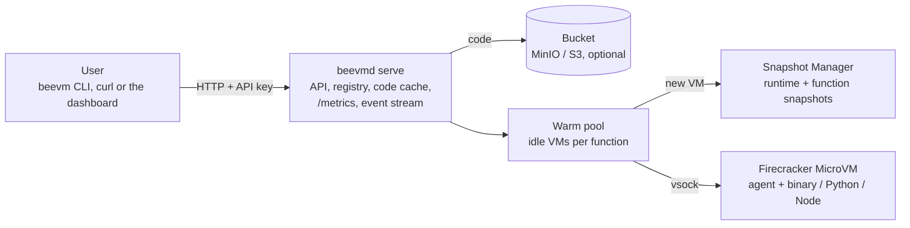

# BeeVM

BeeVM is a small Function-as-a-Service runtime. It runs each user function inside its own
[Firecracker](https://firecracker-microvm.github.io/) MicroVM on a single Linux node, and makes
that fast with snapshot restore and a warm pool.

It is a group project for Advanced Cloud Computing, Case Study 06: *Lightweight MicroVM FaaS
Runtime Engine*. The grading targets are a cold start under 50 ms, verified tenant isolation, and
MicroVM density per node.



A function is deployed once. Its first call restores a VM from a snapshot that already contains
the running interpreter and the imported code. The VM then stays idle for a while, so the next
call of the same function reuses it.

## Status

Milestones 1 to 11 of 13 are done ([docs/progress.md](docs/progress.md)). The large benchmark and
density run (12) and the cloud run with the final report (13) are not started.

Measured on the development laptop (Windows 11, WSL2 with nested KVM, 1 vCPU and 128 MiB per VM):

| What | p50 | p99 |
|---|---|---|
| Full cold boot, VM ready | 937 ms | 1186 ms |
| Snapshot restore, VM ready | 45 ms | 60 to 67 ms |
| Cold call from a function snapshot (Python / binary / Node.js) | 58 / 73 / 85 ms | 74 / 90 / 125 ms |
| Warm call inside the server | 1.6 ms | 5.0 ms |
| Memory per idle VM, six VMs of one function (PSS) | 6.2 MiB | |

The 50 ms target is met at the median but not at p99 on WSL2. The tail comes from nested
virtualization, which is why a run on a cloud Linux node is planned.

## Requirements

- An x86-64 Linux machine with KVM (`/dev/kvm`). Development happens on Windows 11 with
  **WSL2 Ubuntu 24.04** and nested virtualization; that is the tested setup.
- `git`, `make` and `sudo` rights for the one-time setup.
- Free disk space in your home folder. Kernel, root filesystems, snapshots and run folders live
  in `$BEEVM_HOME` (default `~/.beevm`), not in the repository. Each snapshot is about as large
  as its VM's memory (128 MiB by default).

Everything else (Go 1.27, Firecracker 1.17, the guest kernel, Alpine root filesystems) is
downloaded with checksums by `make setup`. No Docker is needed.

## Quick start

All commands run in a Linux (WSL) terminal inside the repository folder.

### 1. Install

```bash
sudo apt update && sudo apt install -y git make
git clone https://github.com/om8P/BeeVM.git
cd BeeVM
make setup
```

`make setup` asks for your sudo password once, adds you to the `kvm` group, and builds the kernel
and the three guest images. It is safe to run again.

The group change needs a new login. On WSL, run `wsl --shutdown` in PowerShell and open the
terminal again. Then check:

```bash
id              # must list "kvm"
make doctor     # checks KVM, images, snapshots, tenants; says what to fix
```

### 2. The fast way: `make demo`

```bash
make demo
```

This builds everything, runs `beevmd doctor`, creates the tenant `demo`, starts the server on
`127.0.0.1:8080`, saves the API key for the CLI (`beevm login`), deploys three example functions
(Go binary, Python, Node.js) and calls each once. Leave it running and use `./bin/beevm` from any
other terminal; Ctrl-C stops the server and every VM.

### 3. The same by hand

```bash
make build examples
./bin/beevmd tenant add acme
./bin/beevmd serve
```

`tenant add` prints an API key **once**; copy it. `serve` listens on `127.0.0.1:8080` and builds
the three runtime snapshots during its first seconds. Leave it running.

In a second terminal:

```bash
./bin/beevm login                   # paste the key; it is saved, so nothing to export
./bin/beevm deploy hello examples/functions/hello-python
./bin/beevm invoke hello --payload '{"name":"Om"}' -v
./bin/beevm invoke hello --payload '{"name":"Om"}' -v
```

```text
created hello (python handler.handler): 523 B, 128 MiB, 1 vCPU, timeout 10s

function log:
hello-python: greeting Om
{"greeting":"Hello, Om!","runtime":"python"}
vm f0733e18: restore (function snapshot) 50 ms, upload 0 ms, load 0 ms, function 10 ms, server total 73 ms, round trip 77 ms

function log:
hello-python: greeting Om
{"greeting":"Hello, Om!","runtime":"python"}
vm f0733e18: warm, function 0 ms, server total 1 ms, round trip 4 ms
```

The first call restored a new VM; the second reused it. If the first call says
`restore (runtime snapshot)` with upload and load times, the function snapshot was still being
built (it takes about half a second after a deploy).

The same call with plain HTTP:

```bash
curl -s -i -X POST -H "Authorization: Bearer <key>" -d '{"name":"curl"}' http://127.0.0.1:8080/invoke/hello
```

Stop the server with Ctrl-C. It finishes running calls, stops every VM and deletes their folders.

## Writing a function

A function takes the call's JSON payload and returns JSON. Three runtimes are supported, and
`beevm deploy` picks one from the path you give it. The quickest start is a working template:

```bash
./bin/beevm init python my-fn       # or: node, binary (a Go program)
./bin/beevm deploy my-fn my-fn
./bin/beevm invoke my-fn --payload '{"name":"you"}' -l
```

| Runtime | You deploy | Contract |
|---|---|---|
| Python 3.14 | a folder or `.zip` with `handler.py`, or one `.py` file | `handler(event)` or `handler(event, context)` returns the result |
| Node.js 24 | a folder or `.zip` with `index.js`, or one `.js` file | exported `handler(event)`, may be `async`; CommonJS or ES modules |
| Static binary | one Linux x86-64 executable | payload on stdin, result JSON on stdout, logs on stderr |

```python
# handler.py
def handler(event):
    name = (event or {}).get("name") or "world"
    return {"greeting": f"Hello, {name}!"}
```

```js
// index.js
exports.handler = async (event) => {
  const name = (event && event.name) || 'world';
  return { greeting: `Hello, ${name}!` };
};
```

Things to know:

- **Another entry point:** `--handler app.main` (Python: `module.function`, Node.js:
  `file.function`). A single file `app.py` defaults to `app.handler`.
- **Binaries must be static.** The guest is Alpine (musl), so a glibc binary will not start. For
  Go, build with `CGO_ENABLED=0 GOOS=linux GOARCH=amd64`.
- **Limits:** memory 64 to 1024 MiB (default 128), 1 to 4 vCPUs (default 1), timeout up to 60 s
  (default 10 s). A package may hold at most 2,000 files and 32 MiB unpacked.
- **State:** the module is imported once per VM, and `/tmp` survives between warm calls of the
  same function. Nothing is ever shared between two functions.
- **Dependencies:** the guest image holds the language runtime only. Put any library your
  function needs inside the folder you deploy.

Working examples are in [examples/functions/](examples/functions/).

## The `beevm` CLI

`beevm` talks to a running server. It takes the key and address from the `--key` and `--url`
flags, else `BEEVM_API_KEY` and `BEEVM_URL`, else what `beevm login` saved
(`~/.config/beevm/config.json`, readable only by you), else `http://127.0.0.1:8080`.

| Command | What it does |
|---|---|
| `beevm login [--url U]` / `logout` / `whoami` | check and save your key / forget it / show your tenant and server |
| `beevm init <python\|node\|binary> [folder]` | write a working starter function |
| `beevm deploy <name> <path> [--runtime R] [--handler H] [--memory M] [--vcpus N] [--timeout D]` | upload a function, or replace it |
| `beevm invoke <name> [--payload J \| --payload-file F] [-l] [-v]` | call it; the payload may also be piped in; `-l` prints what the function printed, `-v` that plus timings |
| `beevm get <name>` | one function's settings |
| `beevm ls` | list your functions |
| `beevm rm <name>` | remove a function, its VMs and its snapshot |
| `beevm prewarm <name> -n N` | start N idle VMs so the next calls are warm |
| `beevm vms` | list your VMs and their states |

`get`, `ls`, `vms` and `whoami` take `--json` for scripts.

## The server and its HTTP API

`beevmd` is the operator's program: it runs the service and manages tenants on the node itself.

| Command | What it does |
|---|---|
| `beevmd doctor` | check KVM, Firecracker, images, disk, snapshots, tenants, the server and leftovers; prints what to run for each problem |
| `beevmd tenant add <name>` / `tenant ls` | create a tenant (prints its key once), list tenants |
| `beevmd key add <tenant>` / `key ls` / `key revoke <prefix>` | manage API keys |
| `beevmd serve [--addr A] [--max-vms 8] [--max-vms-per-tenant N] [--keep-alive 60s] [--runner warm\|snapshot\|cold]` | run the service; logs are text on a terminal, JSON otherwise (`--log-format`) |
| `beevmd snapshot build` / `ls` / `rm <key>` / `rm --stale` | manage snapshots |
| `beevmd invoke --code <path> --payload J` | run a function in one VM, without a server |
| `beevmd bench coldstart [--runs 100] [--mode boot,restore,function,warm]` | measure cold starts |
| `beevmd bench load --fn a,b --rate 20 --duration 1m` | send steady load to a running server |

Every route except `/healthz` and `/metrics` needs `Authorization: Bearer <key>`.

| Route | Purpose |
|---|---|
| `POST /invoke/{name}` | call a function; the body is the payload |
| `PUT /api/v1/functions/{name}` | deploy (multipart upload) |
| `GET /api/v1/functions`, `GET` or `DELETE /api/v1/functions/{name}` | list, show, remove |
| `POST /api/v1/functions/{name}/prewarm?count=N` | start idle VMs |
| `GET /api/v1/vms` | your VMs |
| `GET /api/v1/node` | node density: VMs per state, memory |
| `GET /api/v1/events` | live event stream (Server-Sent Events) |
| `GET /healthz`, `GET /metrics` | health check, Prometheus metrics |

An invoke answers 200 with the function's output, and headers that say how it was served:
`X-BeeVM-Start` (`warm`, `restore` or `boot`), `X-BeeVM-Snapshot`, `X-BeeVM-Boot-Ms`,
`X-BeeVM-Function-Ms`, `X-BeeVM-Total-Ms`, `X-BeeVM-VM-Id`. To get the function's log too, send
`X-BeeVM-Log-Type: tail`: the answer then has `X-BeeVM-Log-Bytes` (the whole log's size) and
`X-BeeVM-Log-Result`, the last 4 KB of the log in base64. Other answers: 401 for a missing or
wrong key, 404 for an unknown function (also when it belongs to another tenant), 502 when the
function itself failed (exit code and log in the body; also when its VM went over a host limit
and was killed), 503 with `Retry-After` when every VM slot is busy or the tenant has reached
`--max-vms-per-tenant`.

`--max-vms-per-tenant` stops one tenant from filling the node: a tenant at its limit only reuses
or replaces its own idle VMs, so other tenants keep their warm VMs.

When `serve` starts, every deployed function whose snapshot is missing (for example after
`make images`) gets it rebuilt in the background, so its first call is fast again.

## Optional parts

None of these is needed for the quick start, and the dashboard and monitoring can be deleted
without touching the core.

| Part | How to use it |
|---|---|
| **Tenant isolation** | `sudo ./bin/beevmd serve --isolation jailer` puts every VM in a jailer chroot under its own user, with cgroup limits and its own network namespace. `make test-isolation` runs six attacks against it. |
| **Code in a bucket** | `make minio` runs a local S3 server; then `set -a; . deploy/minio.env; set +a` before `beevmd serve`. Without a bucket, code stays on local disk. |
| **Web dashboard** | `make ui`, then open http://127.0.0.1:8080/ui/ and paste your API key. |
| **Prometheus and Grafana** | `make monitoring`, then open http://localhost:3000 (dashboard "BeeVM"). |

## Tests

```bash
make test             # unit tests, no KVM needed
make test-kvm         # boots real MicroVMs, end to end (a few minutes)
make test-isolation   # the attack tests; asks for sudo
make test-ui          # dashboard tests
make test-s3          # store tests; needs make minio running
make vet
```

## If something goes wrong

Start with `./bin/beevmd doctor` (or `make doctor`): it checks the usual causes below and prints
the command that fixes each one.

| Symptom | Fix |
|---|---|
| `no API key` or `server answered 401` | run `beevm login`, or set `BEEVM_API_KEY`; `beevm whoami` shows which tenant the key belongs to |
| Permission denied on `/dev/kvm` | you are not in the `kvm` group yet: restart WSL after `make setup`, then check `id` |
| Every call says `boot` and takes about a second | the runtime snapshot is not built yet or failed: read the server log, or run `./bin/beevmd snapshot build` |
| `503` on invoke | every VM slot is busy: retry, or raise `--max-vms` |
| The server will not start and mentions the artifact store | MinIO is not running; or unset `BEEVM_S3_BUCKET` to run without a bucket |
| `/ui/` answers 404 | run `make ui` (serve also finds `web/dist` next to its own binary, so the folder you start it from does not matter) |
| Everything is about twice as slow | the laptop is on battery or in a power-saving mode |
| VMs left over after a crash | `pgrep -a firecracker`, `kill <pid>`, then `rm -rf ~/.beevm/run/serve/*` |

More cases are in Appendix D of the [build guide](developer-guide/guide.md).

## Known limits

- A successful call returns at most the last 4 KB of its log, and logs are not stored anywhere.
- Functions have no environment variables or secrets.
- One node only: there is no scheduler across machines.
- Isolated mode needs root. The default mode runs unprivileged and relies on the MicroVM alone.
- The server has only been run on WSL2 so far.

## Repository layout

```
cmd/beevmd/        server and operator commands
cmd/beevm/         user CLI
cmd/beevm-agent/   guest agent, built into every root filesystem
internal/          api, registry, codestore, store, pool, runner, snapshot, vmm,
                   isolation, netns, agent, metrics, events and shared types
guest/             kernel fetch script, root filesystem build, Python and Node.js shims
examples/          example and attack functions
scripts/           setup and helper scripts
deploy/            MinIO settings, Prometheus and Grafana (optional)
web/               React dashboard (optional)
bench/             benchmark results
docs/              architecture, milestones, progress log
developer-guide/   step-by-step build guide and demo script
```

## Documentation

- [docs/architecture.md](docs/architecture.md): the design and the technology choices.
- [docs/milestones.md](docs/milestones.md): the 13 milestones.
- [docs/progress.md](docs/progress.md): what was built in each session, with measurements.
- [developer-guide/guide.md](developer-guide/guide.md): how every part was built and why, with a
  command cheat sheet (Appendix A) and pinned versions (Appendix B).
- [developer-guide/demo.md](developer-guide/demo.md): a 25-minute demonstration script with
  captured output.
