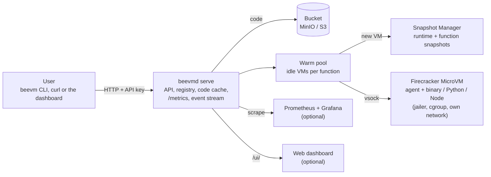

# BeeVM: demonstration script (milestones 1 to 11)

This document shows **what BeeVM can do today** and how to show it to someone: about 10 minutes for the foundation (parts 2 to 6), about 25 minutes for everything. Every output below was captured from a real run on the project laptop (WSL2, 1 vCPU, 128 MiB per VM): parts 2 to 6 on 2026-10-26, parts 7 to 12 on 2026-11-06. What you see on screen should look the same. Times vary from run to run, and this laptop is about twice as slow on battery or in Balance mode, so plug it in and use Performance mode.

**What is not here yet:** the large benchmark and density run (milestone 12) and the run on a cloud node with the final report (milestone 13).

## 0. The story in one picture



A user deploys a function, BeeVM stores it in a bucket, and each call runs it inside its own small virtual machine. A new VM is restored from a snapshot in about 45 ms instead of booted in about a second; afterwards it stays warm, so the next call of the same function takes a few milliseconds.

## 1. Before you start

Everything runs in a **WSL terminal** in the repository folder. One-time setup is in the build guide (`make setup`, `make images`). Then:

```bash
make build examples      # bin/beevmd (server), bin/beevm (user CLI), bin/functions/*
make ui                  # only for part 12: builds the web dashboard into web/dist
```

Plan for **three terminals**: A for the server, B for the user, C for MinIO (part 6) or Prometheus and Grafana (part 11).

| Part | What it shows | Milestone | Minutes |
|---|---|---|---|
| 2 | A virtual machine boots (the foundation) | 1 | 1 |
| 3 | The same, controlled from Go | 2 | 1 |
| 4 | A function runs inside a VM | 3 | 1 |
| 5 | The HTTP service: deploy and call, keys, tenants, failures, parallel calls | 4 | 4 |
| 6 | Code in a bucket: download on first use, cache after | 5 | 3 |
| 7 | Snapshots: a VM ready in ~45 ms instead of ~1 s | 6 | 2 |
| 8 | The warm pool: the next call in ~3 ms | 7 | 2 |
| 9 | Python and Node.js functions, function snapshots | 8 | 3 |
| 10 | Tenant isolation: six attacks, all contained | 9 | 3 |
| 11 | Metrics, Grafana and a load test | 10 | 3 |
| 12 | The live web dashboard | 11 | 3 |
| 13 | Tests and cleanup | all | 1 |

## 2. A VM boots (milestone 1)

```bash
make boot-test
```

```text
[beevm] run folder: /home/<you>/.beevm/run/20261026-205920-413
[beevm] PASS: VM booted and exited cleanly in 1030 ms (process start to exit)
```

**Say:** this is a real Linux kernel booting inside a Firecracker MicroVM, using the laptop's hardware virtualization (KVM). It takes about a second. Snapshots (part 7) cut that to about 45 ms.

For a live look inside: `make boot` gives a shell in the VM (`uname -r` shows the guest kernel `6.1.155`, different from WSL's; type `reboot -f` to leave).

## 3. The same, from Go code (milestone 2)

```bash
./bin/beevmd boot
```

```text
[    0.751817] reboot: Restarting system
...
[anonymous-instance:main] Firecracker exiting successfully. exit_code=0

== summary: ready in 914ms, stopped gracefully in 39ms
```

**Say:** our Go program starts Firecracker, talks to it over its API socket, waits until the guest is ready, stops it gracefully and deletes every file it created. Nothing is left behind.

## 4. A function runs inside a VM (milestone 3)

```bash
./bin/beevmd invoke --code bin/functions/hello-go-binary --payload '{"name":"Om"}' --repeat 3
```

```text
#1 {"greeting":"Hello, Om!","runtime":"binary"}  (2ms in function, 3.2ms round trip)
   log: hello-go-binary: greeting Om
#2 {"greeting":"Hello, Om!","runtime":"binary"}  (0ms in function, 1.2ms round trip)
#3 {"greeting":"Hello, Om!","runtime":"binary"}  (0ms in function, 1.2ms round trip)

== summary: agent ready 892ms, 3 call(s), median round trip 1.2ms, stopped gracefully in 87ms
```

**Say:** a small **guest agent** runs inside every VM. The host talks to it over **vsock** (a direct host-to-VM channel, no network involved), uploads the function, sends the input and gets the output. Once a VM is running, a call costs about a millisecond. That is the speed the warm pool (part 8) delivers for real traffic.

## 5. The HTTP service (milestone 4)

**Note:** this part was captured before the warm pool existed, when every call booted a new VM. To get the same outputs today, start the server with `--runner cold`. With the default (`--runner warm`) the calls below are much faster; parts 7 and 8 show why.

### 5.1 Create two customers (tenants) and start the server

**Terminal A:**

```bash
./bin/beevmd tenant add acme       # prints acme's API key ONCE: copy it
./bin/beevmd tenant add globex     # a second customer
./bin/beevmd tenant ls
./bin/beevmd serve --max-vms 4 --runner cold
```

```text
tenant "acme" created.

API key (shown only once, save it now):

  bvm_...

TENANT  CREATED
acme    2026-10-26 20:59:28
globex  2026-10-26 20:59:28
```

**Say:** only a hash of each key is stored, so even the database does not reveal a working key. The server allows at most 4 VMs at the same time.

### 5.2 Deploy and call a function

**Terminal B:** (use acme's key)

```bash
export BEEVM_API_KEY=bvm_...
./bin/beevm deploy hello bin/functions/hello-go-binary
./bin/beevm invoke hello --payload '{"name":"Om"}' -v
./bin/beevm ls
```

```text
created hello: 2.5 MB, 128 MiB, 1 vCPU, timeout 10s

{"greeting":"Hello, Om!","runtime":"binary"}
vm 8b5c444c: boot 894 ms, function 2 ms, server total 985 ms, round trip 1039 ms
code cache: hit, fetch 0 ms

NAME   SIZE    MEMORY   VCPUS  TIMEOUT  UPDATED
hello  2.5 MB  128 MiB  1      10s      2026-10-26 20:59:30
```

**Say:** this call started a brand-new VM, ran the function and destroyed the VM. About a second of the one second and a bit is the VM booting; the function itself took 2 ms. (On slower days the boot alone is 1.6 to 2 s.) The timing numbers come back with every answer.

### 5.3 Plain HTTP works too

```bash
curl -s -i -X POST -H "Authorization: Bearer $BEEVM_API_KEY" -d '{"name":"curl"}' http://127.0.0.1:8080/invoke/hello
```

```text
HTTP/1.1 200 OK
X-Beevm-Boot-Ms: 910
X-Beevm-Code-Cache: hit
X-Beevm-Function-Ms: 2
X-Beevm-Total-Ms: 1002
X-Beevm-Vm-Id: c18a5c53

{"greeting":"Hello, curl!","runtime":"binary"}
```

### 5.4 No key, no entry

```bash
curl -s -i -X POST -d '{}' http://127.0.0.1:8080/invoke/hello
```

```text
HTTP/1.1 401 Unauthorized
Www-Authenticate: Bearer realm="beevm"
{"error":"missing or invalid API key"}
```

### 5.5 When the function fails, you get a clear answer, and the system stays healthy

```bash
./bin/beevm deploy flaky bin/functions/testfn
./bin/beevm invoke flaky --payload '{"mode":"fail"}'
./bin/beevm deploy slow bin/functions/testfn --timeout 1s
./bin/beevm invoke slow --payload '{"mode":"sleep","ms":3000,"pidfile":"/tmp/demo.pid"}'
```

```text
function log:
boom: this function always fails
error: function failed: function exited with code 3

error: function failed: timeout after 1s
```

**Say:** a crash returns the exit code and the function's own log (HTTP 502). A function that runs too long is killed after its time limit, together with anything it started. After a timeout the VM is thrown away, so nothing leaks into the next call.

### 5.6 Customers cannot see each other

```bash
# globex's key, acme's function name:
curl -s -i -X POST -H "Authorization: Bearer <globex key>" -d '{}' http://127.0.0.1:8080/invoke/hello
BEEVM_API_KEY=<globex key> ./bin/beevm ls
```

```text
HTTP/1.1 404 Not Found
{"error":"function not found"}

no functions yet; deploy one with: beevm deploy <name> <binary>
```

**Say:** the answer is "not found", not "forbidden", so globex cannot even learn that acme has a function called `hello`. (VM-level isolation is in part 10.)

### 5.7 Eight calls at once with room for four VMs

```bash
for i in 1 2 3 4 5 6 7 8; do
  curl -s -o /dev/null -w "call $i: HTTP %{http_code}\n" -X POST -H "Authorization: Bearer $BEEVM_API_KEY" -d '{"name":"p"}' http://127.0.0.1:8080/invoke/hello &
done; wait
```

```text
call 6: HTTP 200 in 1138 ms
call 2: HTTP 200 in 1176 ms
call 5: HTTP 200 in 1176 ms
call 8: HTTP 200 in 1209 ms
call 1: HTTP 200 in 2267 ms
call 3: HTTP 200 in 2301 ms
call 4: HTTP 200 in 2298 ms
call 7: HTTP 200 in 2305 ms
all 8 done in 2316 ms
```

**Say:** four calls ran immediately; the other four waited for a free slot and ran in a second wave. If a call waits longer than 5 seconds for a slot it gets `503 Retry-After` instead of piling up. All eight returned the right answer.

## 6. Code lives in a bucket (milestone 5)

This part needs **MinIO**, a local stand-in for Amazon S3. **Terminal C:**

```bash
make minio        # the first run builds it from source (a few minutes); leave it running
```

(Why from source: MinIO archived its open-source project and no longer serves downloads. See the build guide, Part 7.)

Then stop the server in Terminal A (Ctrl-C), tell it where the bucket is, and start it again:

```bash
set -a; . deploy/minio.env; set +a     # S3 address and the throw-away dev credentials
./bin/beevmd serve --max-vms 4 --runner cold
```

```text
{"level":"INFO","msg":"artifact store ready","bucket":"beevm-artifacts","endpoint":"http://127.0.0.1:9000",...}
{"level":"INFO","msg":"listening","addr":"127.0.0.1:8080","max_vms":4,...}
```

### 6.1 Deploy puts the code in the bucket

In Terminal B, deploy `hello`, `flaky` and `slow` again as in part 5. The bucket's console is at http://127.0.0.1:9001 (user `beevmdev`, password `beevmdev-secret`); on disk it looks like this:

```text
beevm-artifacts/functions/53a3c74f.../xl.meta       <- hello
beevm-artifacts/functions/87865a3e.../xl.meta       <- testfn, used by BOTH flaky and slow
```

**Say:** three functions, two objects: objects are named by the SHA-256 of their content, so identical code is stored once.

### 6.2 A fresh node downloads once, then uses its cache

```bash
rm -f ~/.beevm/functions/*                     # pretend this node has never seen the code
./bin/beevm invoke hello --payload '{"name":"Om"}' -v
./bin/beevm invoke hello --payload '{"name":"Om"}' -v
```

```text
{"greeting":"Hello, Om!","runtime":"binary"}
code cache: miss, fetch 5 ms
{"greeting":"Hello, Om!","runtime":"binary"}
code cache: hit, fetch 0 ms
```

The server log has the same facts in one line per call:

```text
{"msg":"request","method":"POST","path":"/invoke/hello","tenant":"acme","status":200,"duration_ms":1018,"vm":"8a9ec7e6","code_cache":"miss","fetch_ms":5}
{"msg":"request","method":"POST","path":"/invoke/hello","tenant":"acme","status":200,"duration_ms":1034,"vm":"ebbec227","code_cache":"hit","fetch_ms":0}
```

**Say:** the bucket is the source of truth; the node's folder is only a cache. Because the file name is its own checksum, a downloaded file is verified before use and a cached file can never be out of date.

### 6.3 If the bucket goes away

Stop MinIO (Ctrl-C in Terminal C), then:

```bash
./bin/beevm deploy other ./some-binary
./bin/beevm invoke hello --payload '{"name":"Om"}'
```

```text
error: server answered 503: artifact store unavailable, try again shortly

{"greeting":"Hello, Om!","runtime":"binary"}
```

**Say:** new deploys are refused cleanly (and nothing half-registered is left), while functions whose code is already on the node keep working. Moving to real Amazon S3 later is a configuration change only: leave the endpoint empty, give the bucket name and AWS credentials.

Parts 7 to 12 do not need the bucket: stop the server, and in a new terminal start without `deploy/minio.env` loaded.

## 7. Snapshots: a VM ready in 45 ms (milestone 6)

The same function as in part 4, first booted, then restored from a snapshot:

```bash
./bin/beevmd invoke --code bin/functions/hello-go-binary --payload '{"name":"Om"}' --repeat 2
./bin/beevmd snapshot build
./bin/beevmd invoke --restore --code bin/functions/hello-go-binary --payload '{"name":"Om"}' --repeat 2
./bin/beevmd snapshot ls
```

```text
#1 {"greeting":"Hello, Om!","runtime":"binary"}  (2ms in function, 3.3ms round trip)
#2 {"greeting":"Hello, Om!","runtime":"binary"}  (0ms in function, 1.3ms round trip)

== summary: agent ready 1.0161s, 2 call(s), median round trip 3.3ms, stopped gracefully in 58ms

== building snapshot 611ec4a7598f19391b11 (binary runtime, 128 MiB, 1 vCPU)
== snapshot 611ec4a7598f19391b11 ready in 2181 ms

#1 {"greeting":"Hello, Om!","runtime":"binary"}  (23ms in function, 26.9ms round trip)
#2 {"greeting":"Hello, Om!","runtime":"binary"}  (2ms in function, 3.5ms round trip)

== summary: agent ready 61.4ms, 2 call(s), median round trip 26.9ms, killed (restored VMs are thrown away) in 35ms

KEY                   KIND     RUNTIME  ISOLATION  FUNCTION  MEMORY   VCPUS  SIZE     BUILD    CREATED              STATUS
611ec4a7598f19391b11  runtime  binary   none       -         128 MiB  1      128 MiB  2181 ms  2026-11-06 08:53:26  current
```

**Say:** a snapshot is a VM frozen right after it booted: its memory and device state saved to two files. Restoring maps that memory back in instead of booting, so the agent is ready in about 60 ms here instead of a second (the server's restores, below, take 37 to 50 ms). The first call after a restore is a bit slower (23 ms) because the VM loads the memory pages it touches one by one. Measured over 100 runs on this laptop: **p50 about 45 ms, p99 60 to 67 ms**; the p99 is held up by the nested virtualization of WSL2 and is the reason for the cloud run in milestone 13. The snapshot's name is a hash of everything that went into it (Firecracker version, kernel, root filesystem, memory size...), so rebuilding an image automatically makes old snapshots stale.

## 8. The warm pool: the next call in about 3 ms (milestone 7)

Start a fresh server and a tenant. **Terminal A:**

```bash
./bin/beevmd tenant add demo           # copy the key
./bin/beevmd serve --max-vms 6
```

```text
level=INFO msg=listening addr=127.0.0.1:8080 metrics=true ui=true max_vms=6 runner=warm keep_alive=1m0s runtimes="[binary node python]" isolation=none
level=INFO msg="building snapshot c47da80465005160f39c (node runtime, 128 MiB, 1 vCPU)"
level=INFO msg="snapshot c47da80465005160f39c ready in 2324 ms"
```

(This and the following outputs used `--log-format text`, which is easier to read on screen than the default JSON.)

**Terminal B:**

```bash
export BEEVM_API_KEY=bvm_...
./bin/beevm deploy hello bin/functions/hello-go-binary
./bin/beevm invoke hello --payload '{"name":"Om"}' -v
./bin/beevm invoke hello --payload '{"name":"Om"}' -v
```

```text
created hello (binary): 2.5 MB, 128 MiB, 1 vCPU, timeout 10s

{"greeting":"Hello, Om!","runtime":"binary"}
vm 6110ee15: restore (function snapshot) 42 ms, upload 0 ms, load 0 ms, function 26 ms, server total 74 ms, round trip 78 ms
code cache: hit, fetch 0 ms

{"greeting":"Hello, Om!","runtime":"binary"}
vm 6110ee15: warm, function 2 ms, server total 3 ms, round trip 6 ms
code cache: hit, fetch 0 ms
```

**Say:** the first call needed a new VM: restored in 42 ms, from a snapshot that already holds this function's code (part 9). The second call went to **the same VM** (`6110ee15`), which was kept idle after the first one: 3 ms in the server, no restore at all. Idle VMs are kept for 60 s (`--keep-alive`), are never shared between functions, and a timeout or a crashed agent throws the VM away.

The same over plain HTTP shows how the call was served:

```bash
curl -s -i -X POST -H "Authorization: Bearer $BEEVM_API_KEY" -d '{"name":"curl"}' http://127.0.0.1:8080/invoke/hello
```

```text
HTTP/1.1 200 OK
X-Beevm-Boot-Ms: 0
X-Beevm-Function-Ms: 3
X-Beevm-Start: warm
X-Beevm-Total-Ms: 3
X-Beevm-Vm-Id: 6110ee15
{"greeting":"Hello, curl!","runtime":"binary"}
```

Expecting traffic? Start VMs before it arrives:

```bash
./bin/beevm prewarm hello -n 3
./bin/beevm vms
```

```text
started 3 of 3 VMs for hello in 60 ms

VM        FUNCTION  STATE  FOR   CALLS  ADDRESS
03fe49f0  hello     idle   1.1s  0      -
6110ee15  hello     idle   1.1s  3      -
751990aa  hello     idle   1.1s  0      -
edd4fe3f  hello     idle   1.1s  0      -
```

**Say:** three VMs restored in 60 ms in total. When the node is full (`--max-vms`), the least recently used idle VM is removed to make room.

## 9. Python and Node.js functions (milestone 8)

```bash
cat examples/functions/hello-python/handler.py        # def handler(event): ...
./bin/beevm deploy hello-python examples/functions/hello-python
./bin/beevm deploy hello-node examples/functions/hello-node
./bin/beevmd snapshot ls
```

```text
created hello-python (python handler.handler): 523 B, 128 MiB, 1 vCPU, timeout 10s
created hello-node (node index.handler): 548 B, 128 MiB, 1 vCPU, timeout 10s

KEY                      KIND      RUNTIME  ISOLATION  FUNCTION      MEMORY   VCPUS  SIZE     BUILD    CREATED              STATUS
fn-4b5304cc25df8b96d543  function  node     none       3 (tenant 1)  128 MiB  1      128 MiB  535 ms   2026-11-06 08:53:35  current
fn-4602fa2c11fa8964d990  function  python   none       2 (tenant 1)  128 MiB  1      128 MiB  508 ms   2026-11-06 08:53:34  current
fn-822796e6d9a39c1761ac  function  binary   none       1 (tenant 1)  128 MiB  1      128 MiB  462 ms   2026-11-06 08:53:30  current
5690ad06ccff880ff6c9     runtime   python   none       -             128 MiB  1      128 MiB  2236 ms  2026-11-06 08:53:30  current
c47da80465005160f39c     runtime   node     none       -             128 MiB  1      128 MiB  2324 ms  2026-11-06 08:53:28  current
611ec4a7598f19391b11     runtime   binary   none       -             128 MiB  1      128 MiB  2181 ms  2026-11-06 08:53:26  current
```

**Say:** the runtime is detected from the files (`handler.py` means Python, `index.js` Node, a Linux program a binary); a folder is zipped by the CLI. There are two kinds of snapshots: one per **runtime**, built when the server starts (a VM with `python3` or `node` already running), and one per **function**, built in the background right after each deploy, in about half a second (the same, with this function's code already imported).

```bash
./bin/beevm invoke hello-python --payload '{"name":"Om"}' -v
./bin/beevm invoke hello-python --payload '{"name":"Om"}' -v
./bin/beevm invoke hello-node --payload '{"name":"Om"}' -v
./bin/beevm invoke hello-node --payload '{"name":"Om"}' -v
```

```text
{"greeting":"Hello, Om!","runtime":"python"}
vm f0733e18: restore (function snapshot) 50 ms, upload 0 ms, load 0 ms, function 10 ms, server total 73 ms, round trip 77 ms
{"greeting":"Hello, Om!","runtime":"python"}
vm f0733e18: warm, function 0 ms, server total 1 ms, round trip 4 ms

{"greeting":"Hello, Om!","runtime":"node"}
vm 4304afe7: restore (function snapshot) 37 ms, upload 0 ms, load 0 ms, function 36 ms, server total 90 ms, round trip 93 ms
{"greeting":"Hello, Om!","runtime":"node"}
vm 4304afe7: warm, function 1 ms, server total 2 ms, round trip 5 ms
```

**Say:** a cold Python call is 73 ms in total, because the function snapshot already contains the running interpreter and the imported code: upload 0, load 0. Without function snapshots Python took 87 ms and Node 150 ms at the median; with them 58 and 85 ms (50-run benchmark). Warm Python and Node calls are the fastest of all (about 1 ms), because the interpreter stays running between calls.

## 10. Tenant isolation: six attacks, all contained (milestone 9)

The isolated mode needs root, so it is not on by default:

```bash
sudo ./bin/beevmd serve --isolation jailer        # every VM: jailer chroot + own user, cgroup limits, own network
make test-isolation                                # the attack tests below (asks for sudo)
```

Each VM then runs in its own folder as its own user (900000 and up) with a system-call filter, inside a cgroup that limits memory, processes and CPU, with its own network where only the same tenant's VMs can reach it. Inside the VM the function runs as an unprivileged user. `make test-isolation` starts real isolated servers with two tenants (alice attacks, bob is the neighbour) and writes a report. The latest report (2026-11-06 06:26, `bench/results/isolation-20261106-062611.md`):

| Attack | Stopped by | What happened |
|---|---|---|
| Read host files (search for a secret written on the host; read `/etc/shadow`, write the disk, replace the agent) | MicroVM, guest user, jailer, seccomp | 85 files scanned, secret found 0 times; 4/4 tricks denied; Firecracker runs as uid 900003 with no capabilities and only the jail's 9 entries in its `/` |
| Network probe of the other tenant and the host | network namespace per VM, nftables per tenant | same tenant connected (control); other tenant and host blocked both ways; a scan of the VM range finds only its own VM |
| Fork bomb (escaping with `setsid`) | guest process limit, freeze-and-kill after the call | 2,877 forks refused, at most 57 processes, 1 left afterwards; neighbour 2.2 ms before, 2.1 ms during |
| Memory hog: 1 GiB in a 128 MiB VM | guest OOM killer (agent protected), host `memory.max` | function killed, the same VM served the next call; host OOM kills 0; neighbour unchanged |
| CPU hog with `--cpu-limit 50` | cgroup `cpu.max` | VM held to 0.51 CPU, throttled 41 times; neighbour 2.4 ms before, 2.2 ms during |
| Host memory limit below the guest's RAM | cgroup `memory.max` | host killed only that VM's Firecracker; the pool replaced it; neighbour fine |

**Say:** a MicroVM already gives every function its own kernel. Isolation adds layers *around* Firecracker, so even code that escaped the VM would find an empty folder, no rights and no network to the host or other tenants. It costs about 4 ms on VM start (VM ready p50 45.2 ms without, 49.0 ms with).

## 11. Metrics, Grafana and a load test (milestone 10)

With the server from part 8 still running, send load from terminal B for 20 seconds:

```bash
./bin/beevmd bench load --fn hello,hello-python,hello-node --rate 20 --duration 20s
```

```text
load: hello,hello-python,hello-node at 20.0 calls/s for 20s, at most 8 at once, against http://127.0.0.1:8080 (Ctrl-C stops early)
    5s  calls 99  ok 99  warm 99  skipped 0  p50 2.5 ms  p99 29.1 ms
   10s  calls 199  ok 199  warm 199  skipped 0  p50 2.4 ms  p99 13.4 ms
   15s  calls 299  ok 299  warm 299  skipped 0  p50 2.3 ms  p99 11.0 ms

  start  calls  p50 ms  p90 ms  p99 ms  max ms
   warm    400     2.3     3.6    13.3    29.1

status  200: 400
```

The raw numbers the server keeps (a selection):

```bash
curl -s 127.0.0.1:8080/metrics | grep ^beevm_
```

```text
beevm_invocations_total{function="hello",runtime="binary",start="restore",status="ok",tenant="demo"} 1
beevm_invocations_total{function="hello",runtime="binary",start="warm",status="ok",tenant="demo"} 136
beevm_invocations_total{function="hello-python",runtime="python",start="warm",status="ok",tenant="demo"} 134
beevm_vm_ready_seconds_count{snapshot="function",start="restore"} 3
beevm_vms{state="idle"} 6
beevm_vms_max 6
beevm_vm_memory_pss_bytes{state="idle"} 1.44718848e+08
beevm_vm_memory_rss_bytes{state="idle"} 2.15011328e+08
```

**Say:** 400 calls, all warm, 2.3 ms median round trip. The server counts every call by function, runtime and how it started, keeps latency histograms (so p50 and p99 can be computed for any time window), and measures each VM's real memory: the six idle VMs use 145 MB together (PSS) although their processes add up to 215 MB (RSS), because VMs restored from the same snapshot share memory pages.

For the graphs, **terminal C**:

```bash
make monitoring        # Prometheus :9090 + Grafana :3000, no Docker (first run downloads ~600 MB)
```

Open **http://localhost:3000** in the Windows browser: the **BeeVM** dashboard shows calls per second by start kind, warm ratio, p50/p99 latency with the 50 ms target line, VM-ready time per snapshot tier, VMs by state against the limit, and memory per VM. In the recorded run (2026-11-06) a phase with `--keep-alive 2s` and 1 call/s made every call a cold start, and Grafana showed **VM ready p50 45.7 ms**; six prewarmed VMs of one function cost **6.2 MiB each (PSS)** against 22.1 MiB RSS.

## 12. The live web dashboard (milestone 11)

Open **http://127.0.0.1:8080/ui/** in the Windows browser and paste the API key.

- **MicroVMs:** one tile per VM, coloured by state (blue restoring, aqua idle, orange busy, grey recycling), with its call count.
- **Invoke:** pick a function, press Invoke, and see the start kind (warm, restore, boot), the snapshot tier, and how long each phase took.
- **Latency: cold vs warm:** every call as a dot, with the 50 ms target line and p50/p99 per start kind.
- **Warm pools:** idle and busy VMs per function, with a Prewarm button. Tiles at the top show the node's VMs, memory per VM and free room.

For the best effect, restart the server with a short keep-alive and run a slow load, so every call is a cold start and VMs appear and vanish on screen:

```bash
./bin/beevmd serve --max-vms 6 --keep-alive 2s                                  # terminal A
./bin/beevmd bench load --fn hello,hello-python,hello-node --rate 1 --duration 1m   # terminal B
```

In the recorded run (2026-11-06) the dashboard showed blue dots at 60 to 150 ms and **VM ready p50 47 ms, p99 103 ms**; at 20 calls/s with the normal keep-alive, every call was warm (2.2 ms p50 in the server).

The page is fed by a live event stream, which any client can use:

```bash
curl -N -H "Authorization: Bearer $BEEVM_API_KEY" 127.0.0.1:8080/api/v1/events
```

```text
event: hello
data: {"vms":[{"id":"03fe49f0","function":"hello","state":"idle",...,"calls":134}, ...]}

event: vm
data: {"id":"03fe49f0","function":"hello","state":"busy",...,"calls":135}

event: vm
data: {"id":"03fe49f0","function":"hello","state":"idle",...,"calls":135}

event: invoke
data: {"function":"hello","runtime":"binary","status":200,"start":"warm","vm":"03fe49f0","boot_ms":0,"upload_ms":0,"load_ms":0,"function_ms":2,"duration_ms":4.976,...}
```

**Say:** the stream first sends the current VMs, then one message per change; that one call moved VM `03fe49f0` from idle to busy and back and took 5 ms. The dashboard and Grafana are optional: they only use the public API, and deleting them breaks nothing.

## 13. Tests and cleanup

```bash
make test             # unit tests, no VMs needed
make test-kvm         # also boots real VMs: end-to-end checks (316 tests, a few minutes)
make test-ui          # the dashboard's tests
make test-isolation   # the attack tests of part 10 (asks for sudo)
make test-s3          # the store tests against the real MinIO (start it first)
pgrep -a firecracker || echo "no leftover VMs"
```

Ctrl-C on the server stops every VM. At the end of the captured run of parts 7 to 12:

```text
level=INFO msg="recycling vm" vm=751990aa function_id=1 reason="pool closing"
level=INFO msg=stopped
no leftover firecracker processes
leftover VM folders: 0
```

Every VM, however its call ended (success, crash, timeout, Ctrl-C), is killed and its folder deleted.

## 14. If something goes wrong during a live demo

| Symptom | Fix |
|---|---|
| `error: server answered 401` | `BEEVM_API_KEY` is not set in this terminal, or it is the other tenant's key |
| Server will not start, mentions the artifact store | MinIO is not running, or `deploy/minio.env` was not loaded in this terminal; run without it by not setting `BEEVM_S3_BUCKET` |
| `503` on invoke | all VM slots are busy; wait a second and retry (raise `--max-vms`) |
| Every call says `boot`, about 1 s | the runtime snapshot is not built yet (wait a few seconds after start) or failed; check the server log, or `./bin/beevmd snapshot ls` |
| A Python or Node call says `restore (runtime snapshot)` with upload and load times | the function snapshot is still being built (half a second after the deploy); call again |
| Everything is about twice as slow as above | the laptop is on battery or in Balance mode: plug in, Performance mode |
| `/ui/` is 404 | `make ui` was not run, or `serve` was started outside the repository folder (`--ui-dir`) |
| Grafana shows "No data" | is `serve` running on `127.0.0.1:8080`? Check http://127.0.0.1:9090/targets; rates need a few calls and two scrapes |
| Leftover processes after an aborted demo | `pgrep -a firecracker`, then `kill <pid>`; `rm -rf ~/.beevm/run/serve/*` |

## 15. What to say at the end

- **Works today:** real MicroVMs controlled from Go; functions in Go (any static binary), Python 3.14 and Node.js 24; a multi-tenant HTTP service with API keys; code in S3-style storage with a verified local cache; snapshot restore; a warm pool; tenant isolation tested with six attacks; metrics, Grafana and a live dashboard; everything cleaned up automatically.
- **Numbers on this laptop (WSL2):** VM ready from a snapshot **p50 about 45 ms**, p99 60 to 67 ms; a cold call from a function snapshot 58 ms (Python), 73 ms (binary), 85 ms (Node) at the median; a warm call 1 to 3 ms; isolation adds about 4 ms; VMs of one function share memory (6.2 MiB PSS each).
- **Next (milestones 12 and 13):** benchmarks and density (how many VMs fit on one node), then the same measurements on a cloud Linux node without the nested virtualization of WSL2, which is what holds the p99 above 50 ms today.
