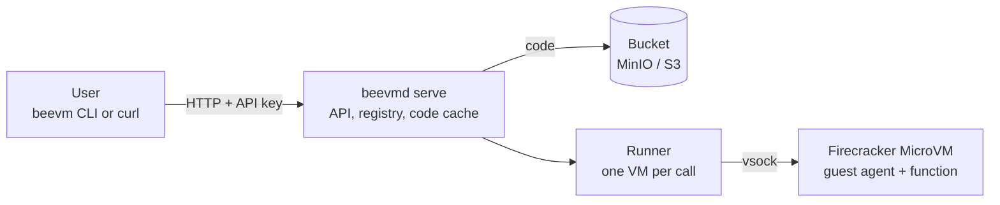

# BeeVM: demonstration script (milestones 1 to 5)

This document shows **what BeeVM can do today** and how to show it to someone in about 10 minutes. Every output below was captured from a real run on the project laptop (WSL2, 1 vCPU, 128 MiB per VM, run on 2026-10-26), so what you see on screen should look the same. Times vary a little from run to run, and this laptop has measured anywhere from 0.9 s to 2.0 s for a VM boot on different days.

**What is not here yet:** snapshot restore (the under-50 ms cold start), the warm pool, Python and Node.js runtimes, tenant isolation hardening (jailer, cgroups, network rules), metrics and the dashboard. Those are milestones 6 to 11. This demo shows the foundation they build on.

## 0. The story in one picture



A user deploys a program, BeeVM stores it in a bucket, and each call runs it inside its own small virtual machine that is destroyed afterwards.

## 1. Before you start

Everything runs in a **WSL terminal** in the repository folder. One-time setup is in the build guide (`make setup`). Then:

```bash
make build examples      # bin/beevmd (server), bin/beevm (user CLI), bin/functions/*
```

Plan for **three terminals**: A for the server, B for the user, C for MinIO (only in part 6).

| Part | What it shows | Milestone | Minutes |
|---|---|---|---|
| 2 | A virtual machine boots (the foundation) | 1 | 1 |
| 3 | The same, controlled from Go | 2 | 1 |
| 4 | A function runs inside a VM | 3 | 1 |
| 5 | The HTTP service: deploy and call, keys, tenants, failures, parallel calls | 4 | 4 |
| 6 | Code in a bucket: download on first use, cache after | 5 | 3 |
| 7 | Tests and cleanup | all | 1 |

## 2. A VM boots (milestone 1)

```bash
make boot-test
```

```text
[beevm] run folder: /home/<you>/.beevm/run/20261026-205920-413
[beevm] PASS: VM booted and exited cleanly in 1030 ms (process start to exit)
```

**Say:** this is a real Linux kernel booting inside a Firecracker MicroVM, using the laptop's hardware virtualization (KVM). It takes about a second. Snapshots (milestone 6) will cut that to under 50 ms.

For a live look inside: `make boot` gives a shell in the VM (`uname -r` shows the guest kernel `6.1.155`, different from WSL's; type `reboot -f` to leave).

## 3. The same, from Go code (milestone 2)

```bash
./bin/beevmd boot
```

```text
[    0.751817] reboot: Restarting system
...
[anonymous-instance:main] Firecracker exiting successfully. exit_code=0

== summary: ready in 914ms, stopped gracefully in 39ms
```

**Say:** our Go program starts Firecracker, talks to it over its API socket, waits until the guest is ready, stops it gracefully and deletes every file it created. Nothing is left behind.

## 4. A function runs inside a VM (milestone 3)

```bash
./bin/beevmd invoke --code bin/functions/hello-go-binary --payload '{"name":"Om"}' --repeat 3
```

```text
#1 {"greeting":"Hello, Om!","runtime":"binary"}  (2ms in function, 3.2ms round trip)
   log: hello-go-binary: greeting Om
#2 {"greeting":"Hello, Om!","runtime":"binary"}  (0ms in function, 1.2ms round trip)
#3 {"greeting":"Hello, Om!","runtime":"binary"}  (0ms in function, 1.2ms round trip)

== summary: agent ready 892ms, 3 call(s), median round trip 1.2ms, stopped gracefully in 87ms
```

**Say:** a small **guest agent** runs inside every VM. The host talks to it over **vsock** (a direct host-to-VM channel, no network involved), uploads the function, sends the input and gets the output. Once a VM is running, a call costs about a millisecond. That is the speed the warm pool (milestone 7) will deliver for real traffic.

## 5. The HTTP service (milestone 4)

### 5.1 Create two customers (tenants) and start the server

**Terminal A:**

```bash
./bin/beevmd tenant add acme       # prints acme's API key ONCE: copy it
./bin/beevmd tenant add globex     # a second customer
./bin/beevmd tenant ls
./bin/beevmd serve --max-vms 4
```

```text
tenant "acme" created.

API key (shown only once, save it now):

  bvm_...

TENANT  CREATED
acme    2026-10-26 20:59:28
globex  2026-10-26 20:59:28
```

**Say:** only a hash of each key is stored, so even the database does not reveal a working key. The server allows at most 4 VMs at the same time.

### 5.2 Deploy and call a function

**Terminal B:** (use acme's key)

```bash
export BEEVM_API_KEY=bvm_...
./bin/beevm deploy hello bin/functions/hello-go-binary
./bin/beevm invoke hello --payload '{"name":"Om"}' -v
./bin/beevm ls
```

```text
created hello: 2.5 MB, 128 MiB, 1 vCPU, timeout 10s

{"greeting":"Hello, Om!","runtime":"binary"}
vm 8b5c444c: boot 894 ms, function 2 ms, server total 985 ms, round trip 1039 ms
code cache: hit, fetch 0 ms

NAME   SIZE    MEMORY   VCPUS  TIMEOUT  UPDATED
hello  2.5 MB  128 MiB  1      10s      2026-10-26 20:59:30
```

**Say:** this call started a brand-new VM, ran the function and destroyed the VM. About a second of the one second and a bit is the VM booting; the function itself took 2 ms. (On slower days the boot alone is 1.6 to 2 s.) The timing numbers come back with every answer.

### 5.3 Plain HTTP works too

```bash
curl -s -i -X POST -H "Authorization: Bearer $BEEVM_API_KEY" -d '{"name":"curl"}' http://127.0.0.1:8080/invoke/hello
```

```text
HTTP/1.1 200 OK
X-Beevm-Boot-Ms: 910
X-Beevm-Code-Cache: hit
X-Beevm-Function-Ms: 2
X-Beevm-Total-Ms: 1002
X-Beevm-Vm-Id: c18a5c53

{"greeting":"Hello, curl!","runtime":"binary"}
```

### 5.4 No key, no entry

```bash
curl -s -i -X POST -d '{}' http://127.0.0.1:8080/invoke/hello
```

```text
HTTP/1.1 401 Unauthorized
Www-Authenticate: Bearer realm="beevm"
{"error":"missing or invalid API key"}
```

### 5.5 When the function fails, you get a clear answer, and the system stays healthy

```bash
./bin/beevm deploy flaky bin/functions/testfn
./bin/beevm invoke flaky --payload '{"mode":"fail"}'
./bin/beevm deploy slow bin/functions/testfn --timeout 1s
./bin/beevm invoke slow --payload '{"mode":"sleep","ms":3000,"pidfile":"/tmp/demo.pid"}'
```

```text
function log:
boom: this function always fails
error: function failed: function exited with code 3

error: function failed: timeout after 1s
```

**Say:** a crash returns the exit code and the function's own log (HTTP 502). A function that runs too long is killed after its time limit, together with anything it started. In both cases the VM is thrown away, so nothing leaks into the next call.

### 5.6 Customers cannot see each other

```bash
# globex's key, acme's function name:
curl -s -i -X POST -H "Authorization: Bearer <globex key>" -d '{}' http://127.0.0.1:8080/invoke/hello
BEEVM_API_KEY=<globex key> ./bin/beevm ls
```

```text
HTTP/1.1 404 Not Found
{"error":"function not found"}

no functions yet; deploy one with: beevm deploy <name> <binary>
```

**Say:** the answer is "not found", not "forbidden", so globex cannot even learn that acme has a function called `hello`. (Stronger, VM-level isolation arrives in milestone 9.)

### 5.7 Eight calls at once with room for four VMs

```bash
for i in 1 2 3 4 5 6 7 8; do
  curl -s -o /dev/null -w "call $i: HTTP %{http_code}\n" -X POST -H "Authorization: Bearer $BEEVM_API_KEY" -d '{"name":"p"}' http://127.0.0.1:8080/invoke/hello &
done; wait
```

```text
call 6: HTTP 200 in 1138 ms
call 2: HTTP 200 in 1176 ms
call 5: HTTP 200 in 1176 ms
call 8: HTTP 200 in 1209 ms
call 1: HTTP 200 in 2267 ms
call 3: HTTP 200 in 2301 ms
call 4: HTTP 200 in 2298 ms
call 7: HTTP 200 in 2305 ms
all 8 done in 2316 ms
```

**Say:** four calls ran immediately; the other four waited for a free slot and ran in a second wave. If a call waits longer than 5 seconds for a slot it gets `503 Retry-After` instead of piling up. All eight returned the right answer.

## 6. Code lives in a bucket (milestone 5)

This part needs **MinIO**, a local stand-in for Amazon S3. **Terminal C:**

```bash
make minio        # the first run builds it from source (a few minutes); leave it running
```

(Why from source: MinIO archived its open-source project and no longer serves downloads. See the build guide, Part 7.)

Then stop the server in Terminal A (Ctrl-C), tell it where the bucket is, and start it again:

```bash
set -a; . deploy/minio.env; set +a     # S3 address and the throw-away dev credentials
./bin/beevmd serve --max-vms 4
```

```text
{"level":"INFO","msg":"artifact store ready","bucket":"beevm-artifacts","endpoint":"http://127.0.0.1:9000",...}
{"level":"INFO","msg":"listening","addr":"127.0.0.1:8080","max_vms":4,...}
```

### 6.1 Deploy puts the code in the bucket

In Terminal B, deploy `hello`, `flaky` and `slow` again as in part 5. The bucket's console is at http://127.0.0.1:9001 (user `beevmdev`, password `beevmdev-secret`); on disk it looks like this:

```text
beevm-artifacts/functions/53a3c74f.../xl.meta       <- hello
beevm-artifacts/functions/87865a3e.../xl.meta       <- testfn, used by BOTH flaky and slow
```

**Say:** three functions, two objects: objects are named by the SHA-256 of their content, so identical code is stored once.

### 6.2 A fresh node downloads once, then uses its cache

```bash
rm -f ~/.beevm/functions/*                     # pretend this node has never seen the code
./bin/beevm invoke hello --payload '{"name":"Om"}' -v
./bin/beevm invoke hello --payload '{"name":"Om"}' -v
```

```text
{"greeting":"Hello, Om!","runtime":"binary"}
code cache: miss, fetch 5 ms
{"greeting":"Hello, Om!","runtime":"binary"}
code cache: hit, fetch 0 ms
```

The server log has the same facts in one line per call:

```text
{"msg":"request","method":"POST","path":"/invoke/hello","tenant":"acme","status":200,"duration_ms":1018,"vm":"8a9ec7e6","code_cache":"miss","fetch_ms":5}
{"msg":"request","method":"POST","path":"/invoke/hello","tenant":"acme","status":200,"duration_ms":1034,"vm":"ebbec227","code_cache":"hit","fetch_ms":0}
```

**Say:** the bucket is the source of truth; the node's folder is only a cache. Because the file name is its own checksum, a downloaded file is verified before use and a cached file can never be out of date.

### 6.3 If the bucket goes away

Stop MinIO (Ctrl-C in Terminal C), then:

```bash
./bin/beevm deploy other ./some-binary
./bin/beevm invoke hello --payload '{"name":"Om"}'
```

```text
error: server answered 503: artifact store unavailable, try again shortly

{"greeting":"Hello, Om!","runtime":"binary"}
```

**Say:** new deploys are refused cleanly (and nothing half-registered is left), while functions whose code is already on the node keep working. Moving to real Amazon S3 later is a configuration change only: leave the endpoint empty, give the bucket name and AWS credentials.

## 7. Tests and cleanup

```bash
make test         # unit tests, about 10 seconds, no VMs needed
make test-kvm     # also boots real VMs: end-to-end checks for milestones 2 to 4 (about 1.5 minutes)
make test-s3      # the store tests against the real MinIO (start it first)
pgrep -a firecracker || echo "no leftover VMs"
```

At the end of the captured run: `no leftover firecracker processes` and `leftover VM folders: 0`. Every VM, however its call ended (success, crash, timeout, Ctrl-C), is killed and its folder deleted.

## 8. If something goes wrong during a live demo

| Symptom | Fix |
|---|---|
| `error: server answered 401` | `BEEVM_API_KEY` is not set in this terminal, or it is the other tenant's key |
| Server will not start, mentions the artifact store | MinIO is not running, or `deploy/minio.env` was not loaded in this terminal; run without it by not setting `BEEVM_S3_BUCKET` |
| `503` on invoke | all VM slots are busy; wait a second and retry (raise `--max-vms`) |
| Calls take 2 s instead of 1 s | normal variation on this laptop; the boot is the slow part, which is what milestone 6 fixes |
| Leftover processes after an aborted demo | `pgrep -a firecracker`, then `kill <pid>`; `rm -rf ~/.beevm/run/serve/*` |

## 9. What to say at the end

- **Works today:** real MicroVMs controlled from Go; functions run in them over vsock; a multi-tenant HTTP service with API keys; failures and timeouts contained; code stored in S3-style object storage with a verified local cache; everything cleaned up automatically.
- **Honest numbers:** a call is about 1 to 2.5 s because every call boots a VM (about 1 s of it). Once a VM is up, a call is about 1 ms.
- **Next (milestone 6):** snapshot restore, to replace the boot with a restore of an already-booted VM. The target is under 50 ms.
