# BeeVM: step-by-step build guide

This guide lets anyone rebuild BeeVM from nothing, in the same order we built it. Every command is here, with what it does, why we do it, and the problems we hit (or that people commonly hit).

It grows with the project: each finished milestone adds a section. The reasons behind each choice are explained in more depth in the learning notes (`developer-guide/learning-notes.docx`).

| Covered so far | Status |
|---|---|
| Quick path: fresh laptop to a running function | — |
| Part 0: what we are building | — |
| Part 1: prepare Windows and WSL2 | Done |
| Part 2: get the code, understand the layout | Done |
| Part 3: Milestone 1, a hand-booted MicroVM | Done |
| Part 4: Milestone 2, boot and stop a VM from Go | Done |
| Part 5: Milestone 3, guest agent over vsock, first function runs | Done |
| Part 6: Milestone 4, HTTP API, registry and CLI | Done |
| Part 7: Milestone 5, artifact store with MinIO / S3 | Done |
| Part 8: Milestone 6, snapshots and fast restore | Done, refined (8.10); userfaultfd spike deferred (8.11) |
| Part 9: the repository, GitHub and renames | Done |
| Appendices: cheat sheet, versions, numbers, troubleshooting, regenerating these documents | — |

---

## Quick path: fresh laptop to a running function

Every step in order. Each one is explained in the parts below.

| # | Where | Command | Part |
|---|---|---|---|
| 1 | BIOS / Task Manager | Make sure CPU virtualization is enabled | 1.1 |
| 2 | PowerShell | `wsl --install -d Ubuntu-24.04` | 1.2 |
| 3 | WSL | `ls -l /dev/kvm` (must exist) | 1.3 |
| 4 | WSL | `sudo apt update && sudo apt install -y git make` | 2.1 |
| 5 | WSL | `git config --global user.name "<name>"` and `user.email "<email>"` | 2.1 |
| 6 | WSL | `cd /mnt/c/Users/<you>/Desktop && git clone https://github.com/om8P/BeeVM.git && cd BeeVM` | 2.2 |
| 7 | WSL | `make setup` (asks for your sudo password once) | 3.1 |
| 8 | PowerShell | `wsl --shutdown`, then reopen the WSL terminal and `cd` back to the repo | 3.1 |
| 9 | WSL | `id` (must list `kvm`) | 3.1 |
| 10 | WSL | `make boot-test` (milestone 1 check: PASS) | 3.4 |
| 11 | WSL | `make build && ./bin/beevmd boot` (milestone 2: boot and stop from Go) | 4.4 |
| 12 | WSL | `make examples && ./bin/beevmd invoke --code bin/functions/hello-go-binary --payload '{"name":"Om"}'` (milestone 3: run a function in a VM) | 5.6 |
| 13 | WSL | `./bin/beevmd tenant add acme`, then `./bin/beevmd serve` (milestone 4: the HTTP service; keep this terminal open) | 6.2 |
| 14 | WSL, second terminal | `export BEEVM_API_KEY=<key>`, `./bin/beevm deploy hello bin/functions/hello-go-binary`, `./bin/beevm invoke hello --payload '{"name":"Om"}' -v` | 6.3 |
| 15 | WSL, optional | Milestone 5: stop the server, run `make minio` in one terminal, then in another `set -a; . deploy/minio.env; set +a` and `./bin/beevmd serve`; deploy and invoke again | 7.3, 7.4 |
| 16 | WSL | Milestone 6: `make images build`, then `./bin/beevmd invoke --restore --code bin/functions/hello-go-binary` and `./bin/beevmd bench coldstart --runs 100` (boot vs restore) | 8.6, 8.7 |
| 17 | WSL | `make test && make test-kvm` (all tests; `make test-s3` too if MinIO is running) | 4.4, 5.7, 6.5, 7.5, 8.8 |

---

## Part 0: what we are building

BeeVM is a Function-as-a-Service (FaaS) runtime, like a tiny AWS Lambda. A user uploads a function; BeeVM runs it inside its own **Firecracker MicroVM** (a very small virtual machine) so different users cannot affect each other. The grading targets are: cold start under 50 ms (via snapshots), tenant isolation, and VM density per machine.

On this laptop everything runs in layers:

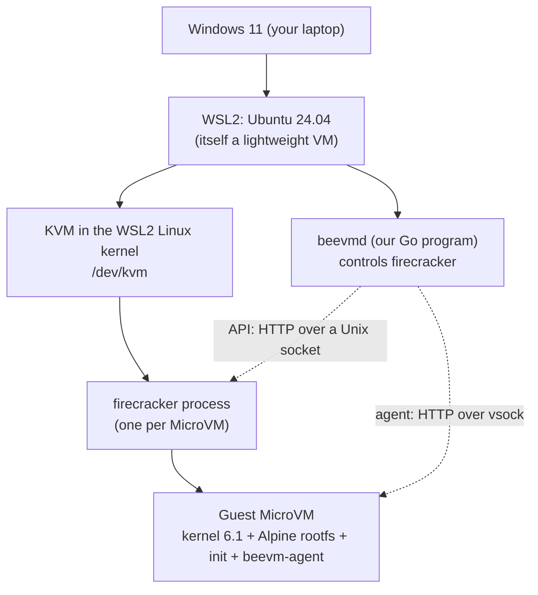

**Why the layers matter:** a MicroVM inside WSL2 is a VM inside a VM ("nested virtualization"). It works, but it is slower than on a real Linux server. That is why our boot numbers here (about 1.7 s) are only a development baseline.

---

## Part 1: prepare Windows and WSL2

### 1.1 Check that the CPU supports virtualization

**What:** Intel VT-x or AMD-V must be turned on in the BIOS/UEFI.
**Why:** KVM (and so Firecracker) needs hardware virtualization.

In Windows: Task Manager → Performance → CPU → "Virtualization: Enabled". If it says Disabled, turn it on in the BIOS setup.

### 1.2 Install WSL2 with Ubuntu 24.04

In **Windows PowerShell**:

```powershell
wsl --install -d Ubuntu-24.04
wsl -l -v
```

`wsl -l -v` must show `VERSION 2`. WSL1 has no real Linux kernel and no KVM.

### 1.3 Check that KVM works inside WSL2

In the **WSL (Ubuntu) terminal**:

```bash
uname -m                                          # must print x86_64
ls -l /dev/kvm                                    # must exist: crw-rw---- root kvm
cat /sys/module/kvm_intel/parameters/nested       # Intel: Y means nested virtualization is on
cat /sys/module/kvm_amd/parameters/nested         # AMD: 1 means on
```

On our laptop (i7-13620H, Windows 11) all of this worked without changing anything.

**Common problems**

| Symptom | Cause | Fix |
|---|---|---|
| `/dev/kvm: No such file` | Nested virtualization off for WSL2 (it is on by default on Windows 11, but can be turned off) | Create or edit `C:\Users\<you>\.wslconfig` with `[wsl2]` and `nestedVirtualization=true`, then `wsl --shutdown` in PowerShell and wait a few seconds before reopening |
| Still no `/dev/kvm` | Virtualization off in BIOS, or an old Windows build | Enable VT-x/AMD-V in BIOS; update Windows 11 |
| `nested` file missing | Wrong CPU vendor file (Intel vs AMD) | Read the other one |

---

## Part 2: get the code and understand the layout

### 2.1 Basic tools and your Git identity

Ubuntu on WSL normally has `git` and `make` already. If not:

```bash
sudo apt update && sudo apt install -y git make
```

Tell Git who you are (it is written into every commit, and is public on GitHub):

```bash
git config --global user.name "Your Name"
git config --global user.email "you@example.com"     # or GitHub's no-reply address, see Part 9.4
```

Everything else (Go, Firecracker, kernel, image) is installed by `make setup` in Part 3.

### 2.2 Clone the repository

In the **WSL terminal** (choose your own Windows folder):

```bash
cd /mnt/c/Users/<you>/Desktop
git clone https://github.com/om8P/BeeVM.git
cd BeeVM
```

`/mnt/c/...` is your Windows `C:` drive seen from Linux. Keeping the code there means you can edit it with Windows tools (VS Code, Claude) while building it in WSL.

> The course case-study `.docx` is **not** in the repo (it is course material). Get it from the course page if you need it.

### 2.3 Two places on disk, on purpose

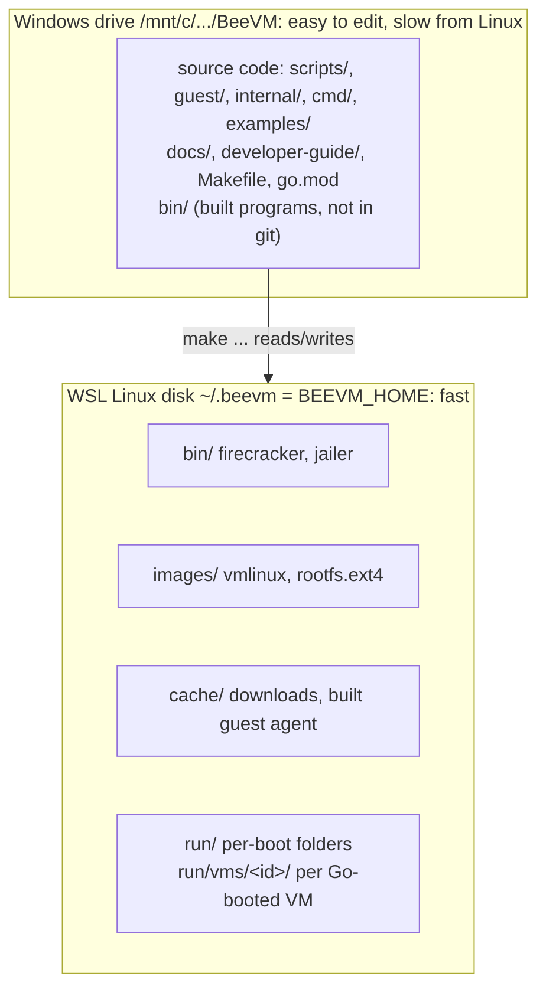

**Why:** reading files on `/mnt/c` from Linux goes through a slow translation layer. VM disk images and (later) snapshots need fast disk access, so they live in `~/.beevm`. To put them elsewhere: `export BEEVM_HOME=/some/linux/path` before running `make`.

### 2.4 Line endings (a problem we hit)

Windows Git had `core.autocrlf=true`, which turns line endings into Windows-style CRLF on checkout. Bash then fails with errors like `$'\r': command not found`.

**Fix (already in the repo):** `.gitattributes` contains `* text=auto eol=lf`, which forces LF for every text file regardless of the Git settings. Check with:

```bash
git ls-files --eol | grep -E "\.sh|Makefile"     # should show w/lf
```

If a script was already checked out with CRLF: `sed -i 's/\r$//' path/to/script.sh`.

---

## Part 3: Milestone 1, a hand-booted MicroVM

**Goal:** prove KVM and Firecracker work, by booting a VM with the plain `firecracker` command and a JSON config file.

### 3.1 One-time setup: `make setup`

In the **WSL terminal**, in the repo folder:

```bash
make setup
```

It asks for your **sudo password** once. It runs `scripts/setup-wsl.sh`, which does these steps, each skipped if already done (so it is safe to run again):

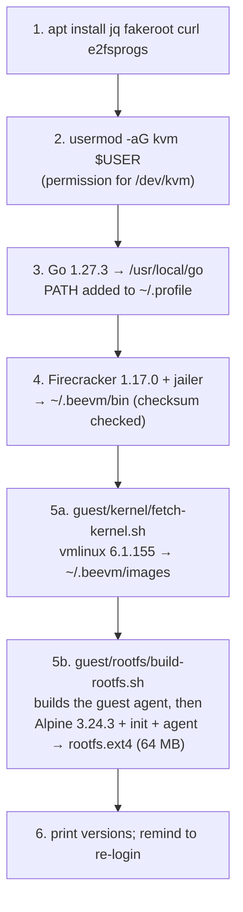

All versions and SHA-256 checksums are pinned in `scripts/common.sh`. Every download is checked against its checksum and refused if it does not match.

**Then, once, in Windows PowerShell:**

```powershell
wsl --shutdown
```

and open the WSL terminal again. **Why:** adding a user to a group only takes effect at the next login. Check with `id` (must list `kvm`).

**What each piece is:**

- **`firecracker`**: the virtual machine monitor (VMM). It uses KVM to run a MicroVM with only a few emulated devices (serial port, disk, network, vsock), which is why it starts fast.
- **`jailer`**: Firecracker's sandboxing helper. Installed now, used in milestone 9.
- **`vmlinux`**: the guest Linux kernel as an uncompressed file. Firecracker loads it straight into guest memory; there is no BIOS or bootloader.
- **`rootfs.ext4`**: the guest's disk (its `/`), containing Alpine Linux, our init script and (since milestone 3) the guest agent.

Setup takes a few minutes the first time (it downloads well over 100 MB: Go, Firecracker, the 43 MB kernel, Alpine). Running it again takes under a second.

### 3.2 How the rootfs is built (no sudo, no Docker)

```bash
make rootfs        # or: bash guest/rootfs/build-rootfs.sh
```

1. Build the guest agent (milestone 3) as a static Go binary: `CGO_ENABLED=0 go build -trimpath -ldflags="-s -w" ./cmd/beevm-agent` into `~/.beevm/cache/beevm-agent`. If the new binary is identical to the old one, the old file is kept.
2. Download `alpine-minirootfs-3.24.3-x86_64.tar.gz` (about 3.6 MB).
3. Inside **one `fakeroot` session**: unpack it, copy `guest/rootfs/init` to `/sbin/beevm-init` and the agent to `/sbin/beevm-agent`, then run `mkfs.ext4 -d <folder> rootfs.ext4 64M`.

- `mkfs.ext4 -d` creates a filesystem image and fills it from a folder **without mounting it**, so no root rights are needed.
- `fakeroot` makes the files *look* owned by root inside that session, so they are root-owned inside the image (the guest expects that).

The image is rebuilt automatically when `guest/rootfs/init`, the build script or the agent binary changes. **After changing agent code, run `make images` (or `make rootfs`)**, otherwise the VM still runs the old agent. The image uses 20 MB on disk.

### 3.3 The guest's init script (PID 1)

`guest/rootfs/init` is the first program the guest kernel runs. It mounts `/proc`, `/sys`, `/dev`, prints a banner, then acts on the `beevm.mode=` value in the kernel command line:

| Mode | Used by | Behaviour |
|---|---|---|
| `selftest` | `make boot-test` | prints `BEEVM_BOOT_OK`, then `reboot -f` (VM exits) |
| `idle` | `beevmd boot`, Go tests (milestone 2) | prints `BEEVM_READY`, waits until stopped |
| `agent` | `beevmd invoke`, agent tests (milestone 3) | mounts a RAM disk on `/run`, starts `/sbin/beevm-agent`, prints `BEEVM_AGENT_STARTED`; if the agent ever exits it prints `BEEVM_AGENT_EXITED code=N` and powers the VM off |
| none | `make boot` | gives you a shell; `reboot -f` exits |

### 3.4 Boot a VM: `make boot-test` and `make boot`

```bash
make boot-test     # automatic: boots, checks, prints the time
make boot          # interactive: you get a shell inside the VM
```

`scripts/boot-vm.sh` makes a run folder `~/.beevm/run/<timestamp>/`, copies `rootfs.ext4` into it (the clean original is never changed), writes `vm-config.json`, and runs `firecracker --no-api --config-file vm-config.json`.

The kernel arguments it passes:

| Argument | Meaning |
|---|---|
| `console=ttyS0` | kernel messages go to the serial port, which Firecracker connects to your terminal |
| `reboot=k` | a guest reboot happens through the keyboard controller, which Firecracker treats as "exit" |
| `panic=1` | if the kernel crashes, reboot after 1 s instead of hanging |
| `pci=off` | Firecracker has no PCI bus, so don't look for one |
| `init=/sbin/beevm-init` | run our script as PID 1 |
| `beevm.mode=...` | our own flag, read by the init script |

What happens during `make boot-test`:

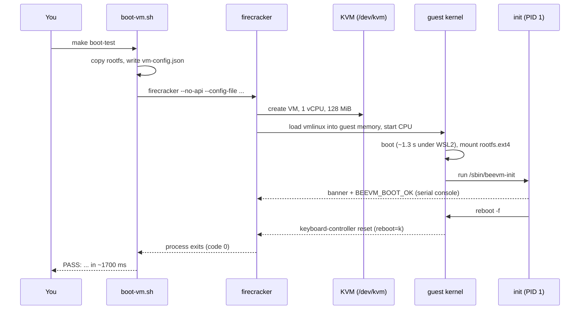

In `make boot`, check that you are really in a different system: `uname -r` shows `6.1.155` inside the VM but `6.6...` in WSL.

**Result:** `make boot-test` passes in 1.7 to 2.0 s. `make clean-images && make setup && make boot-test` rebuilds everything from scratch and passes again.

### 3.5 Problems we hit in milestone 1

| Problem | What happened | Fix |
|---|---|---|
| No kernel for Firecracker 1.17 | Firecracker's CI storage had no `vmlinux-6.1` under `v1.17` or `v1.16` | Took `vmlinux-6.1.155` from the `v1.15` folder. The kernel does not depend on the Firecracker version |
| HTTPS certificate error listing the kernel bucket | `https://spec.ccfc.min.s3.amazonaws.com` fails, since bucket names with dots break the S3 certificate | Use the path-style URL `https://s3.amazonaws.com/spec.ccfc.min/...` |
| `sudo` needs a password | Automation tools cannot type it | You run `make setup` yourself; everything after it needs no sudo |
| `Permission denied` on `/dev/kvm` after setup | The group change is not active until next login | `wsl --shutdown` in PowerShell, reopen WSL |
| Shell scripts fail with `\r` errors | CRLF line endings from Windows Git | `.gitattributes` (Part 2.4) |
| Commands run from Windows into WSL lose `$VARS` and quotes | Each layer (Git Bash, `wsl.exe`, bash) re-parses the text; Git Bash also rewrites `/mnt/...` paths | Put commands in a script file and run `wsl.exe -- bash file.sh`, set `MSYS_NO_PATHCONV=1`, or just use `make` targets. Typing directly in the WSL terminal avoids all of this |
| Slow Alpine download | Mirror speed (about 130 KB/s once) | Only happens once; files are cached in `~/.beevm/cache` |

**Other common problems**

- `make: command not found` or strange errors: you ran it in PowerShell. Run it in the WSL terminal.
- `firecracker not found`: `make setup` did not finish. Run it again; finished steps are skipped.
- Boot hangs or FAIL: read the log path printed by the script (`~/.beevm/run/<...>/console.log`). The last lines usually say what went wrong.
- `ls: cannot access /dev/kvm` after a Windows update: check Part 1.3 again.

---

## Part 4: Milestone 2, boot and stop a VM from Go

**Goal:** replace the shell script with Go code that the rest of BeeVM can call: create, start, stop, kill and clean up a VM, leaving nothing behind.

### 4.1 Go module and the Firecracker SDK

Already done in the repo; for a fresh clone you only need:

```bash
make build         # downloads Go dependencies the first time, builds bin/beevmd
```

For the record, the module was created with the commands below (it was first named after the old GitHub account; see Part 9.3 for the renames):

```bash
go mod init github.com/om8P/BeeVM
go get github.com/firecracker-microvm/firecracker-go-sdk@6fb280e993d4
go mod tidy
```

- A **Go module** is a project with its own name (the module path) and a list of pinned dependencies (`go.mod` and checksums in `go.sum`).
- **firecracker-go-sdk** starts the `firecracker` process and talks to its API for us.
- **Why a commit instead of a release?** The SDK's last release (v1.0.0) is from 2022. Its main branch (December 2025) has updated, security-fixed dependencies. It is tested against Firecracker 1.4.1, but worked with our 1.17.0 without changes. It requires Go 1.24 or newer.

If `go` is "not found" in a new terminal: `source ~/.profile`, or use `make` (it calls `/usr/local/go/bin/go` directly).

### 4.2 The API socket: how Go controls Firecracker

In milestone 1 we used `--no-api` and a JSON file. Now Firecracker runs with `--api-sock <file>`: it listens on a **Unix domain socket** (a file that acts like a local network port) and is configured with HTTP requests:

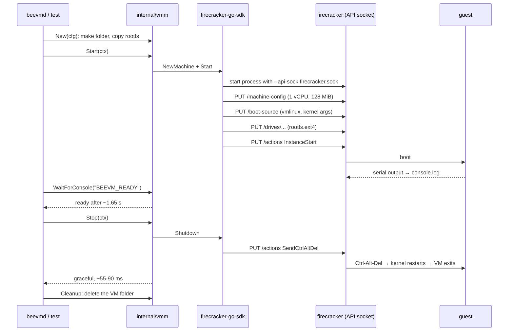

### 4.3 The VM lifecycle in `internal/vmm`

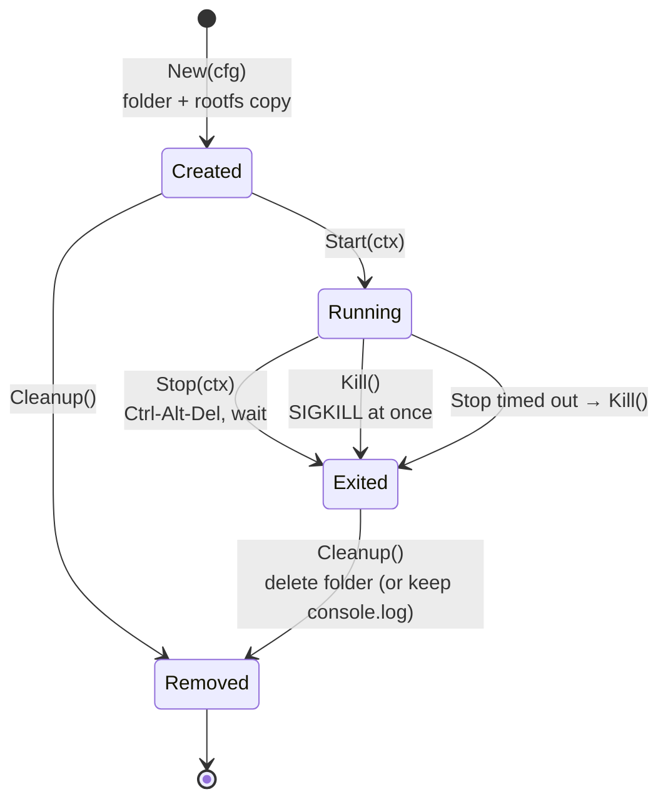

Files:

| File | What it holds |
|---|---|
| `internal/vmm/config.go` | `Config` (paths, vCPUs, memory, extra kernel args), defaults, `Validate()`, the per-VM paths |
| `internal/vmm/vm.go` | `New`, `Start`, `WaitForConsole`, `Stop`, `Kill`, `Cleanup`, `PID`, `Exited` |
| `internal/vmm/vm_test.go` | 9 unit tests that need no KVM |
| `internal/vmm/vm_kvm_test.go` | 3 tests that boot real VMs (`//go:build kvm`) |
| `cmd/beevmd/main.go` | the `beevmd boot` command |

Each VM gets its own folder `~/.beevm/run/vms/<id>/` with `rootfs.ext4`, `firecracker.sock`, `console.log` and (since milestone 3) `v.sock`. The library never reads environment variables; the caller passes all paths. Only `beevmd` reads `BEEVM_HOME`.

### 4.4 Run it

```bash
make test          # unit tests, no KVM needed
make test-kvm      # boots real VMs: graceful stop, kill, cancelled start
make vet           # Go's static checks
make build
./bin/beevmd boot                      # boot, show console, stop, clean up
./bin/beevmd boot --hold 30s           # keep it running 30 s (Ctrl-C kills it)
./bin/beevmd boot --keep-logs          # keep console.log afterwards
./bin/beevmd boot --mem 256 --vcpus 2  # different size
```

**Check that nothing is left behind** (after any of the above, including Ctrl-C):

```bash
pgrep -a firecracker || echo "no firecracker processes"
ls ~/.beevm/run/vms/
```

**Result:** all tests pass; ready in about 1.65 s, graceful stop in 55 to 90 ms; Ctrl-C exits with code 130; no leftovers in any case we tried.

**Build tags:** `//go:build kvm` at the top of `vm_kvm_test.go` means it is only compiled with `go test -tags kvm`. So `make test` passes on machines without KVM, and `make test-kvm` runs the real thing.

### 4.5 Problems we hit in milestone 2

| Problem | Why | What we did |
|---|---|---|
| The VM would die when a start timeout expired | The SDK ties the firecracker process to the context used to start it | The VM gets its own long-lived context; the caller's timeout only limits how long `Start` waits |
| Calling `Shutdown` twice would panic | The SDK closes an internal channel in `Shutdown` | `Stop` wraps it in `sync.Once` |
| Ctrl-C in `beevmd` went straight to firecracker | The SDK forwards signals to firecracker by default | Set `ForwardSignals` to an empty list; `beevmd` decides (it kills the VM and cleans up) |
| `StopVMM` could hang | It sends SIGTERM and waits | `Kill` sends SIGKILL to the process directly and waits at most 5 s |
| Init's SIGINT handler never runs on stop | By default the kernel restarts immediately on Ctrl-Alt-Del, without telling PID 1 | Fine: the VM still exits cleanly. The handler stays as a safety net |
| The kernel takes ~1.3 s to boot | Partly WSL2 nesting; the log also shows a ~460 ms gap around `clk: Disabling unused clocks` | Noted for tuning in milestone 6 |
| `go mod tidy` requires Go 1.24 | The SDK's main branch needs it | Fine with our Go 1.27.3; docs updated to "Go 1.24+" |

**Other common problems**

- `go: command not found`: `source ~/.profile` or open a new WSL terminal.
- KVM tests print `SKIP`: `/dev/kvm` or the images are missing. Run `make setup` and check `id` for `kvm`.
- `address already in use` for the socket: a folder from a crashed run is left over. Delete `~/.beevm/run/vms/<id>`.
- First `make build` is slow: Go is downloading dependencies; later builds are cached.

---

## Part 5: Milestone 3, guest agent over vsock, first function runs

**Goal:** talk to code *inside* the VM. A small Go program, the **guest agent**, runs in every VM. The host uploads a function binary to it, sends a JSON payload, and gets the function's JSON output back.

### 5.1 What was added

| File | What it holds |
|---|---|
| `internal/agentproto/agentproto.go` | Shared request/response types, the port (10000), the limits. Host and guest both import it, so they can never disagree |
| `internal/agent/server.go` | The agent's HTTP handlers and the function runner (no vsock code, so it is testable without a VM) |
| `internal/agent/server_test.go` | 12 unit tests (no KVM) |
| `cmd/beevm-agent/main.go` | The guest program: listens on vsock port 10000 and serves `internal/agent` |
| `internal/vmm/agent.go` | Host side: the vsock handshake (`dialVsock`) and `AgentClient` (Health, UploadFunction, Invoke) |
| `internal/vmm/agent_test.go` | 6 unit tests with a fake Firecracker |
| `internal/vmm/vm_agent_kvm_test.go` | 3 tests that boot real VMs and run functions |
| `internal/vmm/config.go`, `vm.go` | Every VM now gets a vsock device (`v.sock`, guest CID 3); new `vm.Agent()` and `vm.WaitForAgent()` |
| `cmd/beevmd/invoke.go` | The `beevmd invoke` command |
| `examples/functions/hello-go-binary/` | Example function |
| `examples/functions/testfn/` | Test function with modes: `echo`, `fail`, `sleep`, `garbage`, `big` |
| `guest/rootfs/init`, `build-rootfs.sh` | `agent` mode; the agent is built and baked into the image |
| `Makefile` | New target `examples` |

New dependency: `github.com/mdlayher/vsock v1.3.0` (added with `go get github.com/mdlayher/vsock@v1.3.0`, then `go mod tidy`). It also upgraded a few `golang.org/x/...` packages.

### 5.2 Build everything

In the **WSL terminal**, in the repo folder:

```bash
make images        # rebuilds the rootfs so it contains the current guest agent
make build         # bin/beevmd
make examples      # bin/functions/hello-go-binary and bin/functions/testfn
```

- `make images` builds the agent with `CGO_ENABLED=0` (a static binary) and puts it in the image as `/sbin/beevm-agent`. Run it again whenever agent code changes.
- `make examples` builds the example functions the same way. **Functions must be static Linux x86-64 binaries:** the guest runs Alpine, which uses the musl C library, so a normal Ubuntu binary (built against glibc) will not start there. For Go, `CGO_ENABLED=0 GOOS=linux GOARCH=amd64 go build` is enough.

### 5.3 How a call flows

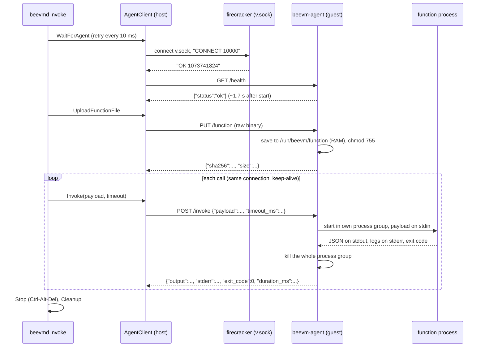

**The vsock handshake.** On the host, Firecracker turns the guest's vsock into a Unix socket file (`v.sock` in the VM folder). To reach guest port 10000, connect to that file, send the line `CONNECT 10000`, and read back `OK <number>`. After that it is a plain byte stream to the agent, and normal HTTP runs over it. If the agent is not listening yet, Firecracker closes the connection, which is why `WaitForAgent` simply retries.

### 5.4 The agent's protocol

| Request | Body | Answer |
|---|---|---|
| `GET /health` | — | `{"status":"ok","agent_version":"0.1.0","uptime_ms":...}` |
| `PUT /function` | the raw binary (≤ 50 MB) | `{"sha256":"...","size":...}` |
| `POST /invoke` | `{"payload": <any JSON>, "timeout_ms": N}` (payload ≤ 6 MB, timeout default 10 s, max 60 s) | `{"output":..., "stderr":"...", "exit_code":N, "duration_ms":N, "error":"..."}` |

- A **function failure** (non-zero exit code, timeout, output that is not JSON, output over 6 MB) comes back as **HTTP 200 with `error` set**: the agent worked, the function did not.
- An **agent or request problem** is a 4xx code: `409` no function uploaded yet, `400` bad request or bad timeout, `413` payload or upload too large.
- `stdout` is only included when the output was not valid JSON (first 4 KB), to help debugging. Only the last 64 KB of `stderr` is kept.
- One call runs at a time per VM; a second call waits for the first.

### 5.5 Write your own function

The contract: **payload JSON on stdin, result JSON on stdout, logs on stderr.** A shortened version of `examples/functions/hello-go-binary/main.go` (the real file also defaults the name to "world"):

```go
func main() {
	var in struct{ Name string `json:"name"` }
	if err := json.NewDecoder(os.Stdin).Decode(&in); err != nil {
		fmt.Fprintln(os.Stderr, "bad input:", err)
		os.Exit(1)
	}
	fmt.Fprintln(os.Stderr, "hello-go-binary: greeting", in.Name)       // becomes a log line
	json.NewEncoder(os.Stdout).Encode(map[string]string{                // becomes the output
		"greeting": "Hello, " + in.Name + "!", "runtime": "binary"})
}
```

Build it as a static binary and run it:

```bash
CGO_ENABLED=0 GOOS=linux GOARCH=amd64 go build -o bin/functions/myfn ./path/to/myfn
./bin/beevmd invoke --code bin/functions/myfn --payload '{"name":"Om"}'
```

The function runs in `/tmp` with only `PATH` and `HOME` set. Anything it starts in the background is killed when the call ends.

### 5.6 Run it

```bash
./bin/beevmd invoke --code bin/functions/hello-go-binary --payload '{"name":"Om"}' --repeat 5
```

Expected output (times vary):

```
== starting VM f5eacc8a (1 vCPU, 128 MiB)
== agent ready after 1.844s
== uploaded bin/functions/hello-go-binary (2580640 bytes, sha256 8f311e18de83...) in 75ms
#1 {"greeting":"Hello, Om!","runtime":"binary"}  (9ms in function, 11.6ms round trip)
   log: hello-go-binary: greeting Om
#2 {"greeting":"Hello, Om!","runtime":"binary"}  (5ms in function, 6.5ms round trip)
...
== summary: agent ready 1.844s, 5 call(s), median round trip 4.5ms, stopped gracefully in 68ms
```

Other things to try (all with `--code bin/functions/testfn`):

| Payload | What you should see |
|---|---|
| `'{"mode":"echo","x":1}'` | `{"echo":{"mode":"echo","x":1}}` |
| `'{"mode":"fail"}'` | `FAILED: function exited with code 3`, plus the log line `boom: ...`; exit code 1 |
| `'{"mode":"sleep","ms":30000}' --timeout 500ms` | `FAILED: timeout after 500ms` after about half a second |
| `'{"mode":"garbage"}'` | `FAILED: function output is not valid JSON`, with the text it printed |

Flags of `beevmd invoke`:

| Flag | Default | Meaning |
|---|---|---|
| `--code PATH` | (required) | the function binary |
| `--payload JSON` | `{}` | input for the function |
| `--repeat N` | 1 | how many calls |
| `--timeout D` | 10s | time limit per call, inside the guest |
| `--ready-timeout D` | 20s | how long to wait for the agent |
| `--console` | off | stream the VM console (it is printed automatically when something fails) |
| `--keep-logs` | off | keep `console.log` in `~/.beevm/run/vms/<id>/` |
| `--mem N`, `--vcpus N` | 128, 1 | VM size |

Ctrl-C kills the VM, cleans up and exits with code 130.

### 5.7 Tests

```bash
make test          # unit tests: agent (12), host client with a fake Firecracker (6), VM lifecycle (9)
make test-kvm      # also boots real VMs: milestone 2 tests + 3 agent tests
```

The agent tests in real VMs check: 20 echo calls each get their own correct answer; a failing function reports exit code 3 and its log; non-JSON output is reported; a function that sleeps too long is killed after 300 ms **and the VM keeps working**; the hello example returns the right greeting; calling before uploading gives a 409; and nothing is left behind afterwards.

**Result:** all pass. Agent ready 1.64 to 1.85 s after start; uploading a 2.5 MB function about 75 ms; a warm call 4 to 5 ms round trip (median), the first about 11 ms; graceful stop 56 to 85 ms.

### 5.8 Problems we hit in milestone 3

| Problem | Why | What we did |
|---|---|---|
| `go get` for vsock also upgraded `golang.org/x/net`, `x/sys` and others | The library needs newer versions | Accepted after `make vet` and all tests passed |
| A `go test -run "A|B"` pattern failed with `command not found` | The `|` passed through `wsl.exe` and became a shell pipe | Use script files or `make` targets |
| Ctrl-C printed the VM console as if it were an error | The failure path did not check for Ctrl-C | It now prints `== interrupted: VM killed, cleaning up` and exits 130 |
| `make images` printed the size with the full path | `cut -d' '` on `du` output, which uses a tab | Changed to `cut -f1` |

**Other common problems**

- `exec format error` from a call: the uploaded file is not a Linux x86-64 executable (for example a Windows `.exe` or a text file).
- `no such file or directory` when the function starts, although it exists: it is a dynamically linked (glibc) binary. Rebuild it static (`CGO_ENABLED=0`).
- `waiting for agent: context deadline exceeded`: the agent did not start. Run with `--console` and look for `beevm-agent:` lines or `BEEVM_AGENT_EXITED`. Did you run `make images` after changing agent code?
- `agent returned 409: no function uploaded yet`: upload before invoking (`beevmd invoke` does this for you).
- A call never returns: check the `--timeout` value; the host waits the function's timeout plus 10 s.

---

## Part 6: Milestone 4, HTTP API, registry and CLI

**Goal:** stop running functions by hand and offer them as a service. A user deploys a binary with a command, then calls it over HTTP with an API key, the way a real FaaS works. For now every call still boots a fresh VM (slow, about 2.5 s) and returns the right answer; snapshots (milestone 6) fix the speed.

### 6.1 What was added

| Package / file | What it holds |
|---|---|
| `internal/registry` | SQLite database (`beevm.db`): tenants, API keys (only the SHA-256 hash is stored), functions and their settings |
| `internal/codestore` | Function binaries on disk, named by their own SHA-256 (identical bytes are stored once) |
| `internal/api` | The HTTP server (chi router): deploy, list, get, delete, invoke, health; key check; request log |
| `internal/runner` | The `Runner` interface and `ColdRunner`: boots one VM per call, limited to `--max-vms` at the same time |
| `internal/apitypes`, `internal/apiclient` | Shared request/response types and the Go client the CLI uses |
| `cmd/beevmd` | New commands `serve`, `tenant add\|ls`, `key add\|ls\|revoke` |
| `cmd/beevm` | The user CLI: `deploy`, `invoke`, `ls`, `rm` |

New dependencies: `go-chi/chi/v5` (router), `spf13/cobra` (CLI), `modernc.org/sqlite` (SQLite without CGO).

### 6.2 Build and start the service

```bash
make build                    # bin/beevmd (server) and bin/beevm (user CLI)
make examples                 # example functions in bin/functions/
./bin/beevmd tenant add acme  # prints the API key ONCE; copy it
./bin/beevmd serve            # http://127.0.0.1:8080, up to 8 VMs at once
```

- Tenants and keys are created on the server machine, not through the network, so there is no admin key that could leak.
- Keys look like `bvm_` plus 43 random characters. Only their hash is stored, so a lost key cannot be recovered: make a new one with `beevmd key add acme` and revoke the old one with `beevmd key revoke <prefix>`.
- Useful `serve` flags: `--addr`, `--max-vms`, `--queue-wait` (how long a call waits for a free VM slot before getting 503).

### 6.3 Use it

In a second WSL terminal:

```bash
export BEEVM_API_KEY=bvm_...            # the key printed above
./bin/beevm deploy hello bin/functions/hello-go-binary
./bin/beevm invoke hello --payload '{"name":"Om"}' -v
./bin/beevm ls
./bin/beevm rm hello
```

`deploy` also takes `--memory` (64 to 1024 MiB, default 128), `--vcpus` (1 to 4) and `--timeout` (up to 60 s, default 10 s). With curl:

```bash
curl -s -X POST -H "Authorization: Bearer $BEEVM_API_KEY" -d '{"name":"Om"}' http://127.0.0.1:8080/invoke/hello
```

### 6.4 The API and its status codes

| Request | Answer |
|---|---|
| `PUT /api/v1/functions/{name}` (multipart: `code` file + optional `config` JSON) | 201 created, 200 replaced; 400 not an ELF binary or bad settings; 413 too large |
| `GET /api/v1/functions`, `GET /api/v1/functions/{name}` | the function(s) of **your** tenant only |
| `DELETE /api/v1/functions/{name}` | 204 |
| `POST /invoke/{name}` (body = JSON payload) | 200 + the function's output |
| `GET /healthz` | 200, no key needed |

Invoke answers: **200** output; **502** the function failed (the body has its exit code and stderr); **503** + `Retry-After` no VM slot free; **404** no such function; **400/413** bad or too large payload; **500** BeeVM itself failed (details only in the server log). Timings come back as headers: `X-BeeVM-Boot-Ms`, `X-BeeVM-Function-Ms`, `X-BeeVM-Total-Ms`, `X-BeeVM-Vm-Id`.

- **401** without a valid key (with a `WWW-Authenticate` header). A revoked key stops working immediately.
- Another tenant's function is **404, never 403**, so one tenant cannot even learn that a name exists.

### 6.5 Tests

```bash
make test          # unit tests, no KVM: registry 12, codestore 5, api 15, client 7, runner 4, CLI 7, plus the older ones
make test-kvm      # also boots VMs: deploy + invoke end to end, failing and slow functions, 5 parallel calls through 2 slots, 503 when busy
```

**Result:** all pass. One invoke over HTTP takes **2.5 to 2.6 s**: about 2.0 s of that is the VM booting, about 0.4 s is copying the 64 MB rootfs for this VM, and the function itself needs 9 to 18 ms. With 4 slots, 10 parallel calls finish in waves of 4 (about 2, 4 and 6 s). Ctrl-C on the server while a call runs lets that call finish; a second Ctrl-C stops waiting.

### 6.6 Problems we hit and decisions to know about

| Problem or decision | Why | What we did |
|---|---|---|
| Key prefix of 8 characters was too short to tell keys apart for revoking | Prefixes could collide | The prefix is now 12 characters (`bvm_` + 8) |
| A client that hangs up has no response to receive | Nobody reads the answer | Logged as status 499; the call's VM is still cleaned up |
| `beevmd serve` clears `run/serve/` when it starts | Anything there is left over from a crash | Assumes it is the only server using that folder |
| Two deploys of identical code racing with a delete | Code could be removed just before the second deploy registers it | A tiny race, accepted for now |
| Copying the rootfs for every call (about 0.4 s) | Each VM needs its own writable disk | Left for milestone 6 (read-only base plus overlay, or reflink) |

---

## Part 7: Milestone 5, artifact store with MinIO / S3

**Goal:** function code lives in cloud-style object storage, as the case study asks. Deploy uploads it to a **bucket**; the node downloads it the first time a function runs and keeps a local copy keyed by its hash. Moving from a laptop MinIO to real AWS S3 is a configuration change only. The store is **optional**: with no bucket configured BeeVM behaves exactly like milestone 4.

### 7.1 What was added

| File | What it holds |
|---|---|
| `internal/store/store.go` | The `Blobs` interface: `Put`, `Get`, `Exists`, `Delete`. The rest of BeeVM only sees this |
| `internal/store/s3.go` | The S3 version (aws-sdk-go-v2). Works for MinIO and AWS. `EnsureBucket` creates the bucket if it is missing |
| `internal/store/mem.go` | An in-memory version for fast tests (can be told to fail, to simulate the store being down) |
| `internal/codestore/codestore.go` | Now a **cache** in front of the store: `Publish`, `Ensure`, `Delete` |
| `internal/api/functions.go`, `invoke.go` | Deploy publishes before registering; invoke calls `Ensure` and reports hit or miss |
| `scripts/minio.sh`, `deploy/minio.env`, `deploy/docker-compose.yml` | A local MinIO server, two ways |
| `Makefile` | `minio`, `minio-up`, `minio-down`, `test-s3` |

New dependencies: `aws-sdk-go-v2` (config, credentials, `service/s3`), `golang.org/x/sync` (single-flight), and `gofakes3` (a fake S3 server inside the tests).

### 7.2 How code moves

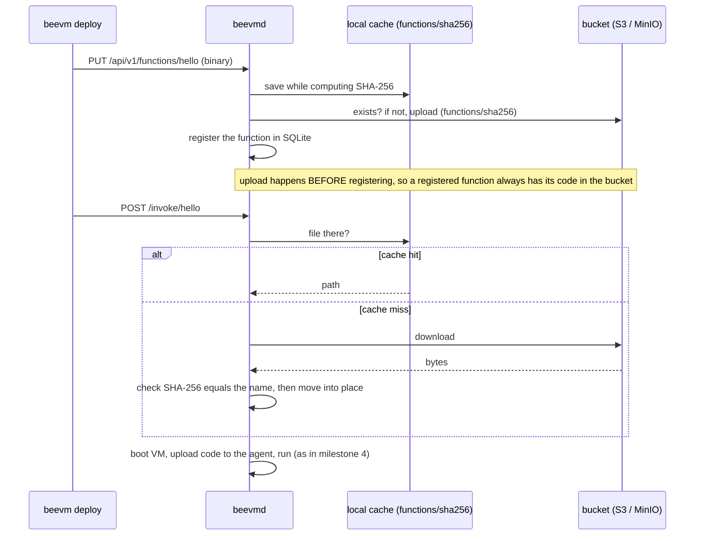

- **Content-addressed:** the hash is both the file's name and its checksum. A cached file can therefore never be out of date, and a download is rejected unless its bytes match the hash.
- **Single-flight:** if 10 calls to a cold function arrive together, one downloads and the others wait for the same result.
- **If the store is down:** deploying new code answers **503** with `Retry-After` and registers nothing. Functions whose code is already cached keep working. If a bucket is configured but unreachable at start-up, `beevmd serve` refuses to start and says why.
- **Delete / replace:** when no function uses a hash any more, it is removed from the bucket and the cache. Identical code deployed under two names is one object.

### 7.3 Run a local MinIO

MinIO is the S3-compatible server we use on the laptop. **Important:** in 2026 MinIO archived its open-source project and its download site now answers `410 Gone` for every community binary. So `make minio` **builds a pinned version from source** with Go (the first build takes a few minutes; Go's checksum database guarantees the source is unchanged). In the first WSL terminal:

```bash
make minio       # builds on first use, then runs in the foreground; Ctrl-C stops it
```

The S3 API is on port 9000 and a web console on http://127.0.0.1:9001 (user `beevmdev`, password `beevmdev-secret`: throw-away development credentials in `deploy/minio.env`).

If you have Docker with Compose, `make minio-up` / `make minio-down` do the same with a container. Its image tag is the last one we know of and was **not tested** here (no Docker in our WSL); if the pull fails, use `make minio`.

### 7.4 Use it

In a second terminal, load the settings, then start the server and use it as in Part 6:

```bash
set -a; . deploy/minio.env; set +a     # sets the BEEVM_S3_* and AWS_* variables for this terminal
./bin/beevmd serve                      # log says: artifact store ready
```

In a third terminal (with `BEEVM_API_KEY` set):

```bash
./bin/beevm deploy hello bin/functions/hello-go-binary     # also uploads to the bucket
rm -f ~/.beevm/functions/*                                 # pretend this is a fresh node
./bin/beevm invoke hello --payload '{"name":"Om"}' -v      # code cache: miss, fetch ~20 ms
./bin/beevm invoke hello --payload '{"name":"Om"}' -v      # code cache: hit, fetch 0 ms
```

Settings (flags on `serve`, or the environment variables): `--s3-bucket` / `BEEVM_S3_BUCKET` (empty means local disk only), `--s3-endpoint` / `BEEVM_S3_ENDPOINT` (empty means real AWS), `--s3-region` / `BEEVM_S3_REGION`, `--s3-path-style` (on by default when an endpoint is set; MinIO needs it). **Credentials are never flags:** the AWS SDK reads `AWS_ACCESS_KEY_ID` and `AWS_SECRET_ACCESS_KEY` (or `~/.aws`, or an instance role on EC2). To use real S3, leave the endpoint unset, set bucket and region, and provide real credentials.

### 7.5 Tests

```bash
make test        # unit tests: store (5, against a fake S3 server inside the test), codestore (10 new), api (8 new)
make test-s3     # the store tests again, against the real MinIO (start `make minio` first)
make test-kvm    # all earlier milestone tests still pass
```

What the new tests prove: upload happens once for identical code; a miss downloads and the next call hits; a corrupted download is rejected and never cached; 10 parallel misses cause at most 2 downloads; deploy with the store down gives 503 and leaves nothing registered or cached; cached functions still run while the store is down; deleting a function removes the object only when nothing else uses it.

**Checked by hand** with a real server and MinIO: deploy puts one object in the bucket; after wiping the cache the first invoke is a miss (18 ms fetch) and the second a hit; deploying the same code as a second function adds no object; removing both functions empties the bucket; with MinIO stopped, new deploys get 503 while cached functions still run; with no bucket set the server runs local-only and logs a warning.

### 7.6 Problems we hit in milestone 5

| Problem | Why | What we did |
|---|---|---|
| MinIO download returned `410 Gone` | MinIO archived its community releases in 2026 and removed the binaries | `scripts/minio.sh` builds the pinned source with `go install`; the version is `MINIO_GO_VERSION` in `scripts/common.sh` |
| Fake-S3 test said `InvalidBucketName` | Bucket names must be lowercase letters, digits and `-`; the first test used the Go test name, which has capitals | Fixed bucket name `beevm-test` |
| Decoding a response in a test failed with "read on closed response body" | The helper that checks the status code also closes the body | Decode first, check the status afterwards (a small helper does both) |
| A path like `/mnt/c/...` passed to `wsl.exe` from Git Bash turned into `C:/Program Files/Git/mnt/...` | Git Bash rewrites anything that looks like a Unix path | Set `MSYS_NO_PATHCONV=1` when calling `wsl.exe` |
| A missing S3 object looked like a generic error for HEAD requests | HEAD answers have no body, so only the status code is available | `isNotFound` checks several error shapes and codes |

**Not done on purpose (later):** a size limit and eviction for the cache, retries with backoff for failed downloads, uploads that bypass the server (presigned URLs), backing up snapshots to S3 (milestone 6).

---

## Part 8: Milestone 6, snapshots and fast restore

**Goal:** the cold start under 50 ms that the case study grades. Instead of booting a new VM for every call (about 1 s), BeeVM boots one VM once, freezes it to disk as a **snapshot**, and then starts every call's VM by **restoring** a copy of that frozen VM. The guest kernel has already booted and the agent is already listening, so the VM is ready in about 47 ms.

### 8.1 What a snapshot is

A Firecracker snapshot is two files:

| File | What it holds | Size |
|---|---|---|
| `mem` | the guest's whole RAM at the moment of the snapshot | as large as the VM's memory (128 MiB) |
| `vmstate` | CPU registers and the state of every device (disk, vsock, serial port) | a few KB |

Restoring means starting a new Firecracker process and telling it to load those two files and continue (`PUT /snapshot/load`). Firecracker does not read the whole 128 MiB first: it **maps** the memory file into the VM (`mmap`, private and copy-on-write). A page is read only when the guest touches it, and many VMs restored from the same file share the pages they only read.

We use one **base snapshot**: a VM that has booted, started its agent and settled, with no function loaded yet. Per-function snapshots (code already inside) come in milestone 8.

### 8.2 What was added

| File | What it holds |
|---|---|
| `internal/vmm/config.go`, `vm.go` | `SharedRootfs` (one read-only disk for all VMs, no copy); Firecracker runs inside the VM folder; the vsock socket is the relative path `v.sock`; `Pause`, `CreateSnapshot`, `StartedAt` |
| `internal/vmm/restore.go` | `vmm.Restore`: start Firecracker, load the snapshot, return a normal `*VM` with timings (`Spawn`, `Load`) |
| `internal/vmm/fcapi.go` | A minimal client for Firecracker's API socket (polls every 1 ms) |
| `internal/agent/resume.go` | New agent endpoint `POST /resume`: set the clock, mix in fresh randomness |
| `internal/snapshot/` | The Snapshot Manager: keys, building, listing, removing |
| `internal/runner/runner.go` | `SnapshotRunner` (the new default) next to `ColdRunner`; a shared VM-slot limiter |
| `cmd/beevmd/snapshotcmd.go`, `bench.go` | `beevmd snapshot ...` and `beevmd bench coldstart` |
| `guest/rootfs/init` | `/tmp` is now RAM too (the root disk is read-only) |
| `examples/functions/testfn` | New modes `readfile`, `writefile`, `time`, `random` (used by the tests) |

No new libraries.

### 8.3 Four problems a snapshot brings, and how we solved them

**1. Paths are stored inside the snapshot.** Firecracker remembers the disk's path and the vsock socket's path. A restored VM lives in a new folder, so an absolute socket path would point at the folder of the VM that was snapshotted. Fix: start every Firecracker process *inside* its VM folder (`cmd.Dir`) and give it the socket as the relative name `v.sock`. Each restored VM then creates `v.sock` in its own folder.

**2. The per-VM disk copy.** Until now every VM got its own copy of the 64 MB root filesystem (about 0.4 s), and the snapshot stores the disk path. Fix: all VMs share **one read-only** root disk. Firecracker tells the kernel to mount it read-only (`ro`), and the init script mounts RAM filesystems on `/run` (the uploaded function) and `/tmp` (anything a function writes). This also made normal boots 0.4 s faster.

**3. Restored VMs are clones.** Every restored VM starts as an exact copy of one moment in the past:
- its **clock** is behind (it stood still while the snapshot sat on disk; we measured 3 to 9 s);
- its **random-number generator** is in the same state in every copy, which is dangerous for anything that needs secret random numbers.

Fix: right after a restore the host calls the agent's `POST /resume` with the host's current time and 64 fresh random bytes. The agent sets the clock and gives the bytes to the kernel (`RNDADDENTROPY`), then forces the kernel to rebuild its generator from them (`RNDRESEEDCRNG`). Newer systems can do this automatically with a "VM generation ID" device. We first thought it was not active in our guest; the M6 refine found that it is (Firecracker 1.17 provides it and the guest reseeds by itself, see 8.10.13). The agent's reseed stays as a second safeguard, and the clock still needs `/resume`.

**4. Open connections do not survive.** A vsock connection that was open at snapshot time is broken after a restore. Fix: the builder closes the host's connection to the agent before pausing, and each restored VM gets a fresh client. The agent's *listening* socket survives, so the host simply connects again.

### 8.4 How a restored call flows

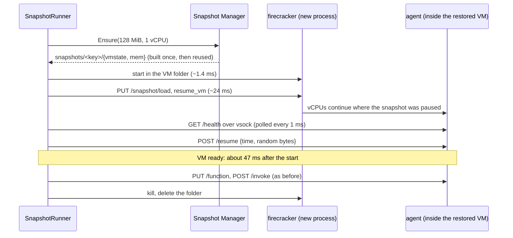

### 8.5 The Snapshot Manager

A snapshot only fits the exact kernel, root filesystem, Firecracker version, memory size, vCPU count and boot arguments it was made with. All of these go into a hash, the snapshot's **key**, and the files live in `~/.beevm/snapshots/<key>/`. After `make images` the rootfs hash changes, so the key changes, so a new snapshot is built automatically; the old one is listed as stale.

Building (about 2.1 to 2.5 s): boot a VM in agent mode, wait for the agent, call `/resume` once (since the M6 refine), **wait 1 more second** (see 8.9), close connections, pause, write the snapshot into `tmp-<random>/`, write `meta.json`, then rename the folder to its key. A half-built snapshot is therefore never used. Ten callers asking for the same missing snapshot share one build.

### 8.6 Use it

```bash
make images build examples           # images: the new init and agent are needed
./bin/beevmd snapshot build          # optional: serve builds it at start-up anyway
./bin/beevmd snapshot ls
./bin/beevmd invoke --restore --code bin/functions/hello-go-binary --payload '{"name":"Om"}'
```

```text
KEY                   MEMORY   VCPUS  SIZE     BUILD    CREATED              STATUS
ffb9d10f5e4ff9ed3c0a  128 MiB  1      128 MiB  2322 ms  2026-10-26 23:41:48  current

== restored VM 5770554d from snapshot ffb9d10f5e4ff9ed3c0a (1 vCPU, 128 MiB): process 1.3ms, load 19.7ms
== agent ready after 43.7ms (guest clock moved 8688 ms forward)
#1 {"greeting":"Hello, Om!","runtime":"binary"}  (15ms in function, 18.3ms round trip)
```

The service uses snapshots by default. With the server running (`./bin/beevmd serve`, as in Part 6):

```bash
./bin/beevm invoke hello --payload '{"name":"Om"}' -v
```

```text
vm 6b88505b: restore 52 ms, upload 20 ms, function 12 ms, server total 136 ms, round trip 140 ms
```

`./bin/beevmd serve --runner cold` brings back a full boot per call (`boot 906 ms ... server total 997 ms`) for comparison. Other commands: `beevmd snapshot rm <key>` and `beevmd snapshot rm --stale`. The new response header `X-BeeVM-Start` says `restore` or `boot`, and `X-BeeVM-Upload-Ms` gives the code upload time.

### 8.7 Measure it: the cold-start benchmark

```bash
./bin/beevmd bench coldstart --runs 100
```

It runs 1 warm-up and 100 measured cold starts per mode, one at a time, and prints percentiles. **p50** is the median (half the runs were faster); **p99** means 99 of 100 runs were at least this fast, which shows the bad cases. Results on the project laptop (WSL2, 1 vCPU, 128 MiB, page cache warm):

| ms | p50 | p90 | p99 | max |
|---|---|---|---|---|
| boot: VM ready | 936.8 | 1020.8 | 1186.1 | 1350.0 |
| boot: first response | 955.8 | 1077.3 | 1213.9 | 1393.9 |
| restore: start process | 1.4 | 2.0 | 2.9 | 5.0 |
| restore: load snapshot | 23.8 | 32.4 | 38.0 | 39.6 |
| **restore: VM ready** | **47.0** | 55.3 | **59.1** | 63.8 |
| restore: upload 2.5 MB | 27.6 | 33.0 | 79.7 | 85.1 |
| restore: invoke | 15.2 | 16.4 | 17.3 | 17.9 |
| restore: first response | 91.0 | 100.1 | 138.0 | 149.9 |

Restore is about **20 times faster** than boot. The median is under 50 ms; p99 (59 ms) is not, on WSL2's nested virtualization. Loading the snapshot is the largest part. The raw data and a summary go to `bench/results/` (not committed).

Notice that the upload and the call are slower after a restore (28 and 15 ms) than after a boot (15 and 3 ms): the guest's memory is loaded lazily, so the first touch of each page costs a read from the snapshot file. Milestones 7 (warm VMs) and 8 (function snapshots) attack exactly this.

### 8.8 Tests

```bash
make test        # new: snapshot manager (8), snapshot runner (4), agent /resume (3), benchmark maths (2), API headers
make test-kvm    # new: restore runs functions (10 restores), 5 parallel restores from one snapshot,
                 #      clock correct + clones differ + read-only root, real manager build, API end to end with snapshots
```

The tests prove: restored VMs answer correctly; parallel restores share one memory file; after `/resume` the guest clock is within 1 s of the host and two clones produce different random bytes; writing to `/` fails while `/tmp` works and is private per VM; a changed rootfs means a new snapshot; a failed build leaves nothing behind and the runner falls back to booting. All earlier tests still pass.

### 8.9 Problems we hit in milestone 6

| Problem | Why | What we did |
|---|---|---|
| The first answer after a restore took about 850 ms (sometimes 15 ms) | The snapshot was taken right after the agent started, while the guest was still finishing start-up work; that unfinished work was frozen into every copy. The vsock connection itself took only ~6 ms | Measured settle times from 0 to 2 s: 0.5 s or more fixes it. The builder waits 1 s before snapshotting |
| Diagnostic test dialled the wrong socket | The config had no VM ID yet; `Restore` picks a random one | Use the VM's own folder |
| The SDK's snapshot loading did not fit | It still sets up vsock (Firecracker refuses configuration before a load) and checks for the API socket only every 10 ms | A small own API client for restore (`fcapi.go`), polling every 1 ms |
| The guest clock was seconds behind after restore | A snapshot freezes the clock | `POST /resume` sets it |
| Restored copies share one random-number state | Every copy starts from the same frozen memory | The host sends fresh random bytes; the agent forces a reseed. (We first thought VM generation ID was not active; the M6 refine showed it is, see 8.10, so this is now a second safeguard) |
| Go strings in edited files got broken line breaks | The tool that ran our edit scripts rewrote `\n` escapes | Edits with escapes are made with a normal editor |

**Not done on purpose (later):** per-function snapshots (M8), the warm pool (M7), backing snapshots up to S3, tuning the snapshot load (smaller memory, hugepages, measuring with a cold page cache and on a cloud machine without nested virtualization). The tuning part was done in the M6 refine (8.10).

### 8.10 Milestone 6 refine 1: tuning the restore

**Goal:** bring the restore's p99 under 50 ms (October: p50 47.0 ms, p99 59.1 ms). **Rule for a refine session:** no public interface may change (HTTP API, CLI commands, existing Go functions); new things may only be added. **Method:** measure first, then change one thing at a time and run 100 restores per change, one at a time, after one warm-up run that is not counted.

All result files of this session are in `bench/results/m6refine/` (git-ignored, so only on the laptop). Each run wrote a `.csv` with every single run and a `.md` with the table and the settings. The files are named after the time they were written:

| File (`coldstart-20261102-…`) | What was measured |
|---|---|
| `200207` / `200221` | baseline: old probe (`--probe health`) and new probe (`--probe resume`), both with `--fc-metrics` |
| `200234` / `200248` | the same two again, without Firecracker metrics |
| `200454` | first run with page-fault counting |
| `200541`, `200555`, `200612`, `200631` | settle 1 s, 0.5 s, 2 s, 5 s (throw-away snapshots, old build procedure) |
| `200649`, `200705` | guest memory 64 MiB and 256 MiB (settle 1 s) |
| `200728` | 100 ms pause between runs |
| `200742` | firecracker pinned to CPU 2 |
| `200754` | plain baseline again (to see the drift during the session) |
| `200851`, `200906` | new build procedure (warm-up `/resume`), settle 1 s, twice |
| `201503` | **final:** 100 boots + 100 restores with the real, rebuilt snapshot |
| `201516` | final restores again |
| `201554` | cold page cache, 30 boots + 30 restores |

#### 8.10.1 Before measuring: check the power mode

The first baseline came out about 2.5 times slower than in October, in *every* phase, not just one. That pointed at the machine, not the code: the laptop was in **Legion Balance Mode** at 31 % battery. After switching to **Legion Performance Mode** and plugging in, the October numbers came back.

| ms, p50 | Balance mode, battery | Performance mode, plugged in |
|---|---|---|
| boot: VM ready (15 runs) | 1844.2 | 942.0 |
| boot: upload / invoke | 55.9 / 11.2 | 14.1 / 3.0 |
| restore: load | 29.4–32.8 | 22.7–23.3 |
| restore: agent (old probe) | 82.8 | 22.2–23.3 |
| restore: VM ready | 115.3–120.1 | 46.8–48.7 |
| restore: upload / invoke | 92.5–95.2 / 44.1–45.0 | 24.3–25.5 / 14.9–16.1 |
| restore: first response | 256.6–259.7 | 87.3–90.0 |

The guest's CPU-heavy phases (agent, upload, invoke) slowed down by 3–4 times, the load only by 1.3 times. Check the mode in PowerShell with `powercfg /getactivescheme` (switch with Fn+Q on the Legion). The Balance-mode result files were deleted when the baseline was restarted; the numbers above are from the session log.

#### 8.10.2 What "VM ready" is made of

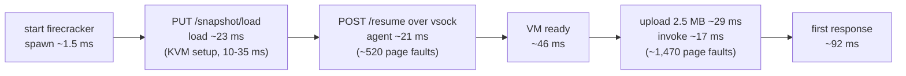

The October benchmark reported only spawn, load and "vm ready". Subtracting showed a hidden part of **~21 ms** after the load (range 9 to 33 ms): reconnecting to the agent and the `/resume` call. The raw October data also showed that the *slow* runs were slow because of the **load** (11 to 40 ms), while the hidden part was steady. So there were two targets: the load's variance (the p99) and the steady ~21 ms.

#### 8.10.3 New measuring tools

**New rows in the benchmark table** (restore only; rows marked *optional* are left out when no run filled them):

| Row | What it measures | How |
|---|---|---|
| `spawn` | firecracker process start until its API socket answers | unchanged |
| `load` | our `PUT /snapshot/load` request, incl. resuming the vCPUs | unchanged |
| `fc load` (optional) | the same load, measured by Firecracker itself | `--fc-metrics` |
| `connect` (optional) | after the load until `/health` answered | only with `--probe health` |
| `agent` | after the load until the agent answered `/resume` | new |
| `attempts (n)` (optional) | requests sent until the agent answered | `--probe resume` |
| `faults agent (n)` | page faults of the firecracker process during the agent phase | `/proc/<pid>/stat` |
| `faults call (n)` | page faults during upload + invoke | `/proc/<pid>/stat` |
| `vm ready` | start until the agent is ready (spawn + load + agent) | unchanged meaning |

The CSV now has the columns `mode, run, spawn_ms, load_ms, fc_load_ms, connect_ms, agent_ms, attempts, faults_agent, faults_call, ready_ms, upload_ms, invoke_ms, first_response_ms`. The `.md` summary has a new "Settings" line that says how the run was made.

**New flags** of `beevmd bench coldstart`:

| Flag | What it does | Details and caveats |
|---|---|---|
| `--probe resume\|health` | how to wait for the agent after a restore | `resume` (default): `VM.WaitAndResume`, one request. `health`: the old way, `/health` until it answers, then `/resume`, kept for comparison |
| `--fc-metrics` | also record Firecracker's own load time | Restore sends `PUT /metrics` (file `metrics.json` in the VM folder) before the load; after the call, `PUT /actions {"action_type":"FlushMetrics"}` and read `latencies_us.load_snapshot`. The flush is outside every measured time; the `PUT /metrics` (~0.3 ms) is inside "vm ready" |
| `--cold-cache` | drop the files from the host's page cache before every run | `posix_fadvise(POSIX_FADV_DONTNEED)` on the firecracker binary, kernel, rootfs and (restore) snapshot files; no sudo needed, unlike `drop_caches`. Pages mapped by a running process stay cached, so **don't use it while `beevmd serve` runs**. On WSL2 the "disk" is a virtual disk file that Windows may still cache |
| `--settle D` | build a throw-away snapshot with this settle time | Built in `~/.beevm/run/bench/snapshots/` and deleted when the benchmark ends. The settle time is not part of the snapshot key, so a throw-away snapshot has the same key as the real one: that is why it lives in its own folder |
| `--gap D` | pause after every run | tests whether tearing down the previous VM disturbs the next one |
| `--pin CPUS` | restore only: limit the firecracker process to these host CPUs | e.g. `--pin 2`; CPU numbers are checked against the machine |
| `--mem N`, `--vcpus N` | VM size | existed already; with `--settle` the snapshot is a throw-away one too |

```bash
./bin/beevmd bench coldstart --mode restore --runs 100 --probe health --fc-metrics
./bin/beevmd bench coldstart --mode restore --runs 100 --settle 2s
./bin/beevmd bench coldstart --mode restore --runs 100 --settle 1s --mem 64
./bin/beevmd bench coldstart --mode restore --runs 100 --gap 100ms
./bin/beevmd bench coldstart --mode restore --runs 100 --pin 2
./bin/beevmd bench coldstart --mode boot,restore --runs 30 --cold-cache
```

**Counting page faults.** Linux counts, per process, how often it had to fix up a missing page: *minor* faults (the page was in memory, it only had to be mapped) and *major* faults (it had to be read from disk). `/proc/<pid>/stat` has them as fields 10 (`minflt`) and 12 (`majflt`), summed over all threads. When the guest touches a page of its memory for the first time after a restore, KVM fixes it up on the firecracker vCPU thread, so that thread's fault counter goes up. The benchmark reads the counter right after the load, when the agent is ready, and after the first response. The command name in field 2 can contain spaces, so the parser skips to the last `)` first.

#### 8.10.4 The baseline: old way vs new way

Four runs in Performance mode, 100 restores each (p50 / p90 / p99 / max, ms):

| Row | A: `health` + metrics (`200207`) | B: `resume` + metrics (`200221`) | A2: `health` (`200234`) | B2: `resume` (`200248`) |
|---|---|---|---|---|
| spawn | 1.5 / 1.9 / 4.7 / 11.5 | 1.5 / 2.0 / 2.8 / 10.4 | 1.5 / 1.7 / 2.6 / 2.6 | 1.5 / 1.9 / 2.7 / 3.3 |
| load | 22.7 / 34.9 / 45.3 / 45.4 | 23.3 / 32.0 / 37.5 / 43.3 | 22.8 / 31.5 / 39.2 / 40.6 | 23.1 / 34.2 / 39.1 / 47.8 |
| fc load | 22.5 / 34.7 / 45.1 / 45.2 | 22.6 / 30.8 / 35.7 / 36.7 | – | – |
| connect | 19.3 / 28.3 / 42.1 / 50.0 | – | 18.6 / 19.9 / 27.5 / 38.7 | – |
| agent | 23.3 / 33.7 / 55.1 / 60.8 | 20.6 / 22.8 / 24.4 / 34.1 | 22.2 / 24.1 / 37.8 / 41.8 | 21.7 / 25.4 / 43.9 / 48.3 |
| **vm ready** | 48.7 / 64.9 / 80.7 / 82.4 | 47.4 / 56.2 / 61.0 / 65.6 | 46.8 / 56.2 / 66.8 / 78.1 | 47.0 / 58.8 / 76.7 / 77.9 |
| upload | 24.5 / 36.5 / 46.1 / 47.8 | 24.3 / 27.7 / 32.4 / 43.7 | 24.6 / 28.9 / 36.2 / 80.4 | 25.5 / 31.9 / 58.2 / 81.0 |
| invoke | 16.1 / 22.5 / 32.1 / 32.8 | 15.0 / 16.9 / 24.7 / 28.6 | 15.3 / 18.3 / 27.9 / 48.9 | 14.9 / 19.2 / 28.8 / 31.8 |
| first response | 90.0 / 122.2 / 134.9 / 146.3 | 87.9 / 96.2 / 103.7 / 104.4 | 87.3 / 98.6 / 127.5 / 187.9 | 88.6 / 106.5 / 157.1 / 157.5 |

What this says:

- **Our request around the load costs almost nothing:** `load` and `fc load` differ by 0.2–0.7 ms at p50. The ~23 ms happen *inside* Firecracker.
- **The new probe saves ~1.5 ms at p50** (agent 22.2–23.3 → 20.6–21.7 ms). Not more, because even a single request takes ~20 ms: the *first* request after a restore is slow in itself (see 8.10.6).
- `attempts` was 1 in every run: the agent always answered the very first request, so the 1 ms polling never had to wait.
- **Identical runs differ a lot at p99** (B 61.0 ms vs B2 76.7 ms). Tails need repeated runs before you believe a difference.

#### 8.10.5 Where the load time goes

1. **Firecracker metrics work before a load.** A hand test with `curl --unix-socket` showed that `PUT /metrics` before `PUT /snapshot/load` is accepted (204), and that `FlushMetrics` writes one JSON line per flush. `latencies_us.load_snapshot` was 42,903 µs on that first, cold try; the `vmm_*` latency fields stayed 0 (not filled in by this version).
2. **The console log has timestamps.** A restore with `beevmd invoke --restore --keep-logs` left a `console.log` in which Firecracker logs each step. Between "Snapshot CPU vendor ID" and "Artificially kick devices" 32 ms passed; the whole load took 32.7 ms. The same run: the three calls took 16.4, 6.3 and 4.4 ms round trip (the first call pays for the page faults), the agent was ready after 61.1 ms, killing the VM took 57 ms.
3. **Trace logging names the step.** Started by hand with `firecracker --api-sock … --level Trace --show-level --show-log-origin`, Firecracker logs `event_start: build microvm from snapshot` and `event_end` 10.3 ms later, of a 10.7 ms load. In between it builds the **VMGenID** device (address `0x000dfff0`, IRQ 7), writes a new generation ID into the guest and notifies the guest's **VMClock** device. Everything else in the load is under 0.5 ms.
4. `strace` would show each KVM call, but it is not installed in WSL and installing it needs sudo. The trace log was enough.
5. **No fast and slow groups.** Sorting the 100 load times of run `200754` and taking every tenth one gives 11.4, 15.5, 18.1, 19.8, 23.2, 23.6, 26.1, 28.1, 31.2, 33.6 ms: an even spread, not two clusters. So it is not one switch (like "the vCPU landed on a slow core"); it is general scheduling noise.

**Why the load is slow and varies.** "Build microvm from snapshot" creates a KVM virtual machine, its vCPU and its memory regions, and restores the CPU registers. Each of these is a call into KVM. Under WSL2, KVM itself runs inside a Hyper-V virtual machine (*nested virtualization*: Hyper-V is level 0, the WSL kernel with KVM is level 1, our guest is level 2). Many KVM operations then cause exits to Hyper-V, and the time depends on what Hyper-V and Windows are doing at that moment. Nothing in our code can change that; on a bare-metal Linux machine KVM talks to the hardware directly.

#### 8.10.6 Where the agent time goes: page faults

Run `200454` was the first with fault counting:

| Row | p50 | p90 | p99 | max |
|---|---|---|---|---|
| agent (ms) | 20.0 | 22.2 | 23.9 | 24.5 |
| faults agent | 544 | 591 | 601 | 606 |
| upload + invoke (ms) | 24.2 + 14.1 | | | |
| faults call | 1414 | 1421 | 1433 | 1453 |

- **544 faults in 20 ms = ~37 µs per fault.** Upload + invoke: 1,414 faults in ~38 ms = ~27 µs per fault.
- Runs with fewer faults are faster: in run `200754` the run with 330 faults needed 14.1 ms for the agent phase, one with 426 faults 17.7 ms, typical ones with ~550–580 faults 19–23 ms.

**Why a page fault costs so much here.** The guest's memory is the snapshot's `mem` file, mapped *privately* by Firecracker (`mem_backend` type `File`). Nothing is read at restore time; a page comes in when the guest first touches it (*lazy loading*), and a write makes a private copy of that one page (*copy-on-write*). The guest uses guest-physical addresses, so the CPU translates twice: guest page tables, then a second table that KVM keeps (*EPT*, Intel's *second level address translation*). On the first touch that second table has no entry, so the CPU stops the guest and asks KVM to fill it in. Under nested virtualization that stop goes to Hyper-V first, which hands it to the WSL kernel's KVM, which maps the file page (a minor fault), and then Hyper-V must update its own tables too. One page = several switches between hypervisors = tens of microseconds. On bare metal it is a few microseconds.

**Why the guest touches ~2 MB to answer one request.** The guest kernel wakes up, handles the vsock device's reset event, the VMGenID notification and the reseed of its random generator; the agent's Go runtime wakes its goroutines and allocates buffers for the HTTP connection. Each of these touches pages that were never touched since the restore. We did not trace this inside the guest; the page count is what matters.

#### 8.10.7 The experiments: what did not help

Every knob, 100 restores each, p50 / p99 (ms; faults: p50):

| Run | load | agent | faults agent | faults call | **vm ready** | upload | invoke | first response |
|---|---|---|---|---|---|---|---|---|
| settle 0.5 s (`200555`) | 24.1 / 40.9 | 19.6 / 24.6 | 529 | 1443 | 46.2 / 60.2 | 25.4 / 56.2 | 14.5 / 20.6 | 86.8 / 127.6 |
| settle 1 s (`200541`) | 24.2 / 45.1 | 19.2 / 22.9 | 504 | 1460 | 46.2 / 62.0 | 25.8 / 31.3 | 16.3 / 18.6 | 88.3 / 116.4 |
| settle 2 s (`200612`) | 26.5 / 45.3 | 18.8 / 24.1 | 427 | 1434 | 47.7 / 61.0 | 25.2 / 34.6 | 15.5 / 17.7 | 88.8 / 104.5 |
| settle 5 s (`200631`) | 24.9 / 38.0 | 19.0 / 23.4 | 484 | 1442 | 45.2 / 60.7 | 26.2 / 69.2 | 15.2 / 17.8 | 86.4 / 121.4 |
| 64 MiB (`200649`) | 23.1 / 43.8 | 22.2 / 42.9 | 546 | 1597 | 46.6 / 77.1 | 32.2 / 141.7 | 15.9 / 33.3 | 95.2 / 237.5 |
| 256 MiB (`200705`) | 23.0 / 47.2 | 20.9 / 43.7 | 538 | 1461 | 45.5 / 74.4 | 27.3 / 59.2 | 16.6 / 32.6 | 90.2 / 151.0 |
| 100 ms gap (`200728`) | 22.1 / 38.0 | 22.5 / 25.0 | 568 | 1413 | 46.9 / 65.0 | 25.1 / 40.3 | 15.1 / 19.0 | 87.8 / 107.4 |
| pinned to CPU 2 (`200742`) | 24.0 / 44.0 | 22.2 / 27.0 | 589 | 1411 | 47.6 / 73.6 | 24.4 / 31.1 | 14.7 / 18.7 | 86.3 / 111.2 |
| plain (`200754`) | 23.6 / 43.4 | 20.9 / 25.0 | 568 | 1413 | 47.0 / 67.2 | 23.9 / 34.1 | 14.5 / 18.3 | 86.3 / 106.6 |

- **Settle time (0.5–5 s):** no clear effect. The fault count moves a little (427–529), but load and "vm ready" stay within the noise. 1 s stays the default.
- **Guest memory 64 / 256 MiB:** the load does *not* depend on memory size, because Firecracker maps the file instead of reading it. 64 MiB made the call slower (1,597 faults, upload p99 142 ms): the guest has less free memory and works harder for the 2.5 MB upload. The function's own memory setting decides the snapshot size anyway, so nothing to change.
- **100 ms pause between runs:** no change, so tearing down the previous VM does not disturb the next one.
- **Pinning to one CPU:** no help, slightly worse. Inside WSL, "CPU 2" is a virtual CPU that Hyper-V moves between physical cores (this laptop's i7-13620H has fast P-cores and slower E-cores), so pinning cannot choose a fast core. Pinning stays a benchmark flag; the server does not pin (it would crowd many VMs onto few cores and hurt density, to be judged in M12).

#### 8.10.8 What we kept

**1. One request instead of two (`VM.WaitAndResume`).** The server's restore path (`internal/runner/runner.go`, `restoreAndRun`) used to poll `/health` until the agent answered and then send `/resume`. Now it sends `/resume` right away and repeats it until it succeeds: the first answer means "the agent is up, its clock is set, its random generator is reseeded". Sending `/resume` twice is harmless, and every retry carries the current time. If the agent *answers* with an error (it got the request but refused it), retrying would not help, so it stops at once. To tell the two cases apart, the agent client now returns a typed `statusError` for "the agent answered with an error status" (the message text is unchanged). Effect, same conditions: agent p50 22.2–23.3 → 20.6–21.7 ms, **p99 37.8–55.1 → 24.4–43.9 ms**; in the final runs p99 was 23.6–26.0 ms.

**2. Warm-up call before snapshotting.** `snapshot.buildVM` now calls `/resume` once after the agent is up and before the 1 s settle. The code of the resume handler (JSON decoding, `settimeofday`, the entropy ioctls) is then already read from the root disk into guest memory when the snapshot is taken. Without it, the first restore-time `/resume` made the guest read those pages from the virtual disk first. The fault count barely moved (~520 vs ~504–544), but the agent phase did, measured twice with throw-away snapshots and settle 1 s:

| ms, p50 / p99 | old build, settle 1 s (`200541`) | new build (`200851`) | new build (`200906`) |
|---|---|---|---|
| agent | 19.2 / 22.9 | 18.0 / 24.6 | 19.2 / 21.3 |
| vm ready | 46.2 / 62.0 | 41.9 / 67.3 | 43.3 / 62.6 |
| faults agent | 504 | 519 | 519 |

We did **not** upload and run a function before snapshotting: that would leave a function file inside every restored VM (an invoke before upload would then run it instead of answering 409). The snapshot stays a clean, empty agent.

**3. `snapshot.BuildVersion` in the key.** The snapshot key already hashed everything a snapshot depends on (Firecracker version, kernel, rootfs and its path, boot args, memory, vCPUs). A change in *how* the snapshot is built was not covered, so the old snapshot would have been reused. Now `Inputs` has a `build_version` field filled from the constant `snapshot.BuildVersion` (1 = the M6 procedure, 2 = with the warm-up call). After the change, `beevmd snapshot ls` showed the two old snapshots as stale, and the next benchmark built the new one automatically (`f6b97d9527d38143d667`, 2,106 ms). **Bump `BuildVersion` whenever `buildVM` changes.** The status text in `snapshot ls` now says "stale (images or build changed)".

#### 8.10.9 Final result

Performance mode, plugged in, warm page cache, real snapshot, one at a time (p50 / p90 / p99 / max, ms):

| Row | final (`201503`) | again (`201516`) |
|---|---|---|
| boot: VM ready | 946.8 / 1137.2 / 1173.2 / 1178.6 | – |
| boot: upload / invoke | 13.9 / 2.8 (p50) | – |
| boot: first response | 960.7 / 1176.7 / 1206.0 / 1213.3 | – |
| restore: spawn | 1.5 / 1.7 / 2.1 / 12.1 | 1.5 / 1.7 / 2.3 / 2.4 |
| restore: load | 22.8 / 31.3 / 41.6 / 44.1 | 23.1 / 31.4 / 43.3 / 51.4 |
| restore: agent | 20.9 / 22.1 / 26.0 / 26.1 | 20.9 / 22.4 / 23.6 / 23.9 |
| restore: faults agent / call (p50) | 514 / 1464 | 510 / 1463 |
| **restore: VM ready** | **45.2** / 55.8 / **65.9** / 68.2 | **45.8** / 53.2 / **67.2** / 72.8 |
| restore: upload | 28.9 / 32.2 / 35.7 / 37.7 | 29.1 / 32.9 / 37.7 / 39.5 |
| restore: invoke | 16.9 / 18.4 / 20.1 / 24.2 | 17.0 / 18.5 / 20.2 / 25.3 |
| restore: first response | 91.6 / 102.1 / 112.9 / 114.2 | 92.0 / 102.7 / 113.4 / 118.0 |

**Cold page cache** (`201554`, 30 runs each, files dropped before every run):

| Row | p50 | p90 | p99 |
|---|---|---|---|
| boot: VM ready | 978.7 | 1001.1 | 1073.2 |
| restore: spawn | 6.5 | 7.9 | 10.2 |
| restore: load | 23.9 | 33.1 | 37.4 |
| restore: agent | 52.8 | 56.6 | 74.3 |
| restore: VM ready | 84.3 | 99.0 | 101.1 |
| restore: first response | 137.4 | 148.7 | 180.9 |

With a cold cache the firecracker binary must be read (spawn 6.5 ms) and every faulted page comes from the disk (agent 52.8 ms, same fault count). The load itself does not read the memory file, so it does not change. Boot only gets 30 ms slower, because it reads the kernel and a few MB of the disk once.

**Verdict.** The median met the target before and now has a little more margin (45–46 ms instead of 47 ms). The p99 is 60–67 ms. October's 59 ms came from a quieter run: today's untouched baseline gave 61–77 ms. The tail is set by the load's KVM noise and by ~520 page faults at ~37 µs each, both caused by nested virtualization. The steps we kept removed the agent phase's tail (p99 24–26 ms instead of 38–55 ms).

#### 8.10.10 The code changes in detail

| File | Change |
|---|---|
| `internal/vmm/vm.go` | `ResumeInfo{Ready, Attempts, ClockAdjustedMS}`; `VM.WaitAndResume(ctx)`: polls with `/resume` at the VM's poll interval (1 ms after a restore), 500 ms limit per attempt, stops at once on an agent error answer, on VM exit or on `ctx` end |
| `internal/vmm/agent.go` | `statusError{code, msg}` for non-2xx answers from the agent (same text as before: `agent returned <code>: <message>`) |
| `internal/vmm/config.go` | `Config.FirecrackerMetrics bool`, `Config.CPUs []int` (both used by restored VMs only), `Config.MetricsPath()` |
| `internal/vmm/restore.go` | after the API socket answers: pin all threads if `CPUs` is set; `PUT /metrics` if `FirecrackerMetrics` is set |
| `internal/vmm/tuning.go` (new) | `pinProcess` (sets the affinity of every thread listed in `/proc/<pid>/task`; the vCPU thread is created later during the load and inherits it), `VM.FirecrackerLoadTime(ctx)` (flush + read), `loadTimeFromMetrics` |
| `internal/runner/runner.go` | `restoreAndRun` uses `WaitAndResume`; `BootMS` comes from `ResumeInfo.Ready` |
| `internal/snapshot/snapshot.go` | `Inputs.BuildVersion`, constant `BuildVersion = 2`, warm-up `/resume` in `buildVM`, `Manager.SetSettle(d)` |
| `cmd/beevmd/bench.go` | `benchSettings`, new rows and flags, `benchSnapshot` (normal or throw-away snapshot), `dropFromPageCache`, `processFaults`, `parseCPUs`, `describeSettings`, optional table rows, new CSV columns; the warm-up run is now run 0 of the same loop |
| `cmd/beevmd/snapshotcmd.go` | stale label text |
| `go.mod` | `golang.org/x/sys` is now a direct dependency (`unix.SchedSetaffinity`, `unix.Fadvise`) |

A first version pinned only the main thread right after `cmd.Start`. Firecracker may already have started its API thread by then, so the final version waits until the API socket answers and then pins every existing thread.

#### 8.10.11 Tests added

```bash
make test       # new: WaitAndResume (first try; 3 refused connections -> 4 attempts, 1 resume;
                #      agent error 500 -> no retry; gives up when ctx ends; VM never started),
                #      loadTimeFromMetrics, pinProcess rejects CPU -1, bench optional rows,
                #      parseCPUs, describeSettings, processFaults, BuildVersion changes the key,
                #      Inputs carry BuildVersion, SetSettle
make test-kvm   # new: TestRestoreWithMetricsAndPinning (Firecracker's load time > 0 and <= ours;
                #      every firecracker thread has Cpus_allowed_list 0); all restore tests now use
                #      WaitAndResume
```

The fake Firecracker in `internal/vmm/agent_test.go` got a `rejectFirst` counter: it closes that many connections first, like a guest whose agent is not listening yet. Results: unit tests in 11 packages pass, also with `-race` for `vmm`, `snapshot`, `runner` and `cmd/beevmd`; all KVM tests pass (the KVM logs showed a restore with spawn 1.4 ms, load 16.2 ms, ready 41.4 ms, 1 attempt; metrics test: our load 19.06 ms, Firecracker's 18.79 ms); no leftover firecracker processes or folders.

#### 8.10.12 Problems we hit in the refine

| Problem | Why | What we did |
|---|---|---|
| The first baseline was 2.5x slower in every phase | Legion Balance Mode, 31 % battery | Switched to Performance mode, plugged in; reran the baseline; note in CLAUDE.md |
| `go test ./...` was killed with exit code 15 and no output | The tool that ran it stopped after 400 s; the first `go vet` over the Windows-mounted folder (`/mnt/c`) alone took about 5 minutes | Ran long commands in the background with a log file; later runs were fast (build cache) |
| `gofmt` complained about `agent_test.go` | A new struct field broke the column alignment | `gofmt -w` |
| A shell trick to edit two test files did nothing | `python3` in Git Bash is the Windows Python, which opened an interactive prompt instead of reading the script | Made the edits with the editor tool |
| `strace` not available | Not installed in WSL; installing needs sudo | Firecracker's `--level Trace` log was enough |
| Pinning could miss a thread | The API thread may exist before we pin | Pin all threads after the API socket answers |
| Identical runs gave different p99 (61 vs 77 ms) | Host noise under nested virtualization | Compared like with like in the same session, ran key measurements twice |
| `snapshot ls` said "images changed" although only the build changed | Old label | New label: "images or build changed" |

#### 8.10.13 Found on the way: the VM generation ID works

Milestone 6 assumed that the guest has no active VM generation ID device. The restored guest's console says otherwise: `random: crng reseeded due to virtual machine fork`, and Firecracker's trace log of a load shows it building the VMGenID device and writing a new generation ID into the guest. Firecracker's own documentation says "Firecracker implements VMGenID". So the guest kernel reseeds its random generator by itself after a restore. The agent's reseed in `/resume` stays as a second safeguard (it costs nothing extra, because `/resume` is needed for the clock anyway). Firecracker 1.17 also has a **VMClock** device that tells the guest about clock changes, but our 6.1 guest kernel has no driver for it, so the clock still needs `/resume`.

### 8.11 Milestone 6 refine 2: userfaultfd page prefetch (spike only, deferred)

**The idea.** Most of the time after the load is page faults, ~2,000 per call at ~27–37 µs each. The REAP paper (Ustiugov et al., ASPLOS 2021) showed that a restored serverless function touches almost the same pages every time. So: record which pages one call touches, and at the next restore copy exactly those pages into the VM in one go, before the guest needs them. The tool for that is **userfaultfd**: a Linux feature that lets one program handle the page faults of another program's memory. Firecracker supports it as a memory backend (`mem_backend` type `Uffd`): instead of mapping the `mem` file, it lets our handler process fill in the pages.

**How it would work with Firecracker 1.17** (from its documentation, "handling page faults on snapshot resume"):

1. Our handler listens on a Unix socket; its path goes into `mem_backend.backend_path` of `PUT /snapshot/load`.
2. Firecracker creates the userfaultfd, maps empty guest memory, registers it, connects to our socket and sends the userfaultfd plus the guest-memory layout (each region's address, size and page size). After that it never talks to the handler again.
3. The handler copies pages into the guest with `UFFDIO_COPY`. It must zero pages after `UFFD_EVENT_REMOVE` (only sent with a balloon device, which we don't have).
4. If the handler dies during a restore, Firecracker waits forever at the next fault, so the handler needs timeouts. It can check who connected with `SO_PEERCRED`.
5. On kernels 6.1 and newer, Firecracker creates the userfaultfd through **`/dev/userfaultfd`**, and access is "managed by file system permissions".

**The spike: can it work on this laptop without sudo?** Checked in WSL:

```text
CONFIG_USERFAULTFD=y                         the kernel supports it
/proc/sys/vm/unprivileged_userfaultfd = 0    normal users may not use the full version
/dev/userfaultfd: crw------- root root       root only
CapEff: 0000000000000000                     our user has no special capabilities
```

A small test calling the `userfaultfd` system call as the normal user:

```text
userfaultfd full (handles KVM/kernel faults): FAILED: Operation not permitted
userfaultfd user-mode only: OK fd=3
/dev/userfaultfd: Permission denied
```

The "user-mode only" kind is no use: it only catches faults caused by user programs, but the guest's faults are handled inside the kernel by KVM. **So it cannot work here without loosening a security setting.** Firecracker's documentation suggests `sudo setfacl -m u:$USER:rw /dev/userfaultfd` for running without the jailer. The setting is locked down by default for a reason: full userfaultfd lets a program pause the kernel in the middle of copying memory, which is a known helper for exploiting kernel race bugs. It would also reset whenever WSL restarts.

**Decision:** leave the laptop's security settings alone, and try the prefetch on the cloud node (M13), where Firecracker runs with root or the jailer (which makes `/dev/userfaultfd` available inside each jail) and without nested virtualization, so the fault cost is lower anyway. Before building it there, read Firecracker's example handlers in `src/firecracker/examples/uffd/` for the exact message format (the documentation does not name the JSON fields).

---

## Part 9: the repository, GitHub and renames

What we did, so you can do the same for your own fork or a new repository.

### 9.1 Create and publish the repository

```bash
gh auth login                                   # once: log the GitHub CLI in
gh repo create <user>/beevm --public --source=. --remote=origin --push
```

`gh repo create ... --source=. --push` creates the repository on GitHub, adds it as `origin` and pushes the current branch. We chose **public** so the group and graders can see it.

### 9.2 Removing a file from history before going public

The first commit contained the course case-study `.docx`. Deleting it in a new commit would still leave it in the history, visible to anyone. So, before the first push, we rewrote the local history:

```bash
git branch backup-before-rewrite        # safety copy of the old history (stays local)
git filter-branch -f --index-filter \
  'git rm -q --cached --ignore-unmatch "Advanced Cloud System Software Design_ 30 Case Studies.docx"' -- main
rm -rf .git/refs/original
echo "Advanced Cloud System Software Design_ 30 Case Studies.docx" >> .gitignore
git show backup-before-rewrite:"Advanced Cloud System Software Design_ 30 Case Studies.docx" \
  > "Advanced Cloud System Software Design_ 30 Case Studies.docx"      # put the file back on disk
```

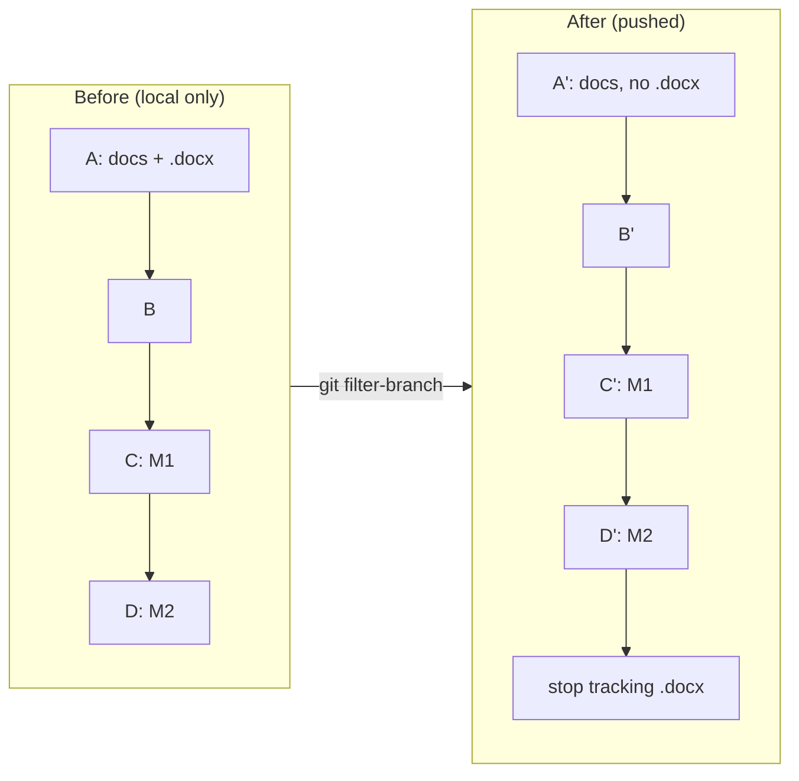

**Things to know:**

- Every rewritten commit gets a **new hash**. Only do this before anyone else has the old history.
- The rewrite **deleted the file from the working folder** (it was no longer tracked), hence the `git show` line to restore it.
- Git's own documentation now recommends `git filter-repo` for this job; `filter-branch` was enough for four local commits.
- When you are sure you do not need it: `git branch -D backup-before-rewrite`.

### 9.3 Renames: repository, module path, GitHub username

The Go module path is both the name in every `import` line and the address other people download the code from, so it should always match the repository.

| When | What changed | Commands |
|---|---|---|
| After the first push | Repository `beevm` renamed to `BeeVM` | `gh repo rename BeeVM --repo <user>/beevm --yes` and `git remote set-url origin https://github.com/<user>/BeeVM.git` |
| Same day | Module path renamed to match | find-and-replace the old path in `go.mod` and every `.go` file, then `make vet build test` |
| Later | GitHub username changed from `OmMhatre-99` to `om8P`; GitHub moved the repository and redirects the old address | `git remote set-url origin https://github.com/om8P/BeeVM.git`, then the module path became `github.com/om8P/BeeVM` the same way |

To find every old reference before a rename: `grep -rIl "old-name" --exclude-dir=.git --exclude-dir=node_modules .`

### 9.4 Things to know about commits

- Commit author name and email come from `git config` and are **public** on GitHub. To hide your email, use GitHub's no-reply address: `git config --global user.email "<id>+<username>@users.noreply.github.com"`. Old commits keep the old values.
- Every milestone ends with: tests pass, `docs/progress.md` updated, one commit.

### 9.5 The documentation folders

| Folder | For whom | In Git |
|---|---|---|
| `docs/` | the project and Claude: `architecture.md`, `milestones.md`, `progress.md` | yes |
| `developer-guide/` | people: this guide (`guide.md`, plus a Word copy) and the learning notes (`learning-notes.docx`) | yes, the documents only |
| `developer-guide/tools/` | the scripts that generate the Word files | no (local only, see Appendix E) |

### 9.6 Commit history on GitHub

| Commit | What |
|---|---|
| `918d884` | planning docs and project setup |
| `e6fdccb` | 13-milestone session guide |
| `e6dad4a` | Milestone 1 |
| `bd71997` | Milestone 2 |
| `717a840` | stop tracking the course document |
| `6364ecd` | rename Go module to match the repository name |
| `c70ccc2` | add this build guide |
| `6a31586` | move the guide and learning notes to `developer-guide/` |
| `7464297` | Milestone 3 |
| `aded71e` | rename Go module to `github.com/om8P/BeeVM` |
| `88fd5c5` | update guide and learning notes through milestone 3 |
| `9d92a7f` | Milestone 4 |
| `d91588c` | Milestone 5 |
| `afd078b` | update guide and learning notes through milestone 5 |
| `1488561` | demonstration script for milestones 1 to 5 |
| `56d718e` | Milestone 6 |

---

## Appendix A: command cheat sheet

All in the **WSL terminal**, in the repo folder, unless marked PowerShell.

| Command | What it does |
|---|---|
| `make help` | list targets |
| `make setup` | one-time install (sudo); safe to re-run |
| `wsl --shutdown` (PowerShell) | restart WSL so the `kvm` group takes effect |
| `make images` / `make kernel` / `make rootfs` | (re)build guest images; `rootfs` also rebuilds the guest agent |
| `make boot-test` | milestone 1 automatic boot check |
| `make boot` | milestone 1 interactive VM (`reboot -f` to exit) |
| `make build` | build `bin/beevmd` (server) and `bin/beevm` (user CLI) |
| `make examples` | build example functions into `bin/functions/` |
| `./bin/beevmd boot [--hold D] [--keep-logs] [--mem N] [--vcpus N]` | milestone 2: boot, show console, stop |
| `./bin/beevmd invoke --code F [--payload J] [--repeat N] [--timeout D] [--console] [--keep-logs] [--restore]` | milestone 3: run a function in a VM (`--restore`: from the base snapshot, milestone 6) |
| `./bin/beevmd snapshot build [--mem N --vcpus N]` / `ls` / `rm <key>` / `rm --stale` | milestone 6: manage base snapshots |
| `./bin/beevmd bench coldstart [--runs N] [--mode boot,restore]` | milestone 6: p50/p90/p99 of boot vs restore, saved to `bench/results/` |
| `./bin/beevmd bench coldstart … [--probe resume\|health] [--fc-metrics] [--cold-cache] [--settle D] [--gap D] [--pin CPUS] [--mem N] [--out DIR]` | M6 refine: tuning experiments (see 8.10.3) |
| `powercfg /getactivescheme` (PowerShell) | check the power mode before benchmarking (Performance mode, plugged in) |
| `firecracker --api-sock S --level Trace --show-level --show-log-origin` | Firecracker with detailed, timestamped logs (how the load time was traced) |
| `./bin/beevmd tenant add <name>` / `tenant ls` | milestone 4: create a tenant (prints its API key once) |
| `./bin/beevmd key add <tenant>` / `key ls` / `key revoke <prefix>` | milestone 4: manage API keys |
| `./bin/beevmd serve [--addr A] [--max-vms N] [--queue-wait D] [--s3-*] [--runner snapshot\|cold]` | milestone 4/5/6: run the HTTP service (restores from snapshots by default) |
| `./bin/beevm deploy <name> <binary> [--memory M] [--vcpus N] [--timeout D]` | upload a function (needs `BEEVM_API_KEY`) |
| `./bin/beevm invoke <name> [--payload J \| --payload-file F] [-v]` | call a function; `-v` prints timings and code cache hit/miss |
| `./bin/beevm ls` / `rm <name>` | list or delete your functions |
| `make minio` / `make minio-up` / `make minio-down` | milestone 5: local S3 server (built from source) or via Docker Compose |
| `set -a; . deploy/minio.env; set +a` | load the S3 settings and dev credentials into this terminal |
| `make test` / `make test-kvm` / `make test-s3` / `make vet` | Go tests and checks (`test-s3` needs MinIO running) |
| `make clean-images` | delete `~/.beevm/images` and `~/.beevm/run` |
| `pgrep -a firecracker` | find leftover VMs |
| `id` | check you are in the `kvm` group |

## Appendix B: pinned versions

| Component | Version | Where pinned |
|---|---|---|
| Firecracker + jailer | 1.17.0 | `scripts/common.sh` |
| Go | 1.27.3 (module needs ≥ 1.24) | `scripts/common.sh`, `go.mod` |
| Guest kernel | vmlinux 6.1.155 (Firecracker CI, v1.15 folder) | `scripts/common.sh` |
| Alpine minirootfs | 3.24.3 | `scripts/common.sh` |
| firecracker-go-sdk | main @ `6fb280e993d4` (Dec 2025) | `go.mod` |
| mdlayher/vsock | v1.3.0 | `go.mod` |
| go-chi/chi | v5.5.0 | `go.mod` |
| spf13/cobra | v1.10.2 | `go.mod` |
| modernc.org/sqlite | v1.61.0 | `go.mod` |
| aws-sdk-go-v2 / service/s3 | v1.47.4 / v1.114.5 | `go.mod` |
| gofakes3 (tests only) | v1.2.0 | `go.mod` |
| MinIO (built from source) | pseudo-version `v0.0.0-20260212201848-7aac2a2c5b7c` | `scripts/common.sh` |
| Guest agent | 0.1.0 | `cmd/beevm-agent/main.go` |
| Host | Windows 11, WSL2 Ubuntu 24.04.3, WSL kernel 6.6.87 | — |

## Appendix C: measured numbers (WSL2, i7-13620H, 1 vCPU, 128 MiB)

| Measurement | Value | Milestone |
|---|---|---|
| Cold boot, shell script, process start to exit | 1.7 to 2.0 s | 1 |
| Guest kernel reaches init | ~1.3 s | 1 |
| Cold boot via Go, Start to `BEEVM_READY` | 1.58 to 1.71 s | 2 |
| Graceful stop (Ctrl-Alt-Del) | 55 to 91 ms | 2, 3 |
| Agent answers `/health` after Start | 1.64 to 1.85 s | 3 |
| Upload a 2.5 MB function | ~75 ms | 3 |
| Function call round trip, warm (median) | 4 to 5 ms | 3 |
| Function call round trip, first call | ~11 ms | 3 |
| Guest agent binary / rootfs on disk | 6.8 MB / 20 MB | 3 |
| One invoke over HTTP (boot a VM per call) | 2.5 to 2.6 s | 4 |
| Copying the rootfs for each call | ~0.4 s | 4 |
| Function code fetch from MinIO (cache miss) | ~18 ms | 5 |
| Cold boot without the rootfs copy, VM ready (p50 / p99 of 100) | 937 / 1186 ms | 6 |
| **Snapshot restore, VM ready (p50 / p99 of 100)** | **47 / 59 ms** | 6 |
| Snapshot restore, first response incl. upload (p50 / p99) | 91 / 138 ms | 6 |
| One invoke over HTTP with snapshot restore | ~130 to 160 ms | 6 |
| Building a base snapshot (incl. 1 s settle) | 2.1 to 2.5 s | 6 |
| `make setup` re-run when all done | 0.6 s | 1 |
| Snapshot restore after tuning, VM ready (p50 / p99 of 100, two runs) | 45.2-45.8 / 65.9-67.2 ms | 6 refine |
| Snapshot restore, split (p50): spawn / load / agent | 1.5 / 22.8-23.1 / 20.9 ms | 6 refine |
| Snapshot load, spread over 100 runs | 11 to 34 ms, evenly spread | 6 refine |
| Our load request vs Firecracker's own load time (p50) | 0.2 to 0.7 ms apart | 6 refine |
| Agent phase p99: `/health` + `/resume` vs `/resume` only | 37.8-55.1 vs 23.6-26.0 ms | 6 refine |
| Page faults after restore: agent ready / upload + call | ~520 / ~1,470 | 6 refine |
| Cost per page fault (nested virtualization) | ~37 µs (agent), ~27 µs (call) | 6 refine |
| First calls on one restored VM (round trip) | 16.4, 6.3, 4.4 ms | 6 refine |
| Snapshot restore with a cold page cache, VM ready / agent (p50) | 84.3 / 52.8 ms | 6 refine |
| Building a base snapshot with the warm-up call | 2.1 s | 6 refine |
| Everything in Balance mode on battery | ~2-2.5x slower (boot 1.84 s, restore ready 115-120 ms) | 6 refine |
| Target cold start (snapshot restore) | < 50 ms: p50 met, p99 not on WSL2 (nested virtualization) | 6 |

## Appendix D: general troubleshooting

1. **Where am I?** Most problems come from running a command in the wrong place. Prompt `PS C:\...>` is PowerShell; `user@host:~$` is WSL.
2. **Read the console log.** Every boot writes one: `~/.beevm/run/<timestamp>/console.log` (script) or `~/.beevm/run/vms/<id>/console.log` (Go, with `--keep-logs`, or `--console` to watch it live).
3. **Check KVM access:** `ls -l /dev/kvm` and `id`.
4. **Stale guest agent?** `make images` after changing anything in `cmd/beevm-agent` or `internal/agent`.
5. **Start clean:** `make clean-images && make setup`.
6. **Leftover processes:** `pgrep -a firecracker`, then `kill <pid>`; leftover folders: `rm -rf ~/.beevm/run/vms/*`.
7. **Server will not start with an S3 error:** is MinIO running (`make minio`), and did you load `deploy/minio.env` in *this* terminal? Unset `BEEVM_S3_BUCKET` to run without an artifact store.
8. **Deploy answers 503 `artifact store unavailable`:** the bucket cannot be reached; start MinIO or fix the endpoint and credentials. Already cached functions keep working.
9. **`make minio` fails to build:** it needs Go and internet access the first time; the MinIO download site no longer serves binaries (410 Gone), which is why it builds from source.
10. **Restored calls are slow (hundreds of ms) or the server logs "snapshot unavailable, booting instead":** run `./bin/beevmd snapshot build` to see the error; after changing guest code run `make images` (the snapshot is rebuilt automatically; `beevmd snapshot rm --stale` cleans up old ones).
11. **Running commands from Windows tools into WSL:** put them in a script file and run `wsl.exe -- bash file.sh`, or use `make`; inline `$VARS`, quotes and `|` get mangled. From Git Bash also set `MSYS_NO_PATHCONV=1`, or `/mnt/c/...` paths are rewritten.
12. **Benchmarks suddenly 2x slower in every phase:** check the power mode (`powercfg /getactivescheme` in PowerShell) and the charger. Benchmark in Legion Performance Mode, plugged in.
13. **Benchmark tails (p99) differ a lot between identical runs:** that is host noise under nested virtualization. Compare runs made in the same session, and repeat a run before trusting a difference.
14. **The first `go vet` / `go test` takes minutes:** Go is compiling everything over the Windows-mounted folder (`/mnt/c`). Later runs use the build cache and are fast. Run long commands in the background or with a long timeout.

## Appendix E: regenerating these documents

The Word files are generated; only the generated documents are in Git. The generator lives in `developer-guide/tools/` on the machine that made them (it is not in the repository). To set it up somewhere else, copy that folder, then on the **Windows side** (needs Node.js):

```bash
cd developer-guide/tools
npm install docx marked @mermaid-js/mermaid-cli     # once
npx puppeteer browsers install chrome-headless-shell  # once: a small headless browser to draw the diagrams
npm run guide      # guide.md -> BeeVM-guide.docx (diagrams rendered to PNG)
npm run build      # notes-data.js -> learning-notes.docx
```

`puppeteer.json` in that folder points the diagram renderer at the downloaded browser; it holds a machine-specific path. **Close the Word files first**: Windows will not let a program overwrite a file that is open in Word.
