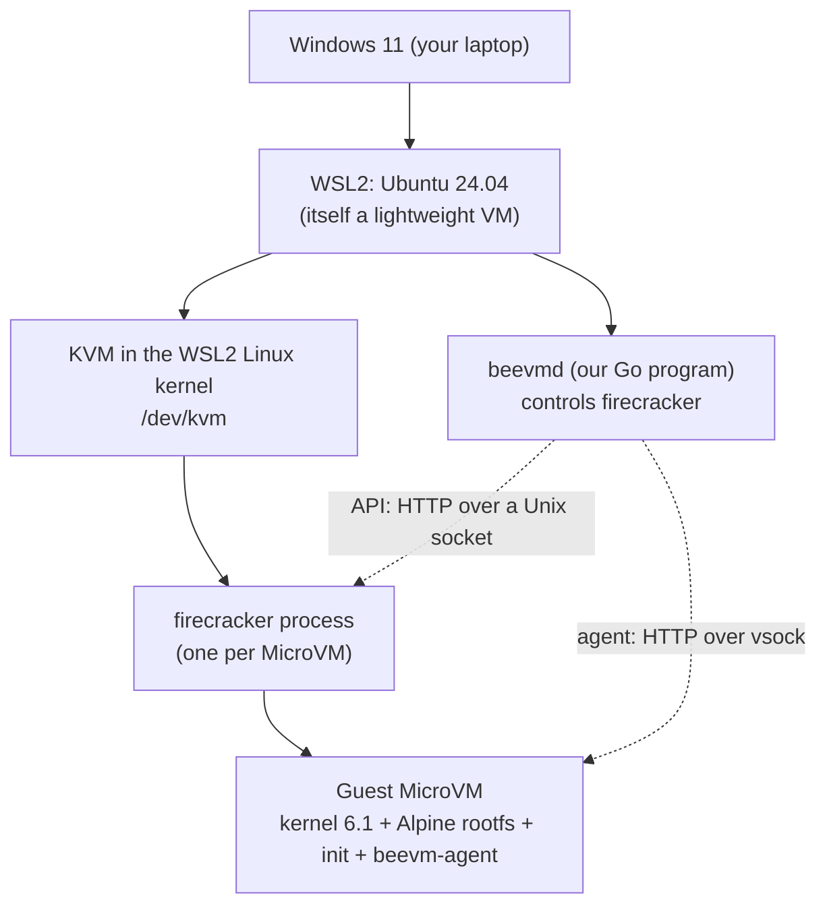
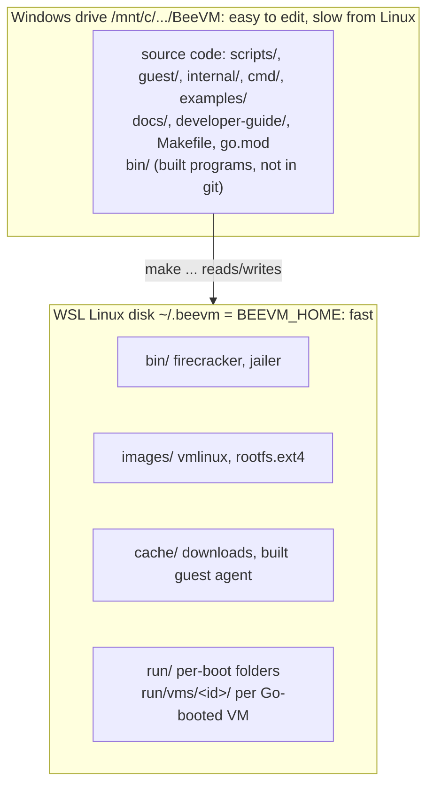
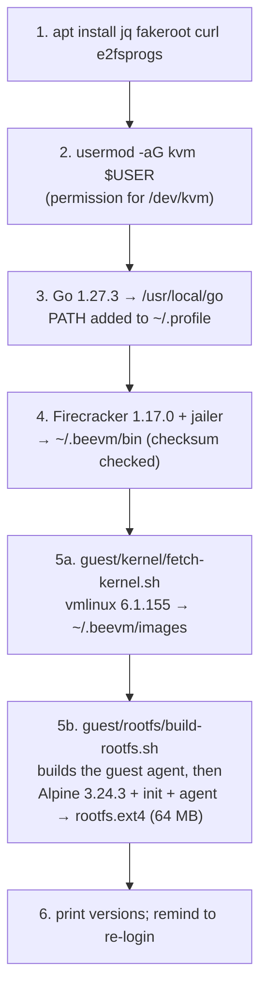
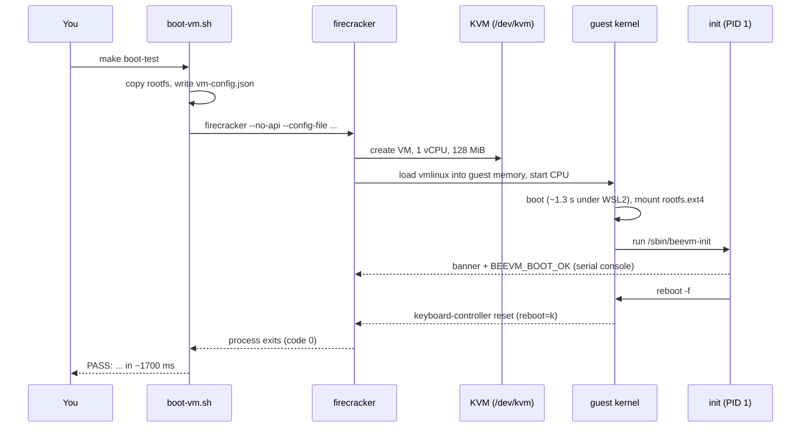
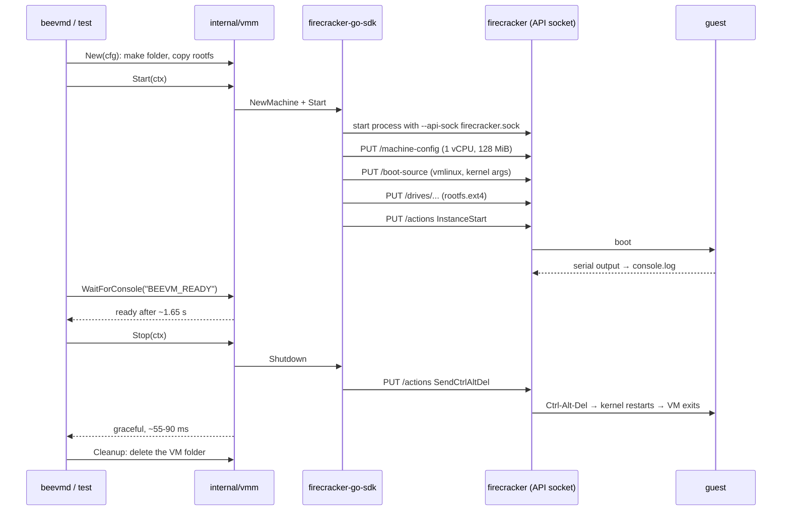
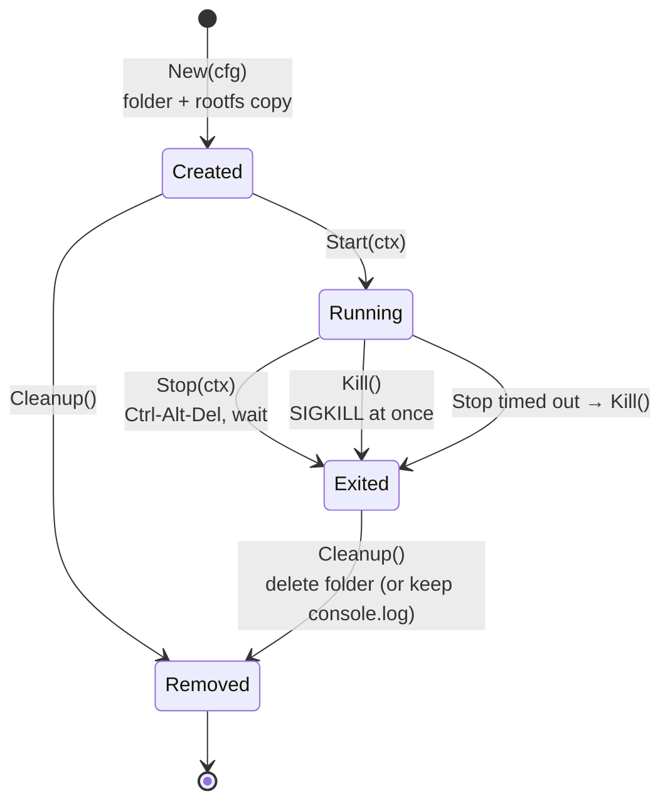
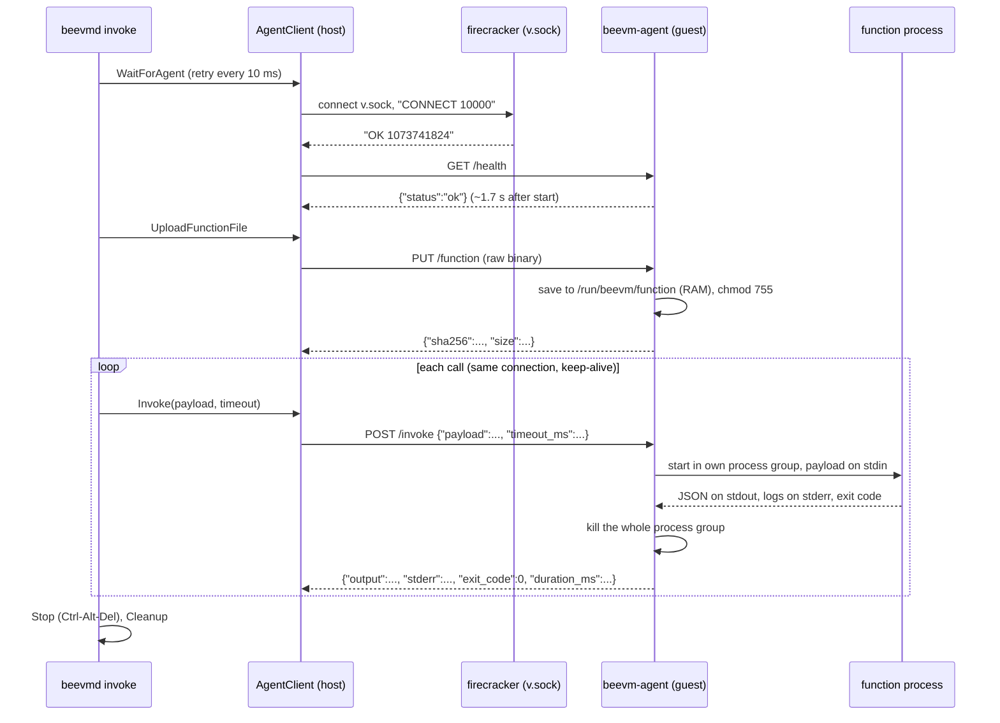
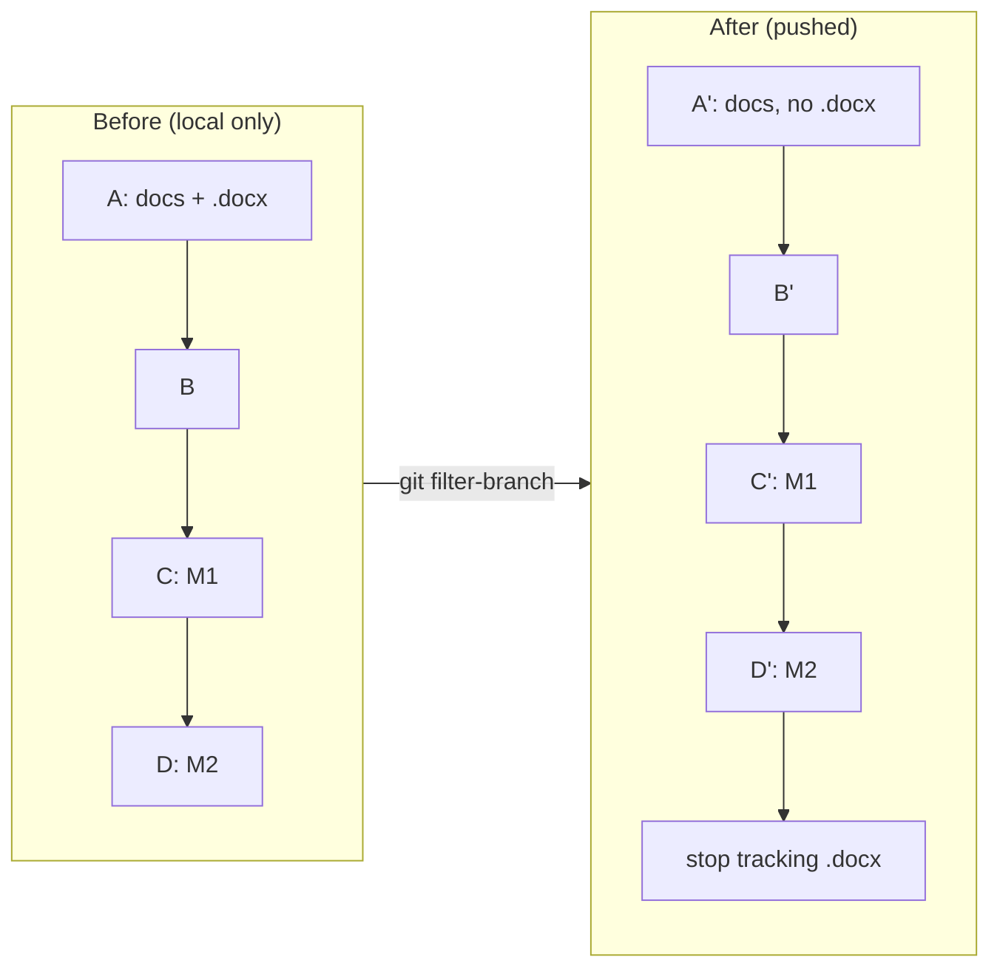

# BeeVM: step-by-step build guide

This guide lets anyone rebuild BeeVM from nothing, in the same order we built it. Every command is here, with what it does, why we do it, and the problems we hit (or that people commonly hit).

It grows with the project: each finished milestone adds a section. The reasons behind each choice are explained in more depth in the learning notes (`developer-guide/learning-notes.docx`).

| Covered so far | Status |
|---|---|
| Quick path: fresh laptop to a running function | — |
| Part 0: what we are building | — |
| Part 1: prepare Windows and WSL2 | Done |
| Part 2: get the code, understand the layout | Done |
| Part 3: Milestone 1, a hand-booted MicroVM | Done |
| Part 4: Milestone 2, boot and stop a VM from Go | Done |
| Part 5: Milestone 3, guest agent over vsock, first function runs | Done |
| Part 6: the repository, GitHub and renames | Done |
| Appendices: cheat sheet, versions, numbers, troubleshooting, regenerating these documents | — |

---

## Quick path: fresh laptop to a running function

Every step in order. Each one is explained in the parts below.

| # | Where | Command | Part |
|---|---|---|---|
| 1 | BIOS / Task Manager | Make sure CPU virtualization is enabled | 1.1 |
| 2 | PowerShell | `wsl --install -d Ubuntu-24.04` | 1.2 |
| 3 | WSL | `ls -l /dev/kvm` (must exist) | 1.3 |
| 4 | WSL | `sudo apt update && sudo apt install -y git make` | 2.1 |
| 5 | WSL | `git config --global user.name "<name>"` and `user.email "<email>"` | 2.1 |
| 6 | WSL | `cd /mnt/c/Users/<you>/Desktop && git clone https://github.com/om8P/BeeVM.git && cd BeeVM` | 2.2 |
| 7 | WSL | `make setup` (asks for your sudo password once) | 3.1 |
| 8 | PowerShell | `wsl --shutdown`, then reopen the WSL terminal and `cd` back to the repo | 3.1 |
| 9 | WSL | `id` (must list `kvm`) | 3.1 |
| 10 | WSL | `make boot-test` (milestone 1 check: PASS) | 3.4 |
| 11 | WSL | `make build && ./bin/beevmd boot` (milestone 2: boot and stop from Go) | 4.4 |
| 12 | WSL | `make examples && ./bin/beevmd invoke --code bin/functions/hello-go-binary --payload '{"name":"Om"}'` (milestone 3: run a function in a VM) | 5.6 |
| 13 | WSL | `make test && make test-kvm` (all tests) | 4.4, 5.7 |

---

## Part 0: what we are building

BeeVM is a Function-as-a-Service (FaaS) runtime, like a tiny AWS Lambda. A user uploads a function; BeeVM runs it inside its own **Firecracker MicroVM** (a very small virtual machine) so different users cannot affect each other. The grading targets are: cold start under 50 ms (via snapshots), tenant isolation, and VM density per machine.

On this laptop everything runs in layers:



**Why the layers matter:** a MicroVM inside WSL2 is a VM inside a VM ("nested virtualization"). It works, but it is slower than on a real Linux server. That is why our boot numbers here (about 1.7 s) are only a development baseline.

---

## Part 1: prepare Windows and WSL2

### 1.1 Check that the CPU supports virtualization

**What:** Intel VT-x or AMD-V must be turned on in the BIOS/UEFI.
**Why:** KVM (and so Firecracker) needs hardware virtualization.

In Windows: Task Manager → Performance → CPU → "Virtualization: Enabled". If it says Disabled, turn it on in the BIOS setup.

### 1.2 Install WSL2 with Ubuntu 24.04

In **Windows PowerShell**:

```powershell
wsl --install -d Ubuntu-24.04
wsl -l -v
```

`wsl -l -v` must show `VERSION 2`. WSL1 has no real Linux kernel and no KVM.

### 1.3 Check that KVM works inside WSL2

In the **WSL (Ubuntu) terminal**:

```bash
uname -m                                          # must print x86_64
ls -l /dev/kvm                                    # must exist: crw-rw---- root kvm
cat /sys/module/kvm_intel/parameters/nested       # Intel: Y means nested virtualization is on
cat /sys/module/kvm_amd/parameters/nested         # AMD: 1 means on
```

On our laptop (i7-13620H, Windows 11) all of this worked without changing anything.

**Common problems**

| Symptom | Cause | Fix |
|---|---|---|
| `/dev/kvm: No such file` | Nested virtualization off for WSL2 (it is on by default on Windows 11, but can be turned off) | Create or edit `C:\Users\<you>\.wslconfig` with `[wsl2]` and `nestedVirtualization=true`, then `wsl --shutdown` in PowerShell and wait a few seconds before reopening |
| Still no `/dev/kvm` | Virtualization off in BIOS, or an old Windows build | Enable VT-x/AMD-V in BIOS; update Windows 11 |
| `nested` file missing | Wrong CPU vendor file (Intel vs AMD) | Read the other one |

---

## Part 2: get the code and understand the layout

### 2.1 Basic tools and your Git identity

Ubuntu on WSL normally has `git` and `make` already. If not:

```bash
sudo apt update && sudo apt install -y git make
```

Tell Git who you are (it is written into every commit, and is public on GitHub):

```bash
git config --global user.name "Your Name"
git config --global user.email "you@example.com"     # or GitHub's no-reply address, see Part 6.4
```

Everything else (Go, Firecracker, kernel, image) is installed by `make setup` in Part 3.

### 2.2 Clone the repository

In the **WSL terminal** (choose your own Windows folder):

```bash
cd /mnt/c/Users/<you>/Desktop
git clone https://github.com/om8P/BeeVM.git
cd BeeVM
```

`/mnt/c/...` is your Windows `C:` drive seen from Linux. Keeping the code there means you can edit it with Windows tools (VS Code, Claude) while building it in WSL.

> The course case-study `.docx` is **not** in the repo (it is course material). Get it from the course page if you need it.

### 2.3 Two places on disk, on purpose



**Why:** reading files on `/mnt/c` from Linux goes through a slow translation layer. VM disk images and (later) snapshots need fast disk access, so they live in `~/.beevm`. To put them elsewhere: `export BEEVM_HOME=/some/linux/path` before running `make`.

### 2.4 Line endings (a problem we hit)

Windows Git had `core.autocrlf=true`, which turns line endings into Windows-style CRLF on checkout. Bash then fails with errors like `$'\r': command not found`.

**Fix (already in the repo):** `.gitattributes` contains `* text=auto eol=lf`, which forces LF for every text file regardless of the Git settings. Check with:

```bash
git ls-files --eol | grep -E "\.sh|Makefile"     # should show w/lf
```

If a script was already checked out with CRLF: `sed -i 's/\r$//' path/to/script.sh`.

---

## Part 3: Milestone 1, a hand-booted MicroVM

**Goal:** prove KVM and Firecracker work, by booting a VM with the plain `firecracker` command and a JSON config file.

### 3.1 One-time setup: `make setup`

In the **WSL terminal**, in the repo folder:

```bash
make setup
```

It asks for your **sudo password** once. It runs `scripts/setup-wsl.sh`, which does these steps, each skipped if already done (so it is safe to run again):



All versions and SHA-256 checksums are pinned in `scripts/common.sh`. Every download is checked against its checksum and refused if it does not match.

**Then, once, in Windows PowerShell:**

```powershell
wsl --shutdown
```

and open the WSL terminal again. **Why:** adding a user to a group only takes effect at the next login. Check with `id` (must list `kvm`).

**What each piece is:**

- **`firecracker`**: the virtual machine monitor (VMM). It uses KVM to run a MicroVM with only a few emulated devices (serial port, disk, network, vsock), which is why it starts fast.
- **`jailer`**: Firecracker's sandboxing helper. Installed now, used in milestone 9.
- **`vmlinux`**: the guest Linux kernel as an uncompressed file. Firecracker loads it straight into guest memory; there is no BIOS or bootloader.
- **`rootfs.ext4`**: the guest's disk (its `/`), containing Alpine Linux, our init script and (since milestone 3) the guest agent.

Setup takes a few minutes the first time (it downloads well over 100 MB: Go, Firecracker, the 43 MB kernel, Alpine). Running it again takes under a second.

### 3.2 How the rootfs is built (no sudo, no Docker)

```bash
make rootfs        # or: bash guest/rootfs/build-rootfs.sh
```

1. Build the guest agent (milestone 3) as a static Go binary: `CGO_ENABLED=0 go build -trimpath -ldflags="-s -w" ./cmd/beevm-agent` into `~/.beevm/cache/beevm-agent`. If the new binary is identical to the old one, the old file is kept.
2. Download `alpine-minirootfs-3.24.3-x86_64.tar.gz` (about 3.6 MB).
3. Inside **one `fakeroot` session**: unpack it, copy `guest/rootfs/init` to `/sbin/beevm-init` and the agent to `/sbin/beevm-agent`, then run `mkfs.ext4 -d <folder> rootfs.ext4 64M`.

- `mkfs.ext4 -d` creates a filesystem image and fills it from a folder **without mounting it**, so no root rights are needed.
- `fakeroot` makes the files *look* owned by root inside that session, so they are root-owned inside the image (the guest expects that).

The image is rebuilt automatically when `guest/rootfs/init`, the build script or the agent binary changes. **After changing agent code, run `make images` (or `make rootfs`)**, otherwise the VM still runs the old agent. The image uses 20 MB on disk.

### 3.3 The guest's init script (PID 1)

`guest/rootfs/init` is the first program the guest kernel runs. It mounts `/proc`, `/sys`, `/dev`, prints a banner, then acts on the `beevm.mode=` value in the kernel command line:

| Mode | Used by | Behaviour |
|---|---|---|
| `selftest` | `make boot-test` | prints `BEEVM_BOOT_OK`, then `reboot -f` (VM exits) |
| `idle` | `beevmd boot`, Go tests (milestone 2) | prints `BEEVM_READY`, waits until stopped |
| `agent` | `beevmd invoke`, agent tests (milestone 3) | mounts a RAM disk on `/run`, starts `/sbin/beevm-agent`, prints `BEEVM_AGENT_STARTED`; if the agent ever exits it prints `BEEVM_AGENT_EXITED code=N` and powers the VM off |
| none | `make boot` | gives you a shell; `reboot -f` exits |

### 3.4 Boot a VM: `make boot-test` and `make boot`

```bash
make boot-test     # automatic: boots, checks, prints the time
make boot          # interactive: you get a shell inside the VM
```

`scripts/boot-vm.sh` makes a run folder `~/.beevm/run/<timestamp>/`, copies `rootfs.ext4` into it (the clean original is never changed), writes `vm-config.json`, and runs `firecracker --no-api --config-file vm-config.json`.

The kernel arguments it passes:

| Argument | Meaning |
|---|---|
| `console=ttyS0` | kernel messages go to the serial port, which Firecracker connects to your terminal |
| `reboot=k` | a guest reboot happens through the keyboard controller, which Firecracker treats as "exit" |
| `panic=1` | if the kernel crashes, reboot after 1 s instead of hanging |
| `pci=off` | Firecracker has no PCI bus, so don't look for one |
| `init=/sbin/beevm-init` | run our script as PID 1 |
| `beevm.mode=...` | our own flag, read by the init script |

What happens during `make boot-test`:



In `make boot`, check that you are really in a different system: `uname -r` shows `6.1.155` inside the VM but `6.6...` in WSL.

**Result:** `make boot-test` passes in 1.7 to 2.0 s. `make clean-images && make setup && make boot-test` rebuilds everything from scratch and passes again.

### 3.5 Problems we hit in milestone 1

| Problem | What happened | Fix |
|---|---|---|
| No kernel for Firecracker 1.17 | Firecracker's CI storage had no `vmlinux-6.1` under `v1.17` or `v1.16` | Took `vmlinux-6.1.155` from the `v1.15` folder. The kernel does not depend on the Firecracker version |
| HTTPS certificate error listing the kernel bucket | `https://spec.ccfc.min.s3.amazonaws.com` fails, since bucket names with dots break the S3 certificate | Use the path-style URL `https://s3.amazonaws.com/spec.ccfc.min/...` |
| `sudo` needs a password | Automation tools cannot type it | You run `make setup` yourself; everything after it needs no sudo |
| `Permission denied` on `/dev/kvm` after setup | The group change is not active until next login | `wsl --shutdown` in PowerShell, reopen WSL |
| Shell scripts fail with `\r` errors | CRLF line endings from Windows Git | `.gitattributes` (Part 2.4) |
| Commands run from Windows into WSL lose `$VARS` and quotes | Each layer (Git Bash, `wsl.exe`, bash) re-parses the text; Git Bash also rewrites `/mnt/...` paths | Put commands in a script file and run `wsl.exe -- bash file.sh`, set `MSYS_NO_PATHCONV=1`, or just use `make` targets. Typing directly in the WSL terminal avoids all of this |
| Slow Alpine download | Mirror speed (about 130 KB/s once) | Only happens once; files are cached in `~/.beevm/cache` |

**Other common problems**

- `make: command not found` or strange errors: you ran it in PowerShell. Run it in the WSL terminal.
- `firecracker not found`: `make setup` did not finish. Run it again; finished steps are skipped.
- Boot hangs or FAIL: read the log path printed by the script (`~/.beevm/run/<...>/console.log`). The last lines usually say what went wrong.
- `ls: cannot access /dev/kvm` after a Windows update: check Part 1.3 again.

---

## Part 4: Milestone 2, boot and stop a VM from Go

**Goal:** replace the shell script with Go code that the rest of BeeVM can call: create, start, stop, kill and clean up a VM, leaving nothing behind.

### 4.1 Go module and the Firecracker SDK

Already done in the repo; for a fresh clone you only need:

```bash
make build         # downloads Go dependencies the first time, builds bin/beevmd
```

For the record, the module was created with the commands below (it was first named after the old GitHub account; see Part 6.3 for the renames):

```bash
go mod init github.com/om8P/BeeVM
go get github.com/firecracker-microvm/firecracker-go-sdk@6fb280e993d4
go mod tidy
```

- A **Go module** is a project with its own name (the module path) and a list of pinned dependencies (`go.mod` and checksums in `go.sum`).
- **firecracker-go-sdk** starts the `firecracker` process and talks to its API for us.
- **Why a commit instead of a release?** The SDK's last release (v1.0.0) is from 2022. Its main branch (December 2025) has updated, security-fixed dependencies. It is tested against Firecracker 1.4.1, but worked with our 1.17.0 without changes. It requires Go 1.24 or newer.

If `go` is "not found" in a new terminal: `source ~/.profile`, or use `make` (it calls `/usr/local/go/bin/go` directly).

### 4.2 The API socket: how Go controls Firecracker

In milestone 1 we used `--no-api` and a JSON file. Now Firecracker runs with `--api-sock <file>`: it listens on a **Unix domain socket** (a file that acts like a local network port) and is configured with HTTP requests:



### 4.3 The VM lifecycle in `internal/vmm`



Files:

| File | What it holds |
|---|---|
| `internal/vmm/config.go` | `Config` (paths, vCPUs, memory, extra kernel args), defaults, `Validate()`, the per-VM paths |
| `internal/vmm/vm.go` | `New`, `Start`, `WaitForConsole`, `Stop`, `Kill`, `Cleanup`, `PID`, `Exited` |
| `internal/vmm/vm_test.go` | 9 unit tests that need no KVM |
| `internal/vmm/vm_kvm_test.go` | 3 tests that boot real VMs (`//go:build kvm`) |
| `cmd/beevmd/main.go` | the `beevmd boot` command |

Each VM gets its own folder `~/.beevm/run/vms/<id>/` with `rootfs.ext4`, `firecracker.sock`, `console.log` and (since milestone 3) `v.sock`. The library never reads environment variables; the caller passes all paths. Only `beevmd` reads `BEEVM_HOME`.

### 4.4 Run it

```bash
make test          # unit tests, no KVM needed
make test-kvm      # boots real VMs: graceful stop, kill, cancelled start
make vet           # Go's static checks
make build
./bin/beevmd boot                      # boot, show console, stop, clean up
./bin/beevmd boot --hold 30s           # keep it running 30 s (Ctrl-C kills it)
./bin/beevmd boot --keep-logs          # keep console.log afterwards
./bin/beevmd boot --mem 256 --vcpus 2  # different size
```

**Check that nothing is left behind** (after any of the above, including Ctrl-C):

```bash
pgrep -a firecracker || echo "no firecracker processes"
ls ~/.beevm/run/vms/
```

**Result:** all tests pass; ready in about 1.65 s, graceful stop in 55 to 90 ms; Ctrl-C exits with code 130; no leftovers in any case we tried.

**Build tags:** `//go:build kvm` at the top of `vm_kvm_test.go` means it is only compiled with `go test -tags kvm`. So `make test` passes on machines without KVM, and `make test-kvm` runs the real thing.

### 4.5 Problems we hit in milestone 2

| Problem | Why | What we did |
|---|---|---|
| The VM would die when a start timeout expired | The SDK ties the firecracker process to the context used to start it | The VM gets its own long-lived context; the caller's timeout only limits how long `Start` waits |
| Calling `Shutdown` twice would panic | The SDK closes an internal channel in `Shutdown` | `Stop` wraps it in `sync.Once` |
| Ctrl-C in `beevmd` went straight to firecracker | The SDK forwards signals to firecracker by default | Set `ForwardSignals` to an empty list; `beevmd` decides (it kills the VM and cleans up) |
| `StopVMM` could hang | It sends SIGTERM and waits | `Kill` sends SIGKILL to the process directly and waits at most 5 s |
| Init's SIGINT handler never runs on stop | By default the kernel restarts immediately on Ctrl-Alt-Del, without telling PID 1 | Fine: the VM still exits cleanly. The handler stays as a safety net |
| The kernel takes ~1.3 s to boot | Partly WSL2 nesting; the log also shows a ~460 ms gap around `clk: Disabling unused clocks` | Noted for tuning in milestone 6 |
| `go mod tidy` requires Go 1.24 | The SDK's main branch needs it | Fine with our Go 1.27.3; docs updated to "Go 1.24+" |

**Other common problems**

- `go: command not found`: `source ~/.profile` or open a new WSL terminal.
- KVM tests print `SKIP`: `/dev/kvm` or the images are missing. Run `make setup` and check `id` for `kvm`.
- `address already in use` for the socket: a folder from a crashed run is left over. Delete `~/.beevm/run/vms/<id>`.
- First `make build` is slow: Go is downloading dependencies; later builds are cached.

---

## Part 5: Milestone 3, guest agent over vsock, first function runs

**Goal:** talk to code *inside* the VM. A small Go program, the **guest agent**, runs in every VM. The host uploads a function binary to it, sends a JSON payload, and gets the function's JSON output back.

### 5.1 What was added

| File | What it holds |
|---|---|
| `internal/agentproto/agentproto.go` | Shared request/response types, the port (10000), the limits. Host and guest both import it, so they can never disagree |
| `internal/agent/server.go` | The agent's HTTP handlers and the function runner (no vsock code, so it is testable without a VM) |
| `internal/agent/server_test.go` | 12 unit tests (no KVM) |
| `cmd/beevm-agent/main.go` | The guest program: listens on vsock port 10000 and serves `internal/agent` |
| `internal/vmm/agent.go` | Host side: the vsock handshake (`dialVsock`) and `AgentClient` (Health, UploadFunction, Invoke) |
| `internal/vmm/agent_test.go` | 6 unit tests with a fake Firecracker |
| `internal/vmm/vm_agent_kvm_test.go` | 3 tests that boot real VMs and run functions |
| `internal/vmm/config.go`, `vm.go` | Every VM now gets a vsock device (`v.sock`, guest CID 3); new `vm.Agent()` and `vm.WaitForAgent()` |
| `cmd/beevmd/invoke.go` | The `beevmd invoke` command |
| `examples/functions/hello-go-binary/` | Example function |
| `examples/functions/testfn/` | Test function with modes: `echo`, `fail`, `sleep`, `garbage`, `big` |
| `guest/rootfs/init`, `build-rootfs.sh` | `agent` mode; the agent is built and baked into the image |
| `Makefile` | New target `examples` |

New dependency: `github.com/mdlayher/vsock v1.3.0` (added with `go get github.com/mdlayher/vsock@v1.3.0`, then `go mod tidy`). It also upgraded a few `golang.org/x/...` packages.

### 5.2 Build everything

In the **WSL terminal**, in the repo folder:

```bash
make images        # rebuilds the rootfs so it contains the current guest agent
make build         # bin/beevmd
make examples      # bin/functions/hello-go-binary and bin/functions/testfn
```

- `make images` builds the agent with `CGO_ENABLED=0` (a static binary) and puts it in the image as `/sbin/beevm-agent`. Run it again whenever agent code changes.
- `make examples` builds the example functions the same way. **Functions must be static Linux x86-64 binaries:** the guest runs Alpine, which uses the musl C library, so a normal Ubuntu binary (built against glibc) will not start there. For Go, `CGO_ENABLED=0 GOOS=linux GOARCH=amd64 go build` is enough.

### 5.3 How a call flows



**The vsock handshake.** On the host, Firecracker turns the guest's vsock into a Unix socket file (`v.sock` in the VM folder). To reach guest port 10000, connect to that file, send the line `CONNECT 10000`, and read back `OK <number>`. After that it is a plain byte stream to the agent, and normal HTTP runs over it. If the agent is not listening yet, Firecracker closes the connection, which is why `WaitForAgent` simply retries.

### 5.4 The agent's protocol

| Request | Body | Answer |
|---|---|---|
| `GET /health` | — | `{"status":"ok","agent_version":"0.1.0","uptime_ms":...}` |
| `PUT /function` | the raw binary (≤ 50 MB) | `{"sha256":"...","size":...}` |
| `POST /invoke` | `{"payload": <any JSON>, "timeout_ms": N}` (payload ≤ 6 MB, timeout default 10 s, max 60 s) | `{"output":..., "stderr":"...", "exit_code":N, "duration_ms":N, "error":"..."}` |

- A **function failure** (non-zero exit code, timeout, output that is not JSON, output over 6 MB) comes back as **HTTP 200 with `error` set**: the agent worked, the function did not.
- An **agent or request problem** is a 4xx code: `409` no function uploaded yet, `400` bad request or bad timeout, `413` payload or upload too large.
- `stdout` is only included when the output was not valid JSON (first 4 KB), to help debugging. Only the last 64 KB of `stderr` is kept.
- One call runs at a time per VM; a second call waits for the first.

### 5.5 Write your own function

The contract: **payload JSON on stdin, result JSON on stdout, logs on stderr.** A shortened version of `examples/functions/hello-go-binary/main.go` (the real file also defaults the name to "world"):

```go
func main() {
	var in struct{ Name string `json:"name"` }
	if err := json.NewDecoder(os.Stdin).Decode(&in); err != nil {
		fmt.Fprintln(os.Stderr, "bad input:", err)
		os.Exit(1)
	}
	fmt.Fprintln(os.Stderr, "hello-go-binary: greeting", in.Name)       // becomes a log line
	json.NewEncoder(os.Stdout).Encode(map[string]string{                // becomes the output
		"greeting": "Hello, " + in.Name + "!", "runtime": "binary"})
}
```

Build it as a static binary and run it:

```bash
CGO_ENABLED=0 GOOS=linux GOARCH=amd64 go build -o bin/functions/myfn ./path/to/myfn
./bin/beevmd invoke --code bin/functions/myfn --payload '{"name":"Om"}'
```

The function runs in `/tmp` with only `PATH` and `HOME` set. Anything it starts in the background is killed when the call ends.

### 5.6 Run it

```bash
./bin/beevmd invoke --code bin/functions/hello-go-binary --payload '{"name":"Om"}' --repeat 5
```

Expected output (times vary):

```
== starting VM f5eacc8a (1 vCPU, 128 MiB)
== agent ready after 1.844s
== uploaded bin/functions/hello-go-binary (2580640 bytes, sha256 8f311e18de83...) in 75ms
#1 {"greeting":"Hello, Om!","runtime":"binary"}  (9ms in function, 11.6ms round trip)
   log: hello-go-binary: greeting Om
#2 {"greeting":"Hello, Om!","runtime":"binary"}  (5ms in function, 6.5ms round trip)
...
== summary: agent ready 1.844s, 5 call(s), median round trip 4.5ms, stopped gracefully in 68ms
```

Other things to try (all with `--code bin/functions/testfn`):

| Payload | What you should see |
|---|---|
| `'{"mode":"echo","x":1}'` | `{"echo":{"mode":"echo","x":1}}` |
| `'{"mode":"fail"}'` | `FAILED: function exited with code 3`, plus the log line `boom: ...`; exit code 1 |
| `'{"mode":"sleep","ms":30000}' --timeout 500ms` | `FAILED: timeout after 500ms` after about half a second |
| `'{"mode":"garbage"}'` | `FAILED: function output is not valid JSON`, with the text it printed |

Flags of `beevmd invoke`:

| Flag | Default | Meaning |
|---|---|---|
| `--code PATH` | (required) | the function binary |
| `--payload JSON` | `{}` | input for the function |
| `--repeat N` | 1 | how many calls |
| `--timeout D` | 10s | time limit per call, inside the guest |
| `--ready-timeout D` | 20s | how long to wait for the agent |
| `--console` | off | stream the VM console (it is printed automatically when something fails) |
| `--keep-logs` | off | keep `console.log` in `~/.beevm/run/vms/<id>/` |
| `--mem N`, `--vcpus N` | 128, 1 | VM size |

Ctrl-C kills the VM, cleans up and exits with code 130.

### 5.7 Tests

```bash
make test          # unit tests: agent (12), host client with a fake Firecracker (6), VM lifecycle (9)
make test-kvm      # also boots real VMs: milestone 2 tests + 3 agent tests
```

The agent tests in real VMs check: 20 echo calls each get their own correct answer; a failing function reports exit code 3 and its log; non-JSON output is reported; a function that sleeps too long is killed after 300 ms **and the VM keeps working**; the hello example returns the right greeting; calling before uploading gives a 409; and nothing is left behind afterwards.

**Result:** all pass. Agent ready 1.64 to 1.85 s after start; uploading a 2.5 MB function about 75 ms; a warm call 4 to 5 ms round trip (median), the first about 11 ms; graceful stop 56 to 85 ms.

### 5.8 Problems we hit in milestone 3

| Problem | Why | What we did |
|---|---|---|
| `go get` for vsock also upgraded `golang.org/x/net`, `x/sys` and others | The library needs newer versions | Accepted after `make vet` and all tests passed |
| A `go test -run "A|B"` pattern failed with `command not found` | The `|` passed through `wsl.exe` and became a shell pipe | Use script files or `make` targets |
| Ctrl-C printed the VM console as if it were an error | The failure path did not check for Ctrl-C | It now prints `== interrupted: VM killed, cleaning up` and exits 130 |
| `make images` printed the size with the full path | `cut -d' '` on `du` output, which uses a tab | Changed to `cut -f1` |

**Other common problems**

- `exec format error` from a call: the uploaded file is not a Linux x86-64 executable (for example a Windows `.exe` or a text file).
- `no such file or directory` when the function starts, although it exists: it is a dynamically linked (glibc) binary. Rebuild it static (`CGO_ENABLED=0`).
- `waiting for agent: context deadline exceeded`: the agent did not start. Run with `--console` and look for `beevm-agent:` lines or `BEEVM_AGENT_EXITED`. Did you run `make images` after changing agent code?
- `agent returned 409: no function uploaded yet`: upload before invoking (`beevmd invoke` does this for you).
- A call never returns: check the `--timeout` value; the host waits the function's timeout plus 10 s.

---

## Part 6: the repository, GitHub and renames

What we did, so you can do the same for your own fork or a new repository.

### 6.1 Create and publish the repository

```bash
gh auth login                                   # once: log the GitHub CLI in
gh repo create <user>/beevm --public --source=. --remote=origin --push
```

`gh repo create ... --source=. --push` creates the repository on GitHub, adds it as `origin` and pushes the current branch. We chose **public** so the group and graders can see it.

### 6.2 Removing a file from history before going public

The first commit contained the course case-study `.docx`. Deleting it in a new commit would still leave it in the history, visible to anyone. So, before the first push, we rewrote the local history:

```bash
git branch backup-before-rewrite        # safety copy of the old history (stays local)
git filter-branch -f --index-filter \
  'git rm -q --cached --ignore-unmatch "Advanced Cloud System Software Design_ 30 Case Studies.docx"' -- main
rm -rf .git/refs/original
echo "Advanced Cloud System Software Design_ 30 Case Studies.docx" >> .gitignore
git show backup-before-rewrite:"Advanced Cloud System Software Design_ 30 Case Studies.docx" \
  > "Advanced Cloud System Software Design_ 30 Case Studies.docx"      # put the file back on disk
```



**Things to know:**

- Every rewritten commit gets a **new hash**. Only do this before anyone else has the old history.
- The rewrite **deleted the file from the working folder** (it was no longer tracked), hence the `git show` line to restore it.
- Git's own documentation now recommends `git filter-repo` for this job; `filter-branch` was enough for four local commits.
- When you are sure you do not need it: `git branch -D backup-before-rewrite`.

### 6.3 Renames: repository, module path, GitHub username

The Go module path is both the name in every `import` line and the address other people download the code from, so it should always match the repository.

| When | What changed | Commands |
|---|---|---|
| After the first push | Repository `beevm` renamed to `BeeVM` | `gh repo rename BeeVM --repo <user>/beevm --yes` and `git remote set-url origin https://github.com/<user>/BeeVM.git` |
| Same day | Module path renamed to match | find-and-replace the old path in `go.mod` and every `.go` file, then `make vet build test` |
| Later | GitHub username changed from `OmMhatre-99` to `om8P`; GitHub moved the repository and redirects the old address | `git remote set-url origin https://github.com/om8P/BeeVM.git`, then the module path became `github.com/om8P/BeeVM` the same way |

To find every old reference before a rename: `grep -rIl "old-name" --exclude-dir=.git --exclude-dir=node_modules .`

### 6.4 Things to know about commits

- Commit author name and email come from `git config` and are **public** on GitHub. To hide your email, use GitHub's no-reply address: `git config --global user.email "<id>+<username>@users.noreply.github.com"`. Old commits keep the old values.
- Every milestone ends with: tests pass, `docs/progress.md` updated, one commit.

### 6.5 The documentation folders

| Folder | For whom | In Git |
|---|---|---|
| `docs/` | the project and Claude: `architecture.md`, `milestones.md`, `progress.md` | yes |
| `developer-guide/` | people: this guide (`guide.md`, plus a Word copy) and the learning notes (`learning-notes.docx`) | yes, the documents only |
| `developer-guide/tools/` | the scripts that generate the Word files | no (local only, see Appendix E) |

### 6.6 Commit history on GitHub

| Commit | What |
|---|---|
| `918d884` | planning docs and project setup |
| `e6fdccb` | 13-milestone session guide |
| `e6dad4a` | Milestone 1 |
| `bd71997` | Milestone 2 |
| `717a840` | stop tracking the course document |
| `6364ecd` | rename Go module to match the repository name |
| `c70ccc2` | add this build guide |
| `6a31586` | move the guide and learning notes to `developer-guide/` |
| `7464297` | Milestone 3 |
| `aded71e` | rename Go module to `github.com/om8P/BeeVM` |

---

## Appendix A: command cheat sheet

All in the **WSL terminal**, in the repo folder, unless marked PowerShell.

| Command | What it does |
|---|---|
| `make help` | list targets |
| `make setup` | one-time install (sudo); safe to re-run |
| `wsl --shutdown` (PowerShell) | restart WSL so the `kvm` group takes effect |
| `make images` / `make kernel` / `make rootfs` | (re)build guest images; `rootfs` also rebuilds the guest agent |
| `make boot-test` | milestone 1 automatic boot check |
| `make boot` | milestone 1 interactive VM (`reboot -f` to exit) |
| `make build` | build `bin/beevmd` |
| `make examples` | build example functions into `bin/functions/` |
| `./bin/beevmd boot [--hold D] [--keep-logs] [--mem N] [--vcpus N]` | milestone 2: boot, show console, stop |
| `./bin/beevmd invoke --code F [--payload J] [--repeat N] [--timeout D] [--console] [--keep-logs]` | milestone 3: run a function in a VM |
| `make test` / `make test-kvm` / `make vet` | Go tests and checks |
| `make clean-images` | delete `~/.beevm/images` and `~/.beevm/run` |
| `pgrep -a firecracker` | find leftover VMs |
| `id` | check you are in the `kvm` group |

## Appendix B: pinned versions

| Component | Version | Where pinned |
|---|---|---|
| Firecracker + jailer | 1.17.0 | `scripts/common.sh` |
| Go | 1.27.3 (module needs ≥ 1.24) | `scripts/common.sh`, `go.mod` |
| Guest kernel | vmlinux 6.1.155 (Firecracker CI, v1.15 folder) | `scripts/common.sh` |
| Alpine minirootfs | 3.24.3 | `scripts/common.sh` |
| firecracker-go-sdk | main @ `6fb280e993d4` (Dec 2025) | `go.mod` |
| mdlayher/vsock | v1.3.0 | `go.mod` |
| Guest agent | 0.1.0 | `cmd/beevm-agent/main.go` |
| Host | Windows 11, WSL2 Ubuntu 24.04.3, WSL kernel 6.6.87 | — |

## Appendix C: measured numbers (WSL2, i7-13620H, 1 vCPU, 128 MiB)

| Measurement | Value | Milestone |
|---|---|---|
| Cold boot, shell script, process start to exit | 1.7 to 2.0 s | 1 |
| Guest kernel reaches init | ~1.3 s | 1 |
| Cold boot via Go, Start to `BEEVM_READY` | 1.58 to 1.71 s | 2 |
| Graceful stop (Ctrl-Alt-Del) | 55 to 91 ms | 2, 3 |
| Agent answers `/health` after Start | 1.64 to 1.85 s | 3 |
| Upload a 2.5 MB function | ~75 ms | 3 |
| Function call round trip, warm (median) | 4 to 5 ms | 3 |
| Function call round trip, first call | ~11 ms | 3 |
| Guest agent binary / rootfs on disk | 6.8 MB / 20 MB | 3 |
| `make setup` re-run when all done | 0.6 s | 1 |
| Target cold start (snapshot restore) | < 50 ms | 6 (to do) |

## Appendix D: general troubleshooting

1. **Where am I?** Most problems come from running a command in the wrong place. Prompt `PS C:\...>` is PowerShell; `user@host:~$` is WSL.
2. **Read the console log.** Every boot writes one: `~/.beevm/run/<timestamp>/console.log` (script) or `~/.beevm/run/vms/<id>/console.log` (Go, with `--keep-logs`, or `--console` to watch it live).
3. **Check KVM access:** `ls -l /dev/kvm` and `id`.
4. **Stale guest agent?** `make images` after changing anything in `cmd/beevm-agent` or `internal/agent`.
5. **Start clean:** `make clean-images && make setup`.
6. **Leftover processes:** `pgrep -a firecracker`, then `kill <pid>`; leftover folders: `rm -rf ~/.beevm/run/vms/*`.
7. **Running commands from Windows tools into WSL:** put them in a script file and run `wsl.exe -- bash file.sh`, or use `make`; inline `$VARS`, quotes and `|` get mangled.

## Appendix E: regenerating these documents

The Word files are generated; only the generated documents are in Git. The generator lives in `developer-guide/tools/` on the machine that made them (it is not in the repository). To set it up somewhere else, copy that folder, then on the **Windows side** (needs Node.js):

```bash
cd developer-guide/tools
npm install docx marked @mermaid-js/mermaid-cli     # once
npx puppeteer browsers install chrome-headless-shell  # once: a small headless browser to draw the diagrams
npm run guide      # guide.md -> BeeVM-guide.docx (diagrams rendered to PNG)
npm run build      # notes-data.js -> learning-notes.docx
```

`puppeteer.json` in that folder points the diagram renderer at the downloaded browser; it holds a machine-specific path. **Close the Word files first**: Windows will not let a program overwrite a file that is open in Word.
